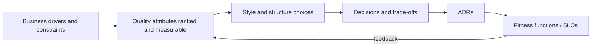

# Day 2: What architects do, and quality attributes you can measure

| | |
|---|---|
| **Day** | 2 of 203 · Tuesday 20 Oct 2026 |
| **Week** | 1 of 29 · Tokens, context and the API surface |
| **Phase** | Phase 1: LLM and application foundations |
| **Kind** | arch |
| **Time** | 120 minutes |

## Today in 30 seconds

Architecture is the set of decisions that are **expensive to change later**. Most of them come from trade-offs between **quality attributes**, the "-ilities" such as availability, latency, scalability, security, cost and operability.

Today you learn how architects frame those trade-offs, how to make each attribute **measurable**, and you rank the top five for Bastion's triage service. That ranking feeds ADR-001 and Milestone M1.

### By the end of today you can

- Describe what an architect is expected to do, beyond drawing boxes
- Explain the two laws of software architecture from Fundamentals of Software Architecture
- Turn six quality attributes into measurable targets (SLO, p95/p99, cost per request, MTTR)
- Rank the top 5 quality attributes for Bastion triage and state one trade-off

## Concepts

### 1. What architects actually do

Richards & Ford (*Fundamentals of Software Architecture*) list eight expectations of an architect:

- make architecture decisions
- continually analyse the architecture
- keep current with trends
- ensure decisions are followed
- have diverse exposure and experience
- know the business domain
- have interpersonal skills
- understand and navigate politics

The deliverable is not a diagram. It is **good decisions, written down with their reasons**, that the team can follow and revisit. For a Principal DevOps promotion this is the visible shift from "built it" to "decided how we build it, and why".



*How quality attributes flow into the decisions you record.*

### 2. The laws: trade-offs and 'why'

**First law:** *everything in software architecture is a trade-off.* If you think you have found something that is not a trade-off, you probably have not found the trade-off yet.

**Second law:** *why is more important than how.* Anyone can read the code later to see *how*. The *why* (constraints, options rejected, assumptions) is lost unless you write it down. That is what ADRs are for.

The book also tells you to aim for the **least-worst architecture**, not the best one, and not to support every characteristic. Each one you add brings design cost and complexity, so pick a few that really drive the design.

> **Analogy:** A car spec sheet. You can't have the top speed of a sports car, the boot of an estate and the fuel economy of a hatchback. The architect's job is to say which matters most for *this* trip, and to write down why.

### 3. Architecture characteristics

A requirement is an **architecture characteristic** if it is a non-domain design consideration, it shapes the structure, and it is critical to success. FoSA groups them as:

- **Operational:** availability, performance, scalability, recoverability
- **Structural:** modularity, maintainability, deployability, extensibility
- **Cross-cutting:** security, privacy, accessibility, legal

Some are **explicit** (in the requirements) and some are **implicit** (nobody asks for security or operability, but you are blamed when they fail). Your job is to surface the implicit ones.

| Attribute | Vague wording | Measurable form (use this) |
| --- | --- | --- |
| Availability | "always up" | ≥99.9% of `POST /v1/triage` requests succeed per 30 days (SLO); error budget 43.2 min |
| Latency | "fast" | p95 time-to-verdict < 4 s; p99 < 10 s; streaming TTFT p95 < 1 s |
| Scalability | "handles load" | Sustains 50 req/s for 10 min with p95 within SLO; scales out without code change |
| Security | "secure" | All OWASP LLM Top 10 risks threat-modelled; 0 high findings open > 14 days; no secrets in git |
| Cost | "cheap" | ≤ $0.002 per triage at p50 token usage; per-key daily cap enforced |
| Operability | "easy to run" | MTTR < 30 min; every alert has a runbook; deploy in < 10 min with rollback |

### 4. Quality-attribute scenarios and the nines

*Software Architecture in Practice* (Bass, Clements, Kazman) writes each attribute as a **scenario** with six parts: source, stimulus, artifact, environment, response and response measure. For example:

> *A burst of 500 transcripts (stimulus) from the red-team harness (source) hits the triage API (artifact) during normal operation (environment). The requests are queued or served, not dropped (response), and p95 stays under 4 s (measure).*

Availability is usually written in "nines". Each extra nine cuts allowed downtime by 10×. For serial dependencies, **availabilities multiply**, so a chain is always weaker than its weakest link.

| Item | Value (%) |
| --- | --- |
| API alone | 99.95 |
| LLM provider | 99.9 |
| Serial path | 99.8 |
| With fallback | 99.9 |

*Bar chart — API alone: 99.95%, LLM provider: 99.9%, Serial path: 99.8%, With fallback: 99.9%.*

*Computed by today's code: three serial hops at 99.95%, 99.9% and 99.95% give 99.80%. Adding a fallback LLM provider (99.5%) raises the path to 99.90%.*

| SLO | Downtime / year | Downtime / 30 days |
| --- | --- | --- |
| 99% | 87.6 h (≈3.65 days) | 7.2 h |
| 99.5% | 43.8 h | 3.6 h |
| 99.9% | 8.76 h | 43.2 min |
| 99.95% | 4.38 h | 21.6 min |
| 99.99% | 52.6 min | 4.3 min |

## When to choose which

### G19. Architecture styles

A preview. The characteristics you rank today decide which style fits. You will use this table properly in Weeks 9, 12 and 27.

| Style | Pros | Cons | Choose when |
| --- | --- | --- | --- |
| Layered / modular monolith | Simple ops, easy refactor, strong consistency | Scaling and team autonomy limits | Early Bastion; most internal tools |
| Microservices | Team autonomy, selective scale | Distributed complexity, data coupling | Clear bounded contexts and platform maturity |
| Event-driven | Loose coupling, resilience | Eventual consistency, harder tracing | Fan-out, audit streams, async AI jobs |
| CQRS | Optimise each side | Two models to keep in sync | Read-heavy dashboards vs write-heavy command paths |
| Event sourcing | Full history, rebuildable projections | Complexity, PII retention challenges | Audit-critical domains |
| Serverless / FaaS | No servers for spiky loads | Cold starts, time limits, vendor coupling | Spiky, short tasks (webhooks, light transforms) |
| Cell-based | Blast-radius control | Routing and more infra | Multi-tenant platforms at serious scale |

**Default:** modular monolith with clear modules early; extract inference, gateway and sandbox as separate services when scaling or isolation demands it; use cells for tenant blast-radius later.

Full guide: roadmap Section 9, [G19 Architecture styles](../roadmap.md#g19-architecture-styles).

## Error budgets, composite availability and why percentiles beat averages

Pure Python, no dependencies. Use it to sanity-check any SLO you write.

```python
# day2_availability.py  -  error budgets and composite availability
from math import ceil, prod

HOURS_PER_YEAR = 365 * 24
MIN_PER_30D = 30 * 24 * 60

def downtime(slo: float) -> str:
    bad = 1 - slo
    return f"{slo:.3%}: {bad * HOURS_PER_YEAR:6.2f} h/year, {bad * MIN_PER_30D:6.1f} min per 30 days"

for slo in (0.99, 0.995, 0.999, 0.9995, 0.9999):
    print(downtime(slo))

# Serial dependencies: the request fails if ANY hop fails, so availabilities multiply.
triage_path = {
    "ingress + API": 0.9995,
    "LLM provider": 0.999,
    "result store": 0.9995,
}
serial = prod(triage_path.values())
print(f"serial triage path: {serial:.4%}")          # lower than every single part

# Redundancy: two independent LLM providers behind a fallback route.
def parallel(*a: float) -> float:
    return 1 - prod(1 - x for x in a)

with_fallback = 0.9995 * parallel(0.999, 0.995) * 0.9995
print(f"with provider fallback: {with_fallback:.4%}")

# Latency percentiles: averages hide the tail your users feel.
latencies_ms = sorted([420, 380, 450, 400, 2900, 410, 395, 430, 405, 6100])
def pct(xs, p):  # nearest-rank percentile
    k = max(0, ceil(p / 100 * len(xs)) - 1)
    return xs[k]
print("mean", sum(latencies_ms) / len(latencies_ms), "p50", pct(latencies_ms, 50), "p90", pct(latencies_ms, 90))
```

99.9% allows 8.76 h per year or 43.2 min per 30 days. The serial path is 99.80%, below every component. A fallback provider brings it back to 99.90%, which is the architectural argument for the LiteLLM fallback route in Week 23. With two slow outliers, the mean (1,229 ms) describes no real user; p50 is 410 ms and p90 2,900 ms. Always set SLOs on percentiles.

## Hands-on task

About 2 hours. Read the FoSA chapters on architectural thinking and architecture characteristics (≈75 min). Then do the exercise (≈45 min) in `bastion/docs/architecture/quality-attributes.md`.

- [ ] Read FoSA 2e: architectural thinking + architecture characteristics chapters
- [ ] Run `day2_availability.py` and check the nines table by hand for 99.9%
- [ ] List candidate quality attributes for Bastion triage (aim for 8-10, including implicit ones)
- [ ] Rank the top 5 and write a measurable target for each (use the table above as a pattern)
- [ ] Write one quality-attribute scenario (six parts) for your #1 attribute
- [ ] Note one explicit trade-off between two attributes (e.g. cost vs latency: cheap model + escalation vs one frontier model)
- [ ] Commit; you will reuse this in ADR-001 and the Week 3 kata

## Security lens

Security is a **cross-cutting** characteristic, and the one most often left implicit. For a red-team triage service, two security attributes usually rank in the top 5:

- **Confidentiality of transcripts.** Attack transcripts can contain harmful content or customer prompts. Labs must use synthetic or public data only.
- **Integrity of verdicts.** An attacker who can inject into a transcript must not be able to flip the verdict (LLM01).

Write them as measurable targets, e.g. "≥10 prompt-injection test cases pass in CI". That is exactly an M1 acceptance criterion.

## Architecture track

**Today is the architecture track.** Topic: *what architects do; quality attributes (scalability, availability, latency, security, cost, operability)*. Exercise: list the top 5 quality attributes for Bastion triage, rank them and note one trade-off between two of them. Keep the file. Architecture checkpoint **A1** (Week 3: first design kata plus the ADR habit) builds directly on it.

## Resources

- [Richards & Ford, Fundamentals of Software Architecture, 2nd ed. (O'Reilly)](https://www.oreilly.com/library/view/fundamentals-of-software/9781098175504/) — chapters on architectural thinking and characteristics
- [Bass, Clements, Kazman, Software Architecture in Practice, 4th ed. (SEI)](https://www.sei.cmu.edu/library/software-architecture-in-practice-fourth-edition/) — optional: quality-attribute scenarios
- [Google SRE book, Embracing Risk (error budgets)](https://sre.google/sre-book/embracing-risk/)
- [Google SRE workbook, Implementing SLOs](https://sre.google/workbook/implementing-slos/)

## Recall quiz

**Q1.** State the first and second laws of software architecture.

<details>
<summary>Answer</summary>

1. Everything in software architecture is a trade-off. 2. Why is more important than how.

</details>

**Q2.** Three criteria that make something an architecture characteristic?

<details>
<summary>Answer</summary>

It is a non-domain design consideration, it influences some structural aspect of the design, and it is critical or important to the application's success.

</details>

**Q3.** 99.9% availability allows how much downtime per 30 days?

<details>
<summary>Answer</summary>

0.1% × 43,200 min = 43.2 minutes (≈8.76 h per year).

</details>

**Q4.** Three serial dependencies at 99.95%, 99.9% and 99.95%: what's the path availability?

<details>
<summary>Answer</summary>

About 99.80%, because serial availabilities multiply. The chain is weaker than any single part.

</details>

**Q5.** Why set latency SLOs on p95/p99 rather than the mean?

<details>
<summary>Answer</summary>

Means hide tail latency. A few slow LLM calls make the mean describe nobody, while p95/p99 capture what the slowest users actually feel.

</details>

**Q6.** Name the six parts of a quality-attribute scenario.

<details>
<summary>Answer</summary>

Source, stimulus, artifact, environment, response, response measure.

</details>

**Q7.** Why not optimise for every quality attribute?

<details>
<summary>Answer</summary>

Each one adds design cost and complexity, and many conflict (cost vs latency, security vs operability). Pick the few that drive the design and aim for the least-worst architecture.

</details>

## Tomorrow

**Day 3 · Wednesday 21 Oct 2026 · 90 min** — Tokens, context and the API surface: concepts II + decision guides

- Explain: pricing (input vs output vs cached tokens)
- Explain: streaming with SSE
- Explain: rate limits and error classes
