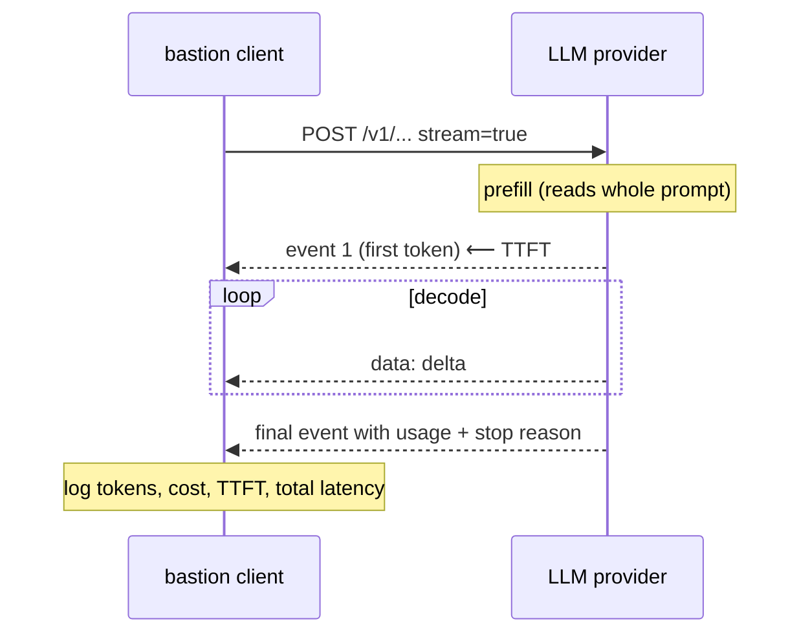

# Day 3: Pricing, streaming (SSE), rate limits and error classes

| | |
|---|---|
| **Day** | 3 of 203 · Wednesday 21 Oct 2026 |
| **Week** | 1 of 29 · Tokens, context and the API surface |
| **Phase** | Phase 1: LLM and application foundations |
| **Kind** | concepts |
| **Time** | 90 minutes |

## Today in 30 seconds

Every LLM call has a **price** (input, output and cached tokens are billed differently), a **shape** (one response, or a stream of Server-Sent Events) and a **failure mode** (rate limits, overloads, bad requests).

Today you learn to estimate cost per call, read an SSE stream and measure time-to-first-token, and to retry only what is safe to retry, using exponential backoff with full jitter. These three pieces are the core of Saturday's provider-agnostic client.

### By the end of today you can

- Compute cost per call from input, output and cached tokens
- Explain how SSE streaming works and measure TTFT vs total latency
- Classify API errors as retryable or not, and implement backoff with full jitter
- Pick a model, prompting and caching strategy with guides G1, G2 and G12

## Concepts

### 1. Pricing: input, output, cached

Providers bill **per million tokens (MTok)**, with separate rates:

- **Input tokens:** everything you send (system prompt, tools, history, documents).
- **Output tokens:** what the model generates. Usually several times the input price. Reasoning models' hidden thinking tokens are billed as output.
- **Cached input:** a repeated **prefix** that the provider has already processed is billed at a discount. On many current models a cache read is about 0.1× the input price. Some providers also charge more to *write* the cache: Anthropic charges 1.25× for the 5-minute TTL and 2× for 1 hour, and OpenAI charges 1.25× on its newest models. The details are model-specific, so check the pricing page.
- **Batch APIs** (OpenAI Batch, Anthropic Message Batches) trade latency for a large discount on offline jobs such as nightly evals.

Cost per call = (fresh input + cached × read multiplier + written × write multiplier) × input price + output × output price.

| Item | Value ($ per 1k calls) |
| --- | --- |
| No cache | 15.0 |
| First call (write) | 17.5 |
| Cache hit | 6.0 |

*Bar chart — No cache: 15.0 $ per 1k calls, First call (write): 17.5 $ per 1k calls, Cache hit: 6.0 $ per 1k calls.*

*Today's code with *illustrative* prices ($2 in / $10 out per MTok) for a 6,000-token prompt (5,000-token stable prefix) and 300 output tokens. Prompt caching cuts the cost by about 60%.*

> **Analogy:** Like a taxi: a fixed flag-fall (prompt), a per-km rate (output tokens, the expensive part), and a season pass (cache) that only works if you take exactly the same route from the start.

### 2. Streaming with Server-Sent Events

With `stream: true` the HTTP response stays open with `Content-Type: text/event-stream`. The server writes events as lines like `event: ...` and `data: ...`, and a **blank line ends each event** (WHATWG HTML spec).

- **OpenAI Chat Completions** streams `data:` chunks and finishes with `data: [DONE]`. The **Responses API** uses typed events such as `response.output_text.delta` and `response.completed`.
- **Anthropic** sends `message_start`, `content_block_start`, `content_block_delta`, `content_block_stop`, `message_delta` and `message_stop`, plus `ping` keep-alives.

Streaming does not make generation faster. It cuts **time-to-first-token (TTFT)**, which is what users perceive. Measure TTFT and total time separately. Token usage usually arrives only at the end of the stream (OpenAI Chat Completions needs `stream_options: {"include_usage": true}`).



*An SSE stream from request to final usage.*

### 3. Rate limits

Limits are set per organisation or project, per model. They are usually counted as **requests per minute (RPM)** and **tokens per minute (TPM)**, sometimes per day as well. Anthropic splits TPM into input (ITPM) and output (OTPM). OpenAI counts the larger of `max_tokens` and the estimated request size against your limit, so an oversized `max_tokens` can throttle you early. Providers return the remaining budget in response headers (e.g. OpenAI `x-ratelimit-remaining-tokens`, Anthropic `anthropic-ratelimit-tokens-remaining`) and may send `retry-after` on a 429.

Whether cached tokens count towards limits **differs by provider**. OpenAI counts them towards TPM. For most Claude models, cache reads do not count towards ITPM, so caching also raises your effective throughput.

Bastion's harness will fire thousands of attack prompts, so a **client-side rate limiter** (token bucket) plus a queue beats hammering the API and backing off.

### 4. Error classes: what to retry

Retry only **transient** failures, and remember that retrying an LLM call **costs money again**.

Use **exponential backoff with full jitter**, `sleep = random(0, min(cap, base·2^attempt))`, so many clients don't retry in lockstep (AWS Architecture Blog). Honour `retry-after` when it is present. Cap the number of attempts and the total time.

The official OpenAI and Anthropic Python SDKs already retry connection errors, 408, 409, 429 and 5xx (twice by default). Don't wrap them in a second retry loop, or the retries multiply.

| Status / error | Meaning | Retry? |
| --- | --- | --- |
| 400 / 422 | Invalid request: bad params, schema, context too long | No. Fix the request (trim context, lower max_tokens) |
| 401 / 403 | Bad key or no permission | No. Alert; may indicate a leaked or revoked key |
| 404 | Wrong model name or endpoint | No |
| 408 / timeouts / connection reset | Transient network issue | Yes, with backoff |
| 429 rate limit | RPM/TPM exceeded | Yes. Honour retry-after, then back off with jitter |
| 429 insufficient_quota (OpenAI) | Out of credits or over the spend limit | No. It is a billing problem |
| 500 / 502 / 503 / 504 | Provider-side error | Yes, with backoff; consider a fallback provider |
| 529 overloaded (Anthropic) | Provider overloaded | Yes, with backoff, or fall back |

## When to choose which

### G12. Caching

Caching is the biggest cost lever you control today. For Bastion triage, put the stable system prompt, rubric and tool specs first.

| Option | How it works | Choose when |
| --- | --- | --- |
| Exact response cache | Key = hash(model, params, full prompt), value = response | Repeated identical calls (classification, triage of duplicates, evals) |
| Semantic cache | Embed the query; return a cached answer if a similar query is within a threshold | FAQ-style, low-risk, single-tenant or tenant-scoped keys only |
| Provider prompt caching | Provider caches the processed prefix of long prompts; cached input tokens billed at a discount | Long stable system prompts, tool specs, documents |
| Self-hosted KV / prefix cache | Engine reuses attention KV state for shared prefixes (vLLM APC, SGLang RadixAttention; LMCache for offload/sharing) | Self-hosted serving with shared prefixes |
| Embedding / retrieval cache | Cache embeddings of documents and frequent queries | High-volume RAG |

**Rule:** put stable content first (system prompt, tools, documents) and variable content last to maximise prefix-cache hits. Every cache key must include tenant ID and model version.

Full guide: roadmap Section 9, [G12 Caching](../roadmap.md#g12-caching).

### G2. Prompting and context engineering

Each prompting choice changes token count, and so cost and rate-limit pressure.

| Option | Cons | Choose when |
| --- | --- | --- |
| Zero-shot instructions | Ambiguous tasks drift | Strong models on well-defined tasks |
| Few-shot examples | More tokens; examples can bias outputs | Format-sensitive or domain-specific tasks |
| Structured outputs | Schema design effort; can reduce quality if over-constrained | Any output consumed by code |
| Context compaction / summarisation | Lossy; summaries can drop key facts or carry injected text | Long-running agents and chats |

**Default:** clear zero-shot instructions plus structured outputs; add few-shot examples for format; use chaining before reaching for agents; treat context as a budget.

Full guide: roadmap Section 9, [G2 Prompting and context engineering](../roadmap.md#g2-prompting-and-context-engineering).

## Cost calculator, SSE parser and retry with full jitter

Runs offline with no API key: the stream and the failures are simulated. On Saturday you wire the same functions to a real provider (hosted or local Ollama).

```python
# day3_api_surface.py  -  cost, SSE parsing and retries with full jitter (offline demo)
import json, random, time
from dataclasses import dataclass

# ---- 1. Cost per call (ILLUSTRATIVE prices in USD per 1M tokens: check current pricing pages)
@dataclass(frozen=True)
class Price:
    input: float = 2.00
    output: float = 10.00
    cache_read_mult: float = 0.10    # cached input billed at 10% (common, provider/model-specific)
    cache_write_mult: float = 1.25   # some providers charge extra to write the cache

def cost_usd(p: Price, input_tok: int, output_tok: int, cached: int = 0, written: int = 0) -> float:
    fresh = input_tok - cached - written
    weighted = fresh + cached * p.cache_read_mult + written * p.cache_write_mult
    return (weighted * p.input + output_tok * p.output) / 1_000_000

p = Price()
print(f"no cache   : ${cost_usd(p, 6_000, 300):.5f}")
print(f"cache write: ${cost_usd(p, 6_000, 300, written=5_000):.5f}")
print(f"cache hit  : ${cost_usd(p, 6_000, 300, cached=5_000):.5f}")

# ---- 2. Minimal SSE parser: events are separated by a blank line; fields are "name: value"
def parse_sse(chunks):
    buf, event = "", {"event": "message", "data": []}
    for chunk in chunks:                       # chunks can split lines anywhere
        buf += chunk
        while "\n" in buf:
            line, buf = buf.split("\n", 1)
            line = line.rstrip("\r")
            if line == "":                     # blank line = dispatch the event
                if event["data"]:
                    yield event["event"], "\n".join(event["data"])
                event = {"event": "message", "data": []}
            elif line.startswith(":"):         # comment / keep-alive
                continue
            else:
                field, _, value = line.partition(":")
                value = value[1:] if value.startswith(" ") else value
                if field == "data":
                    event["data"].append(value)
                elif field == "event":
                    event["event"] = value

fake_stream = ['data: {"delta": "Ver', 'dict: "}\n\n: ping\n\ndata: {"delta": "jailbreak"}\n', '\ndata: [DONE]\n\n']
t0, text = time.perf_counter(), []
for name, data in parse_sse(fake_stream):
    if data == "[DONE]":
        break
    if not text:
        print(f"TTFT {1000 * (time.perf_counter() - t0):.2f} ms")
    text.append(json.loads(data)["delta"])
print("".join(text))

# ---- 3. Retries: only for retryable errors, exponential backoff with FULL jitter
class APIError(Exception):
    def __init__(self, status: int, code: str = "", retry_after: float | None = None):
        super().__init__(f"{status} {code}")
        self.status, self.code, self.retry_after = status, code, retry_after

RETRYABLE = {408, 409, 429, 500, 502, 503, 504, 529}

def should_retry(e: APIError) -> bool:
    if e.status == 429 and e.code == "insufficient_quota":   # billing problem: retrying won't help
        return False
    return e.status in RETRYABLE

def call_with_retries(fn, max_attempts=5, base=0.5, cap=20.0, sleep=time.sleep):
    for attempt in range(max_attempts):
        try:
            return fn()
        except APIError as e:
            if not should_retry(e) or attempt == max_attempts - 1:
                raise
            delay = e.retry_after if e.retry_after is not None else random.uniform(0, min(cap, base * 2 ** attempt))
            print(f"attempt {attempt + 1} failed ({e}); sleeping {delay:.2f}s")
            sleep(delay)

failures = iter([APIError(503), APIError(429, retry_after=1.0)])
def flaky():
    e = next(failures, None)
    if e:
        raise e
    return "ok"
print(call_with_retries(flaky, sleep=lambda s: None))
```

Expected output: no cache $0.01500, cache write $0.01750, cache hit $0.00600 per call. The parser rebuilds `Verdict: jailbreak` from chunks that split mid-token and ignores the `: ping` comment. The retry loop sleeps after the 503 (jittered) and after the 429 (honours `retry_after=1.0`), then returns `ok`. Note the design choice: `insufficient_quota` and 4xx errors fail fast.

## Hands-on task

90 minutes. Read the OpenAI text-generation and streaming guides and the Anthropic API intro (≈45 min). Run and extend the code (≈30 min). Skim G1, G2 and G12 in the roadmap and write the notes (≈15 min).

- [ ] Read the OpenAI text generation + streaming guides and the Anthropic API intro
- [ ] Run `day3_api_surface.py`; confirm the three costs and the reconstructed text
- [ ] Add a `total_timeout` to `call_with_retries` so a call never exceeds 60 s across retries
- [ ] Write down current real prices for one hosted model you will use, from the official pricing page (not from memory)
- [ ] In `notes/week-01.md`: one line each on G1, G2 and G12 for Bastion triage (which model tier, prompting style, cache strategy)
- [ ] Flip the recall cards

## Security lens

**OWASP LLM10:2025 Unbounded Consumption.** Attackers (or your own buggy harness) can run up cost or exhaust capacity: huge inputs, max-length outputs, retry storms and agent loops. This week's controls:

- Set a hard `max_tokens` and client timeouts on every call.
- Enforce a per-key daily **spend cap** and alerting.
- Cap retries and use jitter.
- Keep keys out of git with `gitleaks` in pre-commit.

Two more things to watch:

- **Streaming bypasses post-hoc filters.** Tokens reach the user before an output guardrail can see the whole answer. Either buffer, or moderate incrementally and be ready to cut the stream.
- **Caches can leak.** Shared prompt caches can enable cache-hit timing probes across users. Scope cache keys per tenant (G12 rule).

## Architecture track

Connect this to yesterday's quality attributes. **Cost** (per-call price, caching), **latency** (TTFT vs total, which is why SLOs use p95), **availability** (retries plus a fallback provider) and **operability** (rate-limit headers in your logs). Your retry policy is an architecture decision. Capture it as a candidate for ADR-001 in Week 3. Week 6's architecture track goes deeper on idempotency, retries and backoff.

## Resources

- [OpenAI text generation guide](https://platform.openai.com/docs/guides/text)
- [OpenAI streaming responses guide](https://platform.openai.com/docs/guides/streaming-responses)
- [Anthropic API intro](https://docs.claude.com/en/docs/intro)
- [Anthropic streaming messages (event types)](https://docs.claude.com/en/docs/build-with-claude/streaming)
- [OpenAI rate limits](https://platform.openai.com/docs/guides/rate-limits)
- [Anthropic rate limits](https://docs.claude.com/en/api/rate-limits) — and errors: https://docs.claude.com/en/api/errors
- [OpenAI prompt caching](https://platform.openai.com/docs/guides/prompt-caching)
- [Anthropic prompt caching](https://docs.claude.com/en/docs/build-with-claude/prompt-caching)
- [AWS Architecture Blog, Exponential Backoff and Jitter](https://aws.amazon.com/blogs/architecture/exponential-backoff-and-jitter/)
- [WHATWG HTML spec, Server-sent events](https://html.spec.whatwg.org/multipage/server-sent-events.html)
- [OWASP LLM10:2025 Unbounded Consumption](https://genai.owasp.org/llmrisk/llm102025-unbounded-consumption/)

## Recall quiz

**Q1.** Why does a 5,000-token stable system prompt matter so much for cost?

<details>
<summary>Answer</summary>

When it sits first and stays identical, provider prompt caching bills it at a large discount (often ~0.1× input) on repeat calls. Change one early token and you lose the cache.

</details>

**Q2.** Does streaming make generation faster?

<details>
<summary>Answer</summary>

No. Total generation time is about the same. Streaming reduces time-to-first-token, which is the latency users perceive.

</details>

**Q3.** How does an SSE client know an event is complete?

<details>
<summary>Answer</summary>

A blank line ends the event. Lines starting with `:` are comments or keep-alives. OpenAI Chat Completions ends the stream with `data: [DONE]`.

</details>

**Q4.** Which errors should you retry?

<details>
<summary>Answer</summary>

Transient ones: timeouts/connection errors, 408, 429 rate limits, 5xx and Anthropic 529. Not 400/401/403/404/422, and not OpenAI's 429 insufficient_quota.

</details>

**Q5.** What is full jitter and why use it?

<details>
<summary>Answer</summary>

Sleep a random time between 0 and min(cap, base·2^attempt). It spreads retries so many clients don't hit the provider in synchronised waves.

</details>

**Q6.** Why can a huge max_tokens hurt you even if outputs are short?

<details>
<summary>Answer</summary>

OpenAI counts the larger of max_tokens and the estimated request size against your rate limit, and if the model does run long you pay for it and widen your Unbounded Consumption risk (LLM10).

</details>

**Q7.** Name one security risk specific to streaming.

<details>
<summary>Answer</summary>

Output guardrails that wait for the full response are bypassed, because the user already saw the tokens. Buffer or moderate incrementally.

</details>

## Tomorrow

**Day 4 · Thursday 22 Oct 2026 · 60 min** — Lab prep: Tokens, context and the API surface

- Prepare the environment and scaffolding for this week's lab
- Write the lab's done criteria before coding
