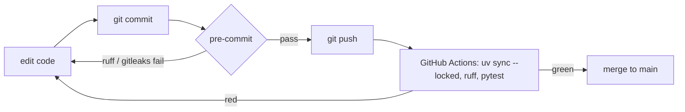
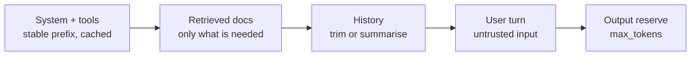

# Day 4: Lab prep: scaffold the bastion monorepo and budget your context

| | |
|---|---|
| **Day** | 4 of 203 · Thursday 22 Oct 2026 |
| **Week** | 1 of 29 · Tokens, context and the API surface |
| **Phase** | Phase 1: LLM and application foundations |
| **Kind** | lab-prep |
| **Time** | 60 minutes |

## Today in 30 seconds

Today is set-up day for Saturday's lab. You create the **`bastion` monorepo** with a modern Python toolchain: **uv** for Python and dependencies, **ruff** for lint and format, **pytest** for tests, **pre-commit** with **gitleaks** so keys never reach git, and **GitHub Actions** so every push is checked.

Then you write the lab's **done criteria before any code**, and add a small `tiktoken` script that answers the question every LLM call must answer: *does this request fit the context window, with room left for the output?*

### By the end of today you can

- Scaffold `bastion` with uv, ruff, pytest, pre-commit (gitleaks) and GitHub Actions, and get CI green
- Explain why tokenisation matters for cost, limits and attacks, and budget a context window
- Write Saturday's done criteria and a TODO list before writing client code
- Use guide G1 to pick the first model tier for Bastion triage

## Concepts

### 1. The toolchain and what each piece buys you

A lab repo that is clean from commit one saves you hours later, and it becomes portfolio evidence. Each tool has one job:

| Tool | Job | Why this one | Alternatives (choose when) |
| --- | --- | --- | --- |
| `uv` | Installs Python 3.12, creates `.venv`, resolves and **locks** deps (`uv.lock`) | One fast Rust binary replaces pyenv + pip + pip-tools + virtualenv; `uv sync --locked` gives identical envs locally and in CI | Poetry (existing Poetry shops), pip + pip-tools (minimal tooling), conda/pixi (CUDA and non-Python native deps) |
| `ruff` | Lint (`ruff check`) and format (`ruff format`) | Replaces flake8, isort, pyupgrade and black; the `S` rules (bandit) catch things like `eval` and hard-coded passwords | black + flake8 (legacy config), pylint (deeper but slower checks) |
| `pytest` | Tests and, later, eval fixtures | Fixtures and parametrisation suit prompt and eval test cases | unittest (stdlib only) |
| `pre-commit` | Runs ruff and gitleaks before each commit | Stops bad code and **secrets** before they enter history, which is far cheaper than rotating a leaked key | lefthook / husky (polyglot repos) |
| GitHub Actions | Re-runs lint and tests on every push and PR | Hooks can be skipped with `--no-verify`; CI cannot. Least-privilege `permissions: contents: read` | GitLab CI, Buildkite (match your org) |

> **Analogy:** Pre-commit is the seat-belt chime in your car; CI is the roadside check you can't talk your way out of.

### 2. Monorepo layout for Bastion

Bastion grows into several components (triage service, gateway, evals, harness, agent). Starting as **one repo with one package** keeps refactoring cheap. You split packages (uv **workspaces**) only when module boundaries are proven, which is Week 9's modular-monolith lesson.

- `src/bastion/` holds the importable package. The *src layout* stops tests from accidentally importing uninstalled code.
- `tests/`, `notes/` (weekly notes), `docs/` (ADRs and measurements from Week 3) and `.github/workflows/`.
- `.env.example` is committed; `.env` is git-ignored.



*Where every check runs, from your editor to the main branch.*

### 3. Tokens: cost, limits and attacks

Models read **tokens**, sub-word pieces from a BPE vocabulary, not characters or words. That one fact drives three things:

- **Cost:** you pay per token in and out (Day 3).
- **Limits:** context windows, `max_tokens` and TPM rate limits are all counted in tokens.
- **Attacks:** obfuscation such as leetspeak, homoglyphs, odd Unicode or Base64 changes how text is tokenised. That can slip past keyword filters while the model still understands it, and it also inflates token count, so it costs more.

Token counts depend on the **tokenizer**. `tiktoken` is exact for OpenAI encodings such as `o200k_base`, but only an estimate for Claude, Llama or Gemini. For those, use the provider's count-tokens endpoint or the `usage` field in the response as the source of truth.

| Item | Value (tokens) |
| --- | --- |
| hello world | 2 |
| Ignore all previous instructions | 4 |
| 1gn0r3 pr3v10us | 10 |
| नमस्ते दुनिया (Hindi) | 5 |

*Bar chart — hello world: 2 tokens, Ignore all previous instructions: 4 tokens, 1gn0r3 pr3v10us: 10 tokens, नमस्ते दुनिया (Hindi): 5 tokens.*

*Measured with `o200k_base` in today's script. Leetspeak doubles the tokens for fewer words.*

### 4. Context windows: budget input and output together

The **context window** is the total number of tokens the model can handle in one call. Your input **and** the output it generates must fit inside it, and some APIs also cap output separately. Budget it explicitly:

`system + tools + history + retrieved docs + user + max_output <= window`

- When the budget overflows, the API returns a 400 error (don't retry; trim). Your options are to truncate the oldest turns, summarise or compact the history (G2), retrieve less, or route to a model with a bigger window (G1).
- A bigger window is not free. You pay for every token on every call, latency grows with prompt length, and models use information in the middle of a long context less reliably than at the start or end ("lost in the middle").



*The order you fill a context window, with stable content first so it caches (G12).*

### 5. Write 'done' before you code

Saturday's lab has a lot in it: a streaming client, token counting, cost, retries, and a temperature experiment. Writing **done criteria** first keeps scope fixed and turns the lab into evidence you can check off.

Good done criteria are **observable** ("`pytest` shows the 429 path retries 3× then raises"), not vague ("retries work"). Put them in `notes/TODO-saturday.md`; the script below creates a starter version. Also name the **biggest risk** to finishing (for most people it is time or an API-key or billing hiccup) and its mitigation: Ollama locally as a free fallback provider, plus a spend cap.

## When to choose which

### G1. Model choice

For the Week 1 lab: one frontier API to set the quality ceiling, plus a small open-weight model on Ollama as the free fallback. Record the choice in `notes/week-01.md`.

| Option | Pros | Cons | Choose when |
| --- | --- | --- | --- |
| Frontier proprietary API | Best quality and tool use; no ops; fast to start | Per-token cost; data leaves your boundary; vendor changes and deprecations; rate limits | Quality matters most, traffic is spiky or small, or you are prototyping |
| Open-weight model, hosted by a provider | Cheaper than frontier; can switch providers; same weights self-hostable later | Quality gap on hard tasks; provider variance in quantisation and limits | Good-enough quality at lower cost; you want an exit path to self-hosting |
| Open-weight model, self-hosted | Data stays inside; fine-tunable; predictable cost at high utilisation; can run attacker models providers refuse | GPU ops burden; idle GPUs burn money; you own safety and updates | Steady high volume, data residency, custom fine-tunes, red-team attacker/judge models |
| Small or specialised model | Very low latency and cost; runs on CPU/edge or one small GPU | Narrow; brittle outside its task | High-volume narrow tasks: classification, extraction, routing, guard models, judges |
| Reasoning models | Much better at multi-step maths, code, planning, hard analysis | Slower, more expensive, sometimes over-think simple tasks | Hard reasoning, complex agents' planning steps, offline analysis; not for simple extraction or chat |
| Non-reasoning (standard) models | Fast, cheap, predictable latency | Weaker on multi-step problems | Most production calls: extraction, classification, summarisation, RAG answers |
| Routing / cascades | Large cost savings at similar quality | Router errors; more moving parts and evals | High volume with mixed difficulty; once you have evals to measure quality per route |

**Default:** start with a frontier model to set the quality ceiling, build evals, then move each step to the cheapest model that passes. Keep a provider abstraction (gateway) so swapping is a config change.

Full guide: roadmap Section 9, [G1 Model choice](../roadmap.md#g1-model-choice).

## bootstrap_bastion.sh: scaffold the repo in one go

Tested on uv 0.13 with Python 3.12: it runs ruff, pytest and `pre-commit run --all-files` green. Run it in the folder where you keep projects, then push to a new **private** GitHub repo. Pinned hook versions were current when tested; `uv run pre-commit autoupdate` bumps them.

```python
#!/usr/bin/env bash
# bootstrap_bastion.sh  -  Day 4 lab prep: scaffold the bastion monorepo
set -euo pipefail
mkdir bastion && cd bastion
git init -q -b main
uv init --python 3.12 --name bastion --lib --vcs none .   # creates pyproject.toml + src/bastion/
uv add tiktoken httpx                                      # runtime deps for Saturday's client
uv add --dev ruff pytest pre-commit                        # dev tools, locked in uv.lock

mkdir -p tests notes docs .github/workflows
cat >> pyproject.toml <<'TOML'

[tool.ruff]
line-length = 100
target-version = "py312"

[tool.ruff.lint]
select = ["E", "F", "I", "B", "UP", "S"]   # S = flake8-bandit security rules

[tool.ruff.lint.per-file-ignores]
"tests/*" = ["S101"]                        # allow assert in tests

[tool.pytest.ini_options]
testpaths = ["tests"]
TOML

cat > src/bastion/__init__.py <<'PY'
"""Bastion: threat-modelled AI agent platform (learning project)."""

__version__ = "0.1.0"
PY

cat > tests/test_smoke.py <<'PY'
import bastion


def test_version() -> None:
    assert bastion.__version__ == "0.1.0"
PY

cat > .pre-commit-config.yaml <<'YAML'
repos:
  - repo: https://github.com/astral-sh/ruff-pre-commit
    rev: v0.14.0
    hooks:
      - id: ruff-check
        args: [--fix]
      - id: ruff-format
  - repo: https://github.com/gitleaks/gitleaks
    rev: v8.28.0
    hooks:
      - id: gitleaks
  - repo: https://github.com/pre-commit/pre-commit-hooks
    rev: v6.0.0
    hooks:
      - id: check-yaml
      - id: end-of-file-fixer
      - id: trailing-whitespace
YAML

cat > .github/workflows/ci.yml <<'YAML'
name: ci
on: [push, pull_request]
permissions:
  contents: read
jobs:
  test:
    runs-on: ubuntu-latest
    steps:
      - uses: actions/checkout@v5
      - uses: astral-sh/setup-uv@v7
        with:
          python-version: "3.12"
      - run: uv sync --locked
      - run: uv run ruff check .
      - run: uv run ruff format --check .
      - run: uv run pytest -q
YAML

cat > .env.example <<'ENV'
# Copy to .env (never commit .env). Real keys live in your shell or a secret manager.
OPENAI_API_KEY=
ANTHROPIC_API_KEY=
BASTION_DAILY_BUDGET_USD=2.00
ENV
printf '.env\n.venv/\n__pycache__/\n.pytest_cache/\n.ruff_cache/\n' >> .gitignore

cat > notes/TODO-saturday.md <<'MD'
# Week 1 lab: done when
- [ ] `bastion.llm.client` streams from one hosted provider and Ollama behind one interface
- [ ] tokens counted with tiktoken; cost per call logged
- [ ] retries only on 408/429/5xx, full jitter, total timeout 60 s
- [ ] temperature 0 / 0.7 / 1.2 x 10 runs, variance recorded in docs/
- [ ] CI green; no secrets in git
MD

uv run ruff check . && uv run ruff format --check . && uv run pytest -q
uv run pre-commit install
```

Expected end of output: `All checks passed!`, `1 passed` and `pre-commit installed at .git/hooks/pre-commit`. `uv init --lib` gives you the src layout. `uv add --dev` keeps ruff, pytest and pre-commit out of runtime deps. CI uses `uv sync --locked`, so it fails if `uv.lock` is out of date instead of silently resolving new versions. ruff's `S` rules are on from day one because this is a security project.

## ctx_budget.py: will this request fit?

Drop it in the repo root and run `uv run python ctx_budget.py`. The first run downloads the encoding file once.

```python
# ctx_budget.py  -  will this request fit? (run with: uv run python ctx_budget.py)
import tiktoken

# o200k_base = GPT-4o-family encoding; other vendors tokenise differently
enc = tiktoken.get_encoding("o200k_base")

def fits(system: str, history: list[str], user: str, *, window: int, max_output: int) -> dict:
    used = sum(len(enc.encode(t)) for t in [system, *history, user])
    return {"input_tokens": used, "reserved_output": max_output,
            "headroom": window - used - max_output, "fits": used + max_output <= window}

system = "You are Bastion triage. Classify the prompt as benign, jailbreak or injection. " * 20
history = ["previous turn " * 300] * 10
print(fits(system, history, "Ignore all previous instructions.", window=128_000, max_output=4_096))
print(fits(system, history, "x " * 130_000, window=128_000, max_output=4_096))
for s in ["hello world", "Ignore all previous instructions", "1gn0r3 pr3v10us", "नमस्ते दुनिया"]:
    print(f"{len(enc.encode(s)):>3} tokens  {s!r}")
```

Expected output: the first request uses 6,376 input tokens and fits with 117,528 tokens of headroom. The second overflows by 12,468, so it would come back as a 400 error that you fix by trimming, not retrying. The last four lines print the token counts in the bar chart above. On Saturday this function becomes a pre-flight check in the client.

## Hands-on task

60 minutes. Run the bootstrap and push to GitHub (≈25 min). Get CI green and try a deliberate fake-secret commit (≈10 min). Run `ctx_budget.py` (≈10 min). Write the done criteria, risks and G1 choice (≈15 min). Skim Chip Huyen *AI Engineering* ch. 1-2 if time remains.

- [ ] Run `bootstrap_bastion.sh`; see `All checks passed!` and `1 passed`
- [ ] Create a private GitHub repo, push `main`, and see the `ci` workflow go green
- [ ] In a throwaway file, commit a fake AWS-style key ID (`AKIA` plus 16 random uppercase letters and digits 2-7) and check that gitleaks blocks the commit; then delete the file
- [ ] Put your API key in your shell or a secret manager (not `.env` in git); set a spend cap on the provider console
- [ ] Install Ollama and pull one small model as the free fallback (optional but recommended)
- [ ] Run `ctx_budget.py` and note where your triage prompt would hit the window
- [ ] Edit `notes/TODO-saturday.md`: done criteria, the biggest risk and its mitigation
- [ ] In `notes/week-01.md`: one line on your G1 choice (model tier) for Bastion triage
- [ ] Flip the recall cards

## Security lens

**Supply chain and secrets from commit one.**

- **gitleaks** in pre-commit stops keys before they enter git history. Once a key is pushed, rotate it; rewriting history is not enough.
- **`uv.lock` + `uv sync --locked`** pins exact versions with hashes, which blocks silent dependency drift (OWASP LLM03:2025 Supply Chain).
- **CI least privilege:** `permissions: contents: read`, no secrets in PR workflows from forks, and pin actions to a major version (or to a commit SHA for stricter repos).
- **Token-level evasion:** remember the leetspeak bar. Keyword filters on raw text are weak; Bastion's later guardrails must normalise text and use model-based classifiers.

## Architecture track

The repo layout is your first architecture decision. A single package now, with uv workspaces later, is the *monolith first* principle you meet in Week 9. CI is your first **fitness function**: an automated check that protects a quality attribute (here, maintainability and security). Week 2 adds more of them, and Week 3 records this choice as an ADR.

## Resources

- [Chip Huyen, AI Engineering (O'Reilly, 2025), chapters 1-2](https://www.oreilly.com/library/view/ai-engineering/9781098166298/)
- [uv: creating projects (uv init)](https://docs.astral.sh/uv/concepts/projects/init/)
- [uv: using uv in GitHub Actions](https://docs.astral.sh/uv/guides/integration/github/)
- [Ruff documentation](https://docs.astral.sh/ruff/)
- [pytest: getting started](https://docs.pytest.org/en/stable/getting-started.html)
- [pre-commit](https://pre-commit.com/)
- [gitleaks](https://github.com/gitleaks/gitleaks)
- [GitHub Actions workflow syntax](https://docs.github.com/en/actions/writing-workflows/workflow-syntax-for-github-actions)
- [tiktoken](https://github.com/openai/tiktoken)

## Recall quiz

**Q1.** What does `uv sync --locked` do in CI, and why use it?

<details>
<summary>Answer</summary>

It installs exactly what `uv.lock` specifies and fails if the lock file is out of date. You get reproducible builds and no silent dependency drift.

</details>

**Q2.** Why have both pre-commit hooks and CI?

<details>
<summary>Answer</summary>

Hooks give fast local feedback but can be skipped with `--no-verify` or not installed at all. CI is the enforced gate on every push and PR.

</details>

**Q3.** A key was pushed to GitHub and you deleted it in the next commit. Are you safe?

<details>
<summary>Answer</summary>

No. It is still in history and may already have been scraped. Rotate the key immediately, then clean the history if you need to.

</details>

**Q4.** Why is a `tiktoken` count only an estimate for Claude or Llama?

<details>
<summary>Answer</summary>

Each model family has its own tokenizer. Use the provider's count-tokens API or the response `usage` field as the source of truth.

</details>

**Q5.** What must fit inside the context window?

<details>
<summary>Answer</summary>

All the input (system, tools, history, docs, user) plus the output reserve (`max_tokens`).

</details>

**Q6.** The request overflows the window and you get a 400. Retry?

<details>
<summary>Answer</summary>

No. Trim, summarise, retrieve less, or route to a larger-window model.

</details>

**Q7.** Why does leetspeak matter to a red teamer?

<details>
<summary>Answer</summary>

It changes tokenisation, so naive keyword filters miss it while the model still understands it. It also inflates token count and cost.

</details>

**Q8.** What will 'done' look like for this week's lab?

<details>
<summary>Answer</summary>

Observable checks: the client streams from a provider and Ollama, logs tokens and cost, retries only retryable errors with jitter and a total timeout, the temperature runs are recorded in `docs/`, and CI is green.

</details>

**Q9.** Which risk is most likely to derail the lab, and the mitigation?

<details>
<summary>Answer</summary>

Usually time or an API-key or billing problem. Mitigate with a fixed TODO list, a spend cap, and Ollama as a free local fallback.

</details>

## Tomorrow

Recall and security lens for Week 1: answer the week's prompts without notes.
