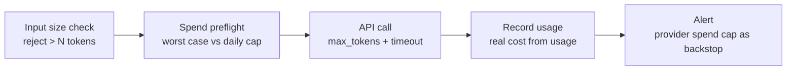

# Day 5: Recall + security lens: lock in Week 1 and cap your spend

| | |
|---|---|
| **Day** | 5 of 203 · Friday 23 Oct 2026 |
| **Week** | 1 of 29 · Tokens, context and the API surface |
| **Phase** | Phase 1: LLM and application foundations |
| **Kind** | review |
| **Time** | 30 minutes |

## Today in 30 seconds

Friday is a short **recall day**. First you answer the week's questions *without notes*: tokens, context windows, sampling, message roles, pricing, streaming and rate limits. Writing answers from memory is what makes them stick, and the gaps you find tell you what to revisit before Saturday's lab.

Then you apply this week's **security lens**: skim the **OWASP Top 10 for LLM Applications 2025** and implement controls for **LLM10 Unbounded Consumption**: a hard `max_tokens`, request timeouts and a per-key daily spend cap, with keys kept out of git by `gitleaks`.

### By the end of today you can

- Recall the seven Week 1 concepts from memory and note your gaps
- Explain the OWASP LLM Top 10 (2025) at a glance and why LLM10 matters for every API caller
- Add max_tokens, timeout and daily-spend-cap controls to Bastion (or schedule them for the lab)

## Concepts

### 1. How to do recall (10 minutes)

Close every tab and note. For each concept below, write two sentences: **what it is** and **where it shows up in Bastion**. Mark each one green (confident), amber (shaky) or red (blank). Only then open the flip cards at the bottom to check.

- Ambers and reds go into `notes/week-01.md` under *Gaps*.
- Re-read only the matching section of Days 1-4, not the whole lesson.

> Retrieval practice beats re-reading: the effort of pulling an answer out of memory is what strengthens it.

> **Analogy:** Re-reading is watching someone lift weights. Recall is lifting them yourself.

### 2. Week 1 on one page

Everything this week fits into one request/response loop. Use this as a map while you check your answers.

| Concept | One-line meaning | Where it bites in Bastion |
| --- | --- | --- |
| Tokenisation | Text is split into sub-word tokens; everything is counted in tokens | Cost, limits and obfuscation attacks (leetspeak inflates tokens and dodges keyword filters) |
| Context window | Input **plus** output must fit in a fixed token budget | Long triage prompts plus retrieved docs can overflow and return a 400 |
| Sampling | `temperature`/`top_p` shape randomness; `max_tokens` and `stop` end output | Triage wants low temperature and a hard `max_tokens` for repeatable labels |
| Message roles | `system`, `user`, `assistant` (and `tool`) separate instructions from data | User text must never be trusted as a system instruction (prompt injection) |
| Pricing | Output tokens cost several times input; cached input is discounted | Long outputs dominate the bill; reuse a stable prefix to benefit from caching |
| Streaming (SSE) | Server-sent events send tokens as they are generated | Faster time-to-first-token in the UI; you must handle partial and broken streams |
| Rate limits and errors | RPM/TPM limits give 429; 5xx is transient; 400/401 are your bug | Retry 429/5xx with jittered backoff; never retry 400/401 |

### 3. OWASP Top 10 for LLM Applications (2025) at a glance

The OWASP list is the shared vocabulary for LLM risks, and you will use it all through the security track. Today you only need the headline of each item:

- **LLM01** Prompt Injection, **LLM02** Sensitive Information Disclosure, **LLM03** Supply Chain, **LLM04** Data and Model Poisoning, **LLM05** Improper Output Handling
- **LLM06** Excessive Agency, **LLM07** System Prompt Leakage, **LLM08** Vector and Embedding Weaknesses, **LLM09** Misinformation, **LLM10** Unbounded Consumption

Week 1 already touched three of them: role separation (LLM01), `uv.lock` and gitleaks (LLM03) and today's spend controls (LLM10).

### 4. LLM10 Unbounded Consumption

Any caller who can make your app send lots of tokens can drain your budget (*denial of wallet*), exhaust your rate limit for everyone else or slow the service down. It can be malicious (huge pasted inputs, prompts that ask for endless output, scripted loops) or accidental (a retry bug, an agent stuck in a loop).

The controls stack in layers, cheapest first:



*Every request passes each gate before money is spent.*

### 5. Which control stops what

No single control is enough; each closes a different hole.

| Control | Stops | Does not stop |
| --- | --- | --- |
| Hard `max_tokens` | Runaway or endless output on one call | Many calls, huge inputs |
| Input token limit | Pasted novels, padding attacks | Many small calls |
| Request timeout | Hung connections tying up workers | Cost of calls that finish |
| Per-key daily spend cap (app) | Slow drain across many calls, retry loops | A leaked key used outside your app |
| Provider console budget/alert | Leaked key used anywhere | Nothing in real time if it only alerts; set a hard limit where offered |
| Rate limit per user (later, in the gateway weeks) | One user starving others | Distributed abuse without auth |
| gitleaks + secret manager | Keys leaking through git | Keys leaked by other routes; rotate on suspicion |

## guard.py: max_tokens, timeout and a per-key daily spend cap

Runs offline with plain Python 3.12 (tested). Call `preflight()` before each API request and `record()` with the response's real `usage` after it. Prices are **illustrative**; put your model's real prices in `PRICE_PER_MTOK`. A JSON file is fine for a lab; a shared store like Redis replaces it once Bastion runs more than one process.

```python
# guard.py  -  Day 5: LLM10 Unbounded Consumption controls (no network, runs offline)
import datetime as dt
import json
import pathlib

MAX_OUTPUT_TOKENS = 512          # hard cap sent as max_tokens on EVERY call
MAX_INPUT_TOKENS = 8_000         # reject oversized prompts before paying for them
TIMEOUT_S = 30                   # pass to your HTTP client, e.g. httpx.Timeout(30)
DAILY_CAP_USD = 2.00             # per API key, per UTC day
PRICE_PER_MTOK = {"in": 0.15, "out": 0.60}   # illustrative prices only

LEDGER = pathlib.Path("spend.json")


class BudgetExceeded(RuntimeError):
    pass


def _today() -> str:
    return dt.datetime.now(dt.timezone.utc).date().isoformat()


def _load() -> dict:
    return json.loads(LEDGER.read_text()) if LEDGER.exists() else {}


def worst_case_cost(in_tokens: int, max_out: int = MAX_OUTPUT_TOKENS) -> float:
    return (in_tokens * PRICE_PER_MTOK["in"] + max_out * PRICE_PER_MTOK["out"]) / 1e6


def preflight(key_id: str, in_tokens: int) -> None:
    """Call BEFORE the API request: refuse if it could break a limit."""
    if in_tokens > MAX_INPUT_TOKENS:
        raise BudgetExceeded(f"input {in_tokens} > {MAX_INPUT_TOKENS} tokens")
    spent = _load().get(key_id, {}).get(_today(), 0.0)
    if spent + worst_case_cost(in_tokens) > DAILY_CAP_USD:
        raise BudgetExceeded(f"daily cap ${DAILY_CAP_USD:.2f} reached for {key_id}")


def record(key_id: str, usage_in: int, usage_out: int) -> float:
    """Call AFTER the response, with the provider's real `usage` numbers."""
    cost = (usage_in * PRICE_PER_MTOK["in"] + usage_out * PRICE_PER_MTOK["out"]) / 1e6
    led = _load()
    day = led.setdefault(key_id, {})
    day[_today()] = round(day.get(_today(), 0.0) + cost, 6)
    LEDGER.write_text(json.dumps(led))
    return cost


if __name__ == "__main__":
    LEDGER.unlink(missing_ok=True)
    preflight("dev-key", 1_200)
    print("call 1 cost $", record("dev-key", 1_200, 300))
    try:
        preflight("dev-key", 50_000)
    except BudgetExceeded as e:
        print("blocked:", e)
    _l = {"dev-key": {_today(): 1.9999}}
    LEDGER.write_text(json.dumps(_l))
    try:
        preflight("dev-key", 1_000)
    except BudgetExceeded as e:
        print("blocked:", e)
```

- `preflight` blocks *before* you pay, using the worst case (input plus the full `max_tokens`).
- `record` uses the provider's `usage` numbers, because local token counts are only estimates for non-OpenAI models.
- The day is keyed on UTC so the cap resets at a predictable time.
- Running it prints one recorded cost and two blocked requests: one for oversized input, one for the daily cap.

## Hands-on task

30 minutes. Recall without notes (≈10 min). Check against the cards and log gaps (≈5 min). Skim the OWASP Top 10 overview (≈10 min; the full read is an hour, so finish it at the weekend). Copy `guard.py` into `src/bastion/` or add it to Saturday's TODO (≈5 min).

- [ ] Write two-sentence answers for all seven concepts without notes, and mark each green, amber or red
- [ ] Check with the flip cards; log ambers and reds under *Gaps* in `notes/week-01.md`
- [ ] Skim the OWASP Top 10 for LLM Applications 2025 overview; read the LLM10 page in full
- [ ] Add `guard.py` to `src/bastion/` (or add it to `notes/TODO-saturday.md` with a concrete step)
- [ ] Confirm a hard spend limit or budget alert is set in your provider console
- [ ] Confirm gitleaks is in `.pre-commit-config.yaml` and blocked Thursday's fake-key test

## Security lens

**Denial of wallet is the first attack every LLM app faces.** It needs no clever prompt, just volume. Treat `max_tokens`, timeouts and spend caps as required settings, not tuning. A leaked key bypasses every app-side control, so pair the app cap with a provider-side limit and rotate any key that touched git, a log or a chat.

## Architecture track

This week's architecture track (Tuesday 2026-10-20): **What architects do; quality attributes (scalability, availability, latency, security, cost, operability)**. Exercise: List the top 5 quality attributes for Bastion triage and rank them; note one tradeoff between two of them.

## Resources

- [OWASP Top 10 for LLM Applications 2025](https://genai.owasp.org/llm-top-10/)
- [OWASP LLM10:2025 Unbounded Consumption](https://genai.owasp.org/llmrisk/llm102025-unbounded-consumption/)
- [gitleaks](https://github.com/gitleaks/gitleaks)
- [HTML spec: server-sent events](https://html.spec.whatwg.org/multipage/server-sent-events.html)

## Recall quiz

**Q1.** Why does tokenisation matter for security, not only cost?

<details>
<summary>Answer</summary>

Obfuscated text (leetspeak, homoglyphs, Base64) tokenises differently, so it can slip past keyword filters while the model still understands it, and it inflates token counts and cost.

</details>

**Q2.** Your prompt is 120k tokens and the window is 128k. You set max_tokens to 16k. What happens?

<details>
<summary>Answer</summary>

Input plus requested output exceeds the window, so the API returns a 400 (or truncates output, depending on provider). Trim or summarise the input; don't retry as-is.

</details>

**Q3.** Which sampling settings suit a triage classifier, and why?

<details>
<summary>Answer</summary>

Low temperature (around 0) for repeatable labels, a small hard `max_tokens`, and stop sequences or structured output so it ends cleanly.

</details>

**Q4.** Why must user text never go in the system message?

<details>
<summary>Answer</summary>

The system role carries trusted instructions. Mixing untrusted input into it makes prompt injection (LLM01) far easier.

</details>

**Q5.** Why do output tokens usually dominate the bill?

<details>
<summary>Answer</summary>

They are priced several times higher than input and are generated one at a time, so long answers cost the most. Cached input is cheaper still.

</details>

**Q6.** What extra work does streaming over SSE create for your client?

<details>
<summary>Answer</summary>

Handling partial chunks, assembling the final message, detecting a broken or stalled stream (timeouts) and getting usage at the end.

</details>

**Q7.** Which errors do you retry, and how?

<details>
<summary>Answer</summary>

429 and 5xx, with exponential backoff plus jitter and a retry cap, honouring `Retry-After`. Never retry 400 or 401; fix the request or key.

</details>

**Q8.** Name three LLM10 controls and what each stops.

<details>
<summary>Answer</summary>

Hard `max_tokens` (runaway output), input token limit (huge inputs), per-key daily spend cap (slow drain and retry loops). Timeouts stop hung calls.

</details>

**Q9.** Why isn't an app-side spend cap enough on its own?

<details>
<summary>Answer</summary>

A leaked key can be used outside your app. You also need a provider-side limit or alert, secret management, and rotation.

</details>

## Tomorrow

Saturday deep-work lab (about 3 hours): build Bastion's first LLM client with token budgeting, sampling settings, streaming, retries and today's spend guard.
