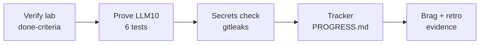
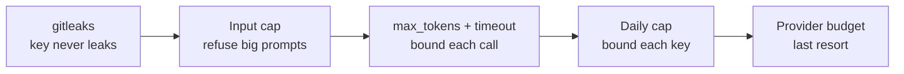

# Day 7: Ship Week 1: finish the lab, prove the spend controls, fill the tracker

| | |
|---|---|
| **Day** | 7 of 203 · Sunday 25 Oct 2026 |
| **Week** | 1 of 29 · Tokens, context and the API surface |
| **Phase** | Phase 1: LLM and application foundations |
| **Kind** | ship |
| **Time** | 150 minutes |

## Today in 30 seconds

Sunday is **ship day**. Nothing new to learn; the job is to turn this week's work into something a reviewer could check in five minutes.

You will do three things. First, **finish and verify** the Week 1 lab against its done-criteria (client, tests, the temperature experiment, CI green). Second, **close the security lens**: prove the OWASP **LLM10 Unbounded Consumption** controls work with six offline tests, and confirm `gitleaks` guards every commit. Third, **write it down**: one row in `docs/PROGRESS.md`, one entry in your brag doc, and a short weekly retro. There is no ADR this week (ADR-001 lands in Week 3), so you'll log decisions as one-liners to turn into that ADR later.

### By the end of today you can

- Check the Week 1 lab against written acceptance criteria and close every gap or log it
- Prove the LLM10 controls (max_tokens, timeout, input cap, per-key daily cap, no secrets in git) with tests, not intentions
- Fill the Week 1 tracker row, a brag-doc entry and a 3-line retro

## Concepts

### 1. What 'shipped' means here

A week counts as shipped when someone else could **verify** it without asking you anything. That means code on `main`, CI green, measurements in `docs/`, and a written record of what you decided and why.

Work in this order, so the most valuable things are done even if you run out of time:



*Ship-day order: verify first, write last.*

### 2. Acceptance check: the lab against its criteria

Go row by row. Anything not green gets either a fix today or a line in `notes/week-01.md` under *Carry-over* with a date. Never leave it silently half-done.

| Criterion | How to prove it | If it fails |
| --- | --- | --- |
| Client streams, counts tokens, costs each call | One manual `chat()` on Ollama prints tokens and a cost line | Check `stream_options.include_usage` and the tiktoken fallback |
| Retries only on 408/429/5xx with jitter | `uv run pytest -q` includes the retry and no-retry tests | Re-read the Day 6 retry table |
| Temperature experiment recorded | `docs/temperature-variance-*.md` committed with 3x10 runs | Run Ollama only; hosted is optional |
| Lint and format clean | `uv run ruff check .` and `ruff format --check .` | `ruff check --fix`, then review the diff |
| CI green on `main` | Actions tab shows a green tick on the last commit | Read the first red step's log, not the last |

### 3. LLM10 Unbounded Consumption: control to proof

OWASP's **LLM10** covers attacks and bugs that burn money or capacity: huge prompts, runaway outputs, retry storms and stolen keys. A control only counts once something **fails when it's removed**. That's what today's tests do.

| Control | Stops | Proof you keep |
| --- | --- | --- |
| Hard `max_tokens` on every call | Runaway or adversarially long outputs | Test asserts the cap exists; client always sends it |
| Input token cap before the call | Paying for giant pasted or injected context | `test_oversized_prompt_is_refused_before_paying` |
| Request timeout | Hung connections tying up workers | Test asserts a bounded `TIMEOUT_S`; client passes it to httpx |
| Per-key daily spend cap | Denial of wallet, leaked key abuse, retry loops | `test_daily_cap_blocks_the_next_call`, `test_cap_is_per_key` |
| Provider-side budget alert | Bugs in your own guard | Screenshot or note of the console setting (not the key) |
| Keys never in git (`gitleaks`) | Key theft from repo history | Fake-key commit blocked; `pre-commit run --all-files` clean |

### 4. Defence in depth for spend

Your guard is **one** layer. If it has a bug, the provider's own budget limit is the backstop; if a key leaks, gitleaks and key rotation limit the damage. Each layer should be able to fail without the bill exploding.



*Each layer catches what the previous one missed.*

> **Analogy:** Like a home's electrics: a fuse per circuit, a main breaker, and the utility's own limit. You don't rely on one switch.

### 5. The tracker row and the brag doc

**`docs/PROGRESS.md`** is for you: did the week happen, how long did it take, what's carried over. Fill *Hours* honestly; it's how you'll know whether the 29-week plan is realistic.

**The brag doc** is for your future promotion case. Each entry needs **what you built, why it matters, evidence (link), and a number**. Write it today while the details are fresh; in nine months you won't remember that temperature 0 gave 10/10 agreement.

### 6. Decisions now, ADR later

This week you made real choices: OpenAI-compatible API first, Ollama as the free fallback, retry only on 408/429/5xx, a JSON ledger before Redis. Write each as **one line with its reason** in `notes/decisions.md`.

In Week 3 these become **ADR-001: provider abstraction and structured output strategy**. Capturing them now means the ADR is editing, not archaeology.

### 7. A three-line retro

Add this to `notes/week-01.md`. Five minutes, no more.

- **Keep:** one thing that worked (e.g. writing done-criteria on Thursday)
- **Drop:** one thing that wasted time
- **Try:** one change for Week 2 (structured outputs and tool calling)

> A retro you actually act on beats a long one you don't.

## When to choose which

### G1. Model choice

Write your Week 1 model-tier choice for Bastion triage as a line in `notes/decisions.md`, with the variance numbers from Saturday as the reason.

| Option | Pros | Cons | Choose when |
| --- | --- | --- | --- |
| Frontier proprietary API | Best quality and tool use; no ops; fast to start | Per-token cost; data leaves your boundary; vendor changes and deprecations; rate limits | Quality matters most, traffic is spiky or small, or you are prototyping |
| Open-weight model, hosted by a provider | Cheaper than frontier; can switch providers; same weights self-hostable later | Quality gap on hard tasks; provider variance in quantisation and limits | Good-enough quality at lower cost; you want an exit path to self-hosting |
| Open-weight model, self-hosted | Data stays inside; fine-tunable; predictable cost at high utilisation; can run attacker models providers refuse | GPU ops burden; idle GPUs burn money; you own safety and updates | Steady high volume, data residency, custom fine-tunes, red-team attacker/judge models |
| Small or specialised model | Very low latency and cost; runs on CPU/edge or one small GPU | Narrow; brittle outside its task | High-volume narrow tasks: classification, extraction, routing, guard models, judges |
| Reasoning models | Much better at multi-step maths, code, planning, hard analysis | Slower, more expensive, sometimes over-think simple tasks | Hard reasoning, complex agents' planning steps, offline analysis; not for simple extraction or chat |
| Non-reasoning (standard) models | Fast, cheap, predictable latency | Weaker on multi-step problems | Most production calls: extraction, classification, summarisation, RAG answers |
| Routing / cascades | Large cost savings at similar quality | Router errors; more moving parts and evals | High volume with mixed difficulty; once you have evals to measure quality per route |

**Default:** start with a frontier model to set the quality ceiling, build evals, then move each step to the cheapest model that passes. Keep a provider abstraction (gateway) so swapping is a config change.

Full guide: roadmap Section 9, [G1 Model choice](../roadmap.md#g1-model-choice).

### G2. Prompting and context engineering

Week 2 moves triage from a one-word zero-shot answer to **structured outputs**. Note in your retro where the one-word format already broke.

| Option | Cons | Choose when |
| --- | --- | --- |
| Zero-shot instructions | Ambiguous tasks drift | Strong models on well-defined tasks |
| Few-shot examples | More tokens; examples can bias outputs | Format-sensitive or domain-specific tasks |
| Structured outputs | Schema design effort; can reduce quality if over-constrained | Any output consumed by code |

**Default:** clear zero-shot instructions plus structured outputs; add few-shot examples for format; use chaining before reaching for agents; treat context as a budget.

Full guide: roadmap Section 9, [G2 Prompting and context engineering](../roadmap.md#g2-prompting-and-context-engineering).

### G12. Caching

No cache yet, on purpose. Log it in `notes/decisions.md` as a future option for repeated temperature-0 triage.

| Option | How it works | Choose when |
| --- | --- | --- |
| Exact response cache | Key = hash(model, params, full prompt), value = response | Repeated identical calls (classification, triage of duplicates, evals) |
| Provider prompt caching | Provider caches the processed prefix of long prompts; cached input tokens billed at a discount | Long stable system prompts, tool specs, documents |

**Rule:** put stable content first (system prompt, tools, documents) and variable content last to maximise prefix-cache hits. Every cache key must include tenant ID and model version.

Full guide: roadmap Section 9, [G12 Caching](../roadmap.md#g12-caching).

## tests/test_guard.py: prove the LLM10 controls

Tests Day 5's `guard.py` placed at `src/bastion/guard.py`. Runs fully offline with `pytest` (tested on Python 3.13: `6 passed`, ruff check and format clean). Each test points `LEDGER` at a temporary file, so your real spend ledger is never touched.

```python
"""Prove the LLM10 controls work: offline, no API key, no network."""

import json

import pytest

from bastion import guard


@pytest.fixture(autouse=True)
def isolated_ledger(tmp_path, monkeypatch):
    # Each test gets its own empty spend ledger.
    monkeypatch.setattr(guard, "LEDGER", tmp_path / "spend.json")


def test_small_call_is_allowed():
    guard.preflight("dev-key", 1_200)  # no exception means allowed


def test_oversized_prompt_is_refused_before_paying():
    with pytest.raises(guard.BudgetExceeded, match="input"):
        guard.preflight("dev-key", guard.MAX_INPUT_TOKENS + 1)


def test_daily_cap_blocks_the_next_call():
    guard.LEDGER.write_text(
        json.dumps({"dev-key": {guard._today(): guard.DAILY_CAP_USD - 0.0001}})
    )
    with pytest.raises(guard.BudgetExceeded, match="daily cap"):
        guard.preflight("dev-key", 1_000)


def test_cap_is_per_key():
    guard.LEDGER.write_text(
        json.dumps({"dev-key": {guard._today(): guard.DAILY_CAP_USD}})
    )
    guard.preflight("other-key", 1_000)  # a different key still has budget


def test_record_accumulates_real_usage():
    guard.record("dev-key", 1_000_000, 0)
    guard.record("dev-key", 0, 1_000_000)
    spent = json.loads(guard.LEDGER.read_text())["dev-key"][guard._today()]
    assert spent == pytest.approx(
        guard.PRICE_PER_MTOK["in"] + guard.PRICE_PER_MTOK["out"]
    )


def test_output_and_timeout_caps_are_set():
    assert 0 < guard.MAX_OUTPUT_TOKENS <= 4_096
    assert 0 < guard.TIMEOUT_S <= 120
```

Each test removes one assumption: an oversized prompt is refused **before** you pay, the cap is enforced **per key** (one leaked key can't drain another's budget), and `record()` adds the provider's real usage. If you ever loosen a limit by accident, CI goes red. Run it with `uv run pytest -q tests/test_guard.py`.

## docs/PROGRESS.md row and a brag-doc entry

Templates to copy. The values in the example row are placeholders: put your own hours, outcome and numbers in.

```python
# docs/PROGRESS.md  (update every Sunday)

| Week | Dates | Phase | AI outcome | Arch outcome | Guides | Done? | Hours | Notes |
|---|---|---|---|---|---|---|---|---|
| 1 | 19-25 Oct 2026 | 1 | Provider client + spend caps | Quality attributes list | G1 G2 G12 | yes / partial | 11.5 | e.g. temp 0 agreed 10/10 on Ollama; hosted run skipped |

# docs/BRAG.md  (one entry per shipped thing, newest first)

## 2026-10-25 - Cost-safe LLM client for Bastion
- What: provider-agnostic streaming client with retries, token counts and cost per call
- Why it matters: every later feature calls one bounded, tested place
- Evidence: PR/commit link, `10 passed` + `6 passed` in CI, docs/temperature-variance-ollama.md
- Number: worst-case spend per key capped at $2.00/day (illustrative cap)
- Skill shown: LLM10 controls, offline testing, measurement before opinion
```

Keep both files in the repo so they're versioned with the work they describe. The brag entry links to evidence instead of describing it.

## Hands-on task

About 150 minutes. Verify the lab and fix gaps (about 50 min). Add `test_guard.py`, run gitleaks across the repo and confirm the provider budget (about 40 min). Tracker, brag doc, decisions and retro (about 35 min). Flip the cards and commit (about 25 min). If you're short on time, do sections 2 and 3 and the tracker row; the rest can be a 10-minute job tomorrow.

- [ ] Go through the acceptance table; fix each gap or log it under *Carry-over* in `notes/week-01.md`
- [ ] Add `tests/test_guard.py`; `uv run pytest -q` shows all tests passing (10 client + 6 guard)
- [ ] Confirm the client sends `max_tokens` and passes the timeout on every request
- [ ] `pre-commit run --all-files` is clean, and gitleaks still blocks a fake-key commit
- [ ] Provider console: a budget limit or alert is set (note it, never the key)
- [ ] Fill the Week 1 row in `docs/PROGRESS.md`, with honest hours
- [ ] Add a brag-doc entry with an evidence link and one number
- [ ] Write this week's decisions as one-liners in `notes/decisions.md` (input for ADR-001)
- [ ] Write the three-line retro; push and see CI go green

## Security lens

**A control you haven't tested is a hope.** The LLM10 tests are your first *security regression tests*: if anyone (including you, at 11pm) raises a limit or removes the cap, CI fails. Keep two more habits from today:

- **Never put real keys in fixtures or logs.** Tests use fake key IDs like `dev-key`.
- **Rotate any key that touched a file**, even one you deleted, because git history keeps it. gitleaks scans history too: `gitleaks git .` (v8.19+) or `gitleaks detect` on older versions.

## Architecture track

This week's architecture track (Tuesday 2026-10-20): **What architects do; quality attributes (scalability, availability, latency, security, cost, operability)**. Exercise: List the top 5 quality attributes for Bastion triage and rank them; note one tradeoff between two of them.

## Resources

- [OWASP Top 10 for LLM Applications 2025](https://genai.owasp.org/llm-top-10/) — Overview and the LLM10 page
- [OWASP LLM10: Unbounded Consumption](https://genai.owasp.org/llmrisk/llm102025-unbounded-consumption/) — Attack examples and mitigations
- [gitleaks](https://github.com/gitleaks/gitleaks) — Pre-commit hook and history scans
- [pytest: monkeypatch and tmp_path](https://docs.pytest.org/en/stable/how-to/monkeypatch.html) — How the tests isolate the ledger

## Recall quiz

**Q1.** What is the one-sentence outcome of Week 1?

<details>
<summary>Answer</summary>

Bastion has a tested, provider-agnostic LLM client that streams, counts tokens, costs each call, retries safely and can't exceed a per-key daily spend cap, with the temperature variance measured and recorded.

</details>

**Q2.** What would a reviewer challenge first?

<details>
<summary>Answer</summary>

Whether the spend controls really hold: the guard is a single-process JSON file, so two workers could both pass preflight. The answer: fine for a lab, and the provider budget is the backstop; move the ledger to a shared store like Redis with atomic increments before running more than one process.

</details>

**Q3.** Why does the input cap run *before* the API call?

<details>
<summary>Answer</summary>

Input tokens are billed as soon as the request is sent. Refusing an oversized prompt locally costs nothing; refusing it after the call means you've already paid.

</details>

**Q4.** Why test that the cap is per key?

<details>
<summary>Answer</summary>

So one leaked or misbehaving key can only burn its own budget. A global cap would let one caller deny service to everyone else.

</details>

**Q5.** You deleted a file containing a key and committed. Are you safe?

<details>
<summary>Answer</summary>

No. The key is still in git history. Rotate the key, then scan history with gitleaks; rewriting history is optional cleanup, rotation is the fix.

</details>

**Q6.** Why write decisions as one-liners now instead of a full ADR?

<details>
<summary>Answer</summary>

The reasons are freshest now, and ADR-001 in Week 3 can be assembled from them. It keeps the ADR habit without stalling ship day.

</details>

## Tomorrow

Monday starts **Week 2: structured outputs, tool calling and prompting**. You'll make the model return JSON that a Pydantic schema validates, instead of trusting free text.
