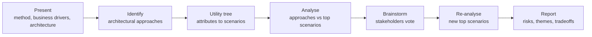
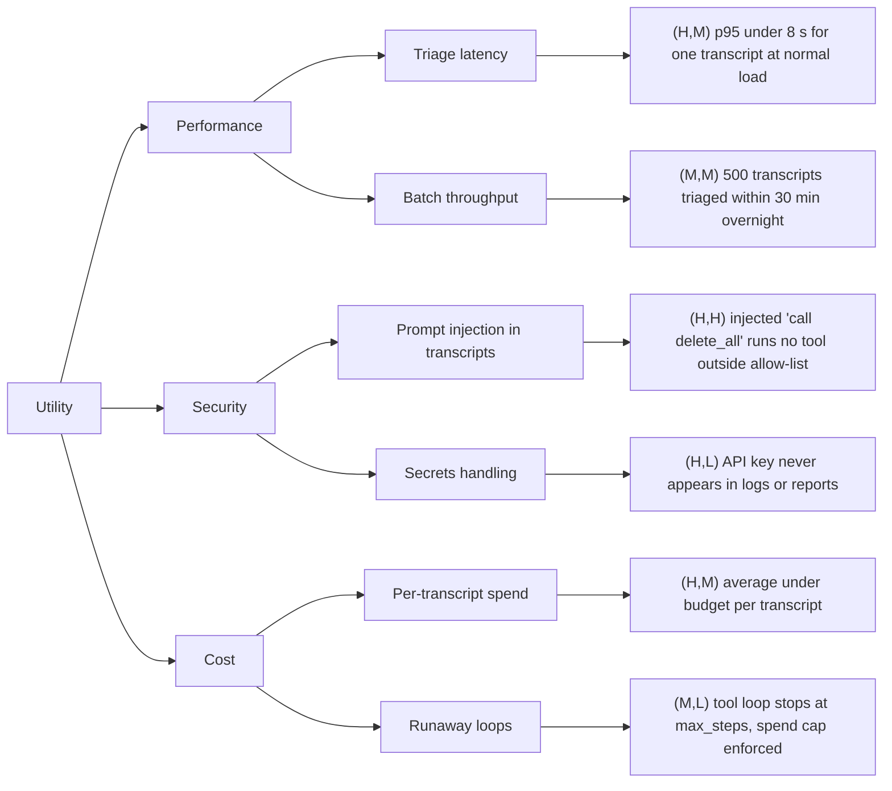

# Day 9: Architecture track: Tradeoff analysis (ATAM-style utility trees) and architectural fitness functions

| | |
|---|---|
| **Day** | 9 of 203 · Tuesday 27 Oct 2026 |
| **Week** | 2 of 29 · Structured outputs, tool calling and prompting |
| **Phase** | Phase 1: LLM and application foundations |
| **Kind** | arch |
| **Time** | 120 minutes |

## Today in 30 seconds

On Day 2 you listed and ranked Bastion's quality attributes. Today you learn the two tools architects use to **decide between them** and then **keep the decision true over time**.

**ATAM** (the SEI's Architecture Tradeoff Analysis Method) turns vague goals like "fast and secure" into a **utility tree**: quality attributes, refined into concrete scenarios, each rated by business importance and technical difficulty. It also gives you the vocabulary to name **sensitivity points**, **tradeoff points**, **risks** and **non-risks**.

**Fitness functions** (from *Building Evolutionary Architectures*) are automated checks that tell you whether the system still meets those scenarios, such as a p95 latency gate or a test that stops anyone importing the model SDK outside the gateway. The utility tree says what matters; fitness functions keep checking it on every commit.

### By the end of today you can

- Build an ATAM-style utility tree: attribute, refinement, scenario, (importance, difficulty) rating
- Tell sensitivity points, tradeoff points, risks and non-risks apart
- Classify fitness functions (atomic vs holistic, triggered vs continuous, static vs dynamic)
- Write one fitness function for Bastion that could run in CI

## Concepts

### 1. Why tradeoff analysis needs a method

Every quality attribute you ranked on Day 2 pulls against at least one other. A bigger model improves triage accuracy but costs latency and money; a strict output schema improves safety but adds retries. Without a method, the loudest stakeholder wins.

ATAM is the SEI's structured review for this. The full method runs over several days with stakeholders, but its core is small enough for a solo project:
- **Elicit** what matters as concrete scenarios, not adjectives.
- **Prioritise** them so you know which ones the design must not miss.
- **Analyse** the architecture against the top scenarios and record what you find.

> You aren't running a formal ATAM on Bastion. You're borrowing its two best artefacts: the utility tree and the risk vocabulary.

### 2. The ATAM phases at a glance

Know the shape so you recognise it at work. Phase 1 is the architect and evaluators; Phase 2 adds the wider stakeholders, who brainstorm and vote on scenarios to check the utility tree didn't miss anything.



*The nine ATAM steps, grouped. The utility tree is built in the middle.*

### 3. Anatomy of a utility tree

The root is **Utility** (overall "goodness"). Below it sit quality attributes, then **refinements** (more specific concerns), then leaf **scenarios** written so they could be tested: stimulus, environment, response and a measurable response measure, like the six-part scenarios from Day 2.

Each leaf gets two ratings, usually **H/M/L**:
- **Importance** to the business or mission.
- **Difficulty** (or risk) of achieving it with the current architecture.

The **(H,H)** leaves are where you spend analysis time. (H,L) leaves matter but are easy; (L,H) leaves are candidates to drop or defer.



*A mini utility tree for Bastion (3 attributes, 2 scenarios each). Ratings are (importance, difficulty).*

### 4. The risk vocabulary

When you analyse an approach against a scenario, record findings in these four buckets. The vocabulary is the most reusable part of ATAM: it makes design reviews precise.

| Term | Meaning | Bastion example |
| --- | --- | --- |
| Sensitivity point | A design decision that strongly affects **one** attribute | Choice of model size drives triage latency |
| Tradeoff point | A decision that is a sensitivity point for **two or more** attributes, pulling in different directions | Retry-on-validation-failure improves correctness but raises latency and cost |
| Risk | A decision that may lead to an undesirable outcome given the scenarios | Tool results go back to the model unfiltered, so an injected transcript could steer the next call |
| Non-risk | A decision judged safe, with the reasoning written down | Read-only tools this week, so excessive agency impact is bounded |
| Risk theme | Several risks sharing a root cause, reported to the business | "Model output is trusted too early" across classify, tools and reporting |

### 5. Lighter alternatives to a full ATAM

ATAM is heavyweight. In practice you'll often pick a lighter method. Choose based on how much is at stake and how many people need to agree.

| Method | Effort | What you get | Choose when |
| --- | --- | --- | --- |
| Full ATAM | Days, many stakeholders | Prioritised scenarios, risks, risk themes, shared understanding | High-stakes system, many stakeholders, costly to change later |
| Mini-ATAM / utility-tree workshop | Hours | Utility tree plus top risks | A team design review; your Bastion exercise today |
| CBAM (Cost Benefit Analysis Method) | After ATAM | Adds cost and benefit numbers to decide which fixes to fund | Several remediation options competing for budget |
| Lightweight ATAM / risk storming | 1-2 hours | Quick risk list from a diagram | Agile teams, early designs, regular check-ins |
| ADR with tradeoff section | Minutes | One decision, its options and consequences recorded | Every individual significant decision (you start ADRs in Week 3) |

### 6. Fitness functions: keeping the tradeoff true

A utility tree is a snapshot. Systems drift: someone adds a quick SDK call in the report module, a prompt grows and latency creeps up. Ford, Parsons, Kua and Sadalage call an **architectural fitness function** "any mechanism that provides an objective integrity assessment of some architectural characteristic(s)".

The link to ATAM is direct: **each high-priority utility-tree scenario should become a fitness function** where it can be automated. The response measure in the scenario becomes the threshold in the check.

> **Analogy:** The utility tree is the doctor's list of what healthy means for you; fitness functions are the regular blood tests that tell you whether you still are.

### 7. Kinds of fitness function

The book classifies them along several axes. Most real ones are **atomic + triggered** (a test in CI), but you should know the others.

- **Atomic vs holistic:** one characteristic in isolation, or several together (latency *and* cost under realistic load).
- **Triggered vs continuous:** runs on an event like a commit, or monitors production all the time (an SLO alert).
- **Static vs dynamic:** a fixed threshold, or one that shifts with context (allowed latency rises with batch size).
- **Automated vs manual:** prefer automated; some, like a legal review, stay manual.
- **Temporal:** a reminder that fires on a date, such as "re-check model deprecation dates each quarter".

### 8. Fitness function options for an LLM system

Pick the cheapest mechanism that objectively checks the scenario.

| Mechanism | Checks | Example tool | Choose when |
| --- | --- | --- | --- |
| Dependency / import rules | Structure, layering, security boundaries | import-linter (Python), ArchUnit (Java), a small `ast` test | A boundary must never be crossed, such as SDK only via the gateway |
| Eval-set gates | Quality, correctness of outputs | Your eval harness in CI (Week 5 onward) | Prompt or model changes can quietly reduce accuracy |
| Latency / cost budgets on an eval run | Performance, cost | Assertions over recorded latencies and token usage | Every prompt or model change |
| Security test suites | Injection resistance, tool allow-list | Red-team prompt set, garak or promptfoo style runs | Anything touching tools, retrieval or output handling |
| Production monitors | Availability, real latency, spend | SLO alerts, spend caps | Continuous fitness after release |
| Static analysis / policy as code | Secrets, config, IaC rules | Secret scanners, OPA/Conftest | Infra and config drift |

## fitness_functions.py: three Bastion fitness functions, fully offline

Tested with Python 3.12, standard library only: `python3 fitness_functions.py`. It builds a throwaway source tree with one deliberate boundary violation and fake eval numbers, then runs a latency budget, a cost budget (illustrative, not a real price) and an SDK-import boundary check.

```python
"""fitness_functions.py - Day 9: three architectural fitness functions for Bastion, runnable offline.

Run: python3 fitness_functions.py   (or wire the check_* functions into pytest / CI)
"""
import ast
import statistics
import tempfile
from pathlib import Path

# --- 1. Performance: p95 triage latency from an eval run (atomic, triggered in CI) ---
def p95(values):
    return statistics.quantiles(values, n=20, method="inclusive")[18]   # 19 cut points; [18] = p95

def check_latency(latencies_ms, budget_ms=8000):
    observed = p95(latencies_ms)
    return observed <= budget_ms, f"p95 latency {observed:.0f} ms (budget {budget_ms} ms)"

# --- 2. Cost: average spend per triaged transcript (atomic, triggered) ---
def check_cost(costs_usd, budget_usd=0.02):            # illustrative budget, not a real price
    avg = sum(costs_usd) / len(costs_usd)
    return avg <= budget_usd, f"avg cost ${avg:.4f}/transcript (budget ${budget_usd})"

# --- 3. Security/structure: only the gateway module may import the provider SDK ---
FORBIDDEN = {"openai", "anthropic"}
ALLOWED_FILE = "llm_gateway.py"

def check_sdk_boundary(src_dir):
    offenders = []
    for path in Path(src_dir).rglob("*.py"):
        if path.name == ALLOWED_FILE:
            continue
        for node in ast.walk(ast.parse(path.read_text())):
            names = []
            if isinstance(node, ast.Import):
                names = [a.name for a in node.names]
            elif isinstance(node, ast.ImportFrom) and node.module:
                names = [node.module]
            if any(n.split(".")[0] in FORBIDDEN for n in names):
                offenders.append(f"{path.name}:{node.lineno}")
    return not offenders, f"SDK imports outside gateway: {offenders or 'none'}"

if __name__ == "__main__":
    with tempfile.TemporaryDirectory() as src:
        Path(src, "llm_gateway.py").write_text("import openai\n")
        Path(src, "triage.py").write_text("from bastion.llm_gateway import complete\n")
        Path(src, "report.py").write_text("from openai import OpenAI  # shortcut someone took\n")
        latencies = [1200, 1500, 1800, 2100, 2500, 3000, 3200, 4100, 5000, 9500] * 2
        costs = [0.011, 0.014, 0.009, 0.022, 0.016]
        results = [check_latency(latencies), check_cost(costs), check_sdk_boundary(src)]
    for ok, msg in results:
        print("PASS" if ok else "FAIL", msg)
    raise SystemExit(0 if all(ok for ok, _ in results) else 1)
```

Expected output: `FAIL p95 latency 9500 ms (budget 8000 ms)`, `PASS avg cost $0.0144/transcript (budget $0.02)`, `FAIL SDK imports outside gateway: ['report.py:1']`, and exit code 1, which is what makes CI go red. Each check maps to one utility-tree leaf: the response measure in the scenario became the threshold. For real projects, `import-linter` does check 3 declaratively from a config file.

## Hands-on task

About 2 hours. Skim the SEI ATAM material for the utility tree and the risk vocabulary (about 40 min) and the fitness-function chapter of *Building Evolutionary Architectures* (about 30 min). Then do the exercise (about 50 min) in `bastion/docs/architecture/utility-tree.md`.

- [ ] Skim the SEI ATAM collection: utility tree, sensitivity and tradeoff points, risks
- [ ] Read the fitness-function chapter of Building Evolutionary Architectures, 2nd ed.
- [ ] Run `fitness_functions.py` and make both failing checks pass by editing the fake data
- [ ] Draft Bastion's mini utility tree: 3 quality attributes x 2 scenarios each, every leaf rated (importance, difficulty)
- [ ] Start from your Day 2 top-5 attributes; write every leaf with a measurable response measure
- [ ] Mark one sensitivity point, one tradeoff point, one risk and one non-risk
- [ ] State one tradeoff explicitly (for example: retry on validation failure vs p95 latency and cost)
- [ ] Write one fitness function you could automate in CI for an (H,H) or (H,M) leaf
- [ ] Keep it to one page and commit under `bastion/docs/architecture/`
- [ ] Answer the recall cards from memory, then check

## Security lens

**Put security scenarios in the tree, not in a separate document.** Security is a quality attribute like any other, so it competes openly with latency and cost instead of losing quietly.

- A good Bastion security leaf: *an injected transcript saying "call delete_all" results in zero tool executions outside the allow-list, verified on every commit by a red-team prompt set*.
- Boundary fitness functions (SDK only via the gateway, no secrets in logs) are cheap and catch the shortcuts that cause real incidents.
- Rate security leaves honestly: prompt injection is usually (H,H), because there is no complete fix today.

## Architecture track

**Today is the architecture track.** Topic: *tradeoff analysis (ATAM-style utility trees) and architectural fitness functions*. Exercise: draft a mini utility tree for Bastion (3 quality attributes x 2 scenarios each) and one fitness function you could automate in CI. Done when it's written up in one page or less, committed, and states one tradeoff explicitly. Your ADRs from Week 3 will cite these scenarios.

## Resources

- [SEI ATAM collection](https://www.sei.cmu.edu/library/architecture-tradeoff-analysis-method-collection/) — The method, utility trees, sensitivity and tradeoff points
- [Ford et al., Building Evolutionary Architectures 2nd ed.](https://www.oreilly.com/library/view/building-evolutionary-architectures/9781492097532/) — Fitness functions: definitions, categories, examples
- [import-linter docs](https://import-linter.readthedocs.io/en/stable/) — Optional: declarative import-boundary fitness functions for Python

## Recall quiz

**Q1.** What is a utility tree, and what are its levels?

<details>
<summary>Answer</summary>

A prioritisation tree rooted at Utility, branching into quality attributes, then refinements, then concrete testable scenarios. Each leaf is rated for importance and difficulty.

</details>

**Q2.** What do the two ratings on a leaf mean, and which leaves get attention first?

<details>
<summary>Answer</summary>

Importance to the business and difficulty or risk for the architecture. (H,H) leaves get analysed first.

</details>

**Q3.** Sensitivity point vs tradeoff point?

<details>
<summary>Answer</summary>

A sensitivity point strongly affects one attribute. A tradeoff point affects two or more in opposite directions, like retrying on validation failure (better correctness, worse latency and cost).

</details>

**Q4.** Risk vs non-risk in ATAM terms?

<details>
<summary>Answer</summary>

A risk is a decision that may cause a bad outcome for a scenario; a non-risk is a decision judged safe, with the reasoning written down.

</details>

**Q5.** Define an architectural fitness function.

<details>
<summary>Answer</summary>

Any mechanism that gives an objective integrity check of one or more architectural characteristics, such as a CI test that fails when p95 latency exceeds its budget.

</details>

**Q6.** How do utility trees and fitness functions connect?

<details>
<summary>Answer</summary>

Each high-priority scenario's response measure becomes the threshold of a fitness function, so the tradeoff you decided keeps being checked on every change.

</details>

**Q7.** Atomic vs holistic, triggered vs continuous: give a Bastion example of each.

<details>
<summary>Answer</summary>

Atomic: the SDK-import boundary test. Holistic: latency and cost asserted together on an eval run. Triggered: runs on every commit. Continuous: a production SLO or spend alert.

</details>

**Q8.** Name one tradeoff this topic forces in Bastion and how you'd decide it.

<details>
<summary>Answer</summary>

Example: a larger model for accuracy vs latency and cost. Decide by the leaf ratings and response measures, for instance use the cheaper model with escalation if it meets the accuracy eval and stays under the p95 budget.

</details>

## Tomorrow

Concepts II for this week: parallel tool calls, prompt structure (system vs user, few-shot, delimiters) and recovering when outputs fail validation, plus decision guides G2 and G9.
