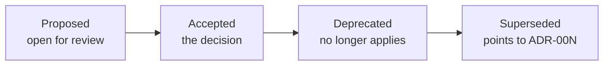
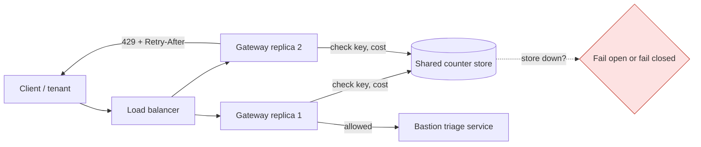

# Day 16: Architecture track: Documenting decisions: ADRs; first design kata

| | |
|---|---|
| **Day** | 16 of 203 · Tuesday 3 Nov 2026 |
| **Week** | 3 of 29 · Testing an LLM service (M1) |
| **Phase** | Phase 1: LLM and application foundations |
| **Kind** | arch |
| **Time** | 120 minutes |

## Today in 30 seconds

Today you start two habits that run through the whole roadmap: **writing down decisions** and **practising design on paper**.

An **Architecture Decision Record (ADR)** is a short text file, one per significant decision, with a fixed shape: *Title, Status, Context, Decision, Consequences* (Michael Nygard's 2011 format). ADRs are numbered, kept in the repo next to the code, and never rewritten: when a decision changes you write a new ADR that **supersedes** the old one. That history is what lets a reviewer, or you in six months, understand *why* the system looks the way it does.

Then you do **Kata #1: a distributed rate limiter**, using the 9-part kata template from Section 8. It's a classic because it forces real tradeoffs: accuracy vs latency, a shared store vs local counters, and fail-open vs fail-closed when that store goes down. It's also directly useful for Bastion, whose LLM gateway will need per-tenant token budgets. This is Architecture Checkpoint **A1**.

### By the end of today you can

- Write an ADR in Nygard's format and know when a decision deserves one
- Use statuses and supersession instead of editing old decisions
- Work through the 9-part kata template for a distributed rate limiter
- Compare token bucket, fixed window and sliding window algorithms, and state one tradeoff explicitly

## Concepts

### 1. What an ADR is, and why architects keep them

Code shows **what** the system does. It rarely shows **why**, or which alternatives were rejected. Nygard's point is that teams lose that reasoning fast, then either blindly accept old decisions or blindly reverse them.

An ADR is deliberately small: one decision, one to two pages at most, plain Markdown, committed under `docs/adr/` (Bastion: `bastion/docs/architecture/adr/`). Write one when a decision is **architecturally significant**: it affects structure, quality attributes, dependencies, interfaces or construction techniques, or it would be expensive to reverse.

> If a new teammate would ask "why on earth did they do it this way?", that's an ADR.

### 2. The five sections

Nygard's original template. Keep each section short and concrete.

| Section | What goes in it | Bastion example (ADR-001) |
| --- | --- | --- |
| Title | Numbered short noun phrase | ADR-001: Use structured JSON output with schema validation for triage |
| Status | Proposed, Accepted, Deprecated, or Superseded by ADR-NNN | Accepted |
| Context | The forces at play: requirements, constraints, quality attributes, facts. Neutral, no decision yet | Downstream code must parse verdicts; free text failed parsing in Week 2 tests; p95 budget is 8 s |
| Decision | What we will do, in active voice: "We will..." | We will request JSON matching the `Verdict` schema and retry once on validation failure |
| Consequences | Everything that follows, good *and* bad | Parse errors near zero; one retry adds latency and cost on failures; schema changes need a migration note |

### 3. Lifecycle: never edit, supersede

Once an ADR is **Accepted** it becomes history. If you change your mind, write a new ADR and mark the old one *Superseded by ADR-00N*. The log then tells the story of how the architecture evolved.



*Fixing typos is fine. Changing the decision means a new record.*

### 4. Good ADR habits

- **One decision per record.** "Use Postgres and Redis and Kubernetes" is three ADRs.
- **List the options you rejected** and why; that's the part people forget and most need.
- **Write consequences honestly**, including the costs. An ADR with only upsides is a sales pitch.
- **Link evidence:** the utility-tree scenario from Day 9, an eval result, a benchmark.
- **Keep it in the repo**, reviewed in a pull request like code.

### 5. Common ADR mistakes

- Writing it *after* the fact as paperwork, with no real alternatives considered
- A Context section that already argues for the answer
- Recording trivia (library minor versions) and missing the big calls
- Editing an accepted ADR so history disappears
- Hiding it in a wiki nobody opens

> Variants like MADR add an explicit *Considered Options* section. Any template works if you use it consistently.

> **Analogy:** An ADR log is like a ship's logbook: short entries, written at the time, never torn out, so anyone can reconstruct why the ship turned.

### 6. The design kata template (Section 8)

A kata is a timed design exercise on paper. You'll use the same nine headings for all four katas, so they become a portfolio for Checkpoint A3.

| # | Heading | For the rate limiter, answer... |
| --- | --- | --- |
| 1 | Problem and constraints | Limit what, per whom, how many requests/s at peak, how much added latency is OK? |
| 2 | API / interface | `check(key, cost) -> allow, remaining, retry_after`; HTTP 429 with `Retry-After` |
| 3 | High-level design | Where it runs (gateway, sidecar, library) and where counters live |
| 4 | Data model and consistency | Counter per key, TTL, atomic update; exact vs approximate |
| 5 | Failure modes | Store down or slow, clock skew, hot keys, retry storms |
| 6 | Security and tenancy | Key by authenticated tenant, not spoofable headers; per-tenant fairness |
| 7 | Tradeoffs | What you rejected and why |
| 8 | Fitness functions / SLOs | Added p99 latency, false-reject rate, over-admission under load |
| 9 | Open questions | Global vs per-region limits? Charge by tokens or requests? |

### 7. Rate-limit algorithms compared

The System Design Primer and most interview write-ups cover these four. All are valid; they trade accuracy, memory and burst behaviour.

| Algorithm | How it works | Pros | Cons | Choose when |
| --- | --- | --- | --- | --- |
| Fixed window counter | Count per key per clock window (e.g. per minute), reset at the boundary | Tiny state, one atomic increment | Up to 2x the limit can pass around a window boundary | Coarse quotas where edge bursts don't matter |
| Sliding window log | Store every request timestamp, count those in the last N seconds | Exact | Memory grows with traffic per key | Low-volume, high-value limits |
| Sliding window counter | Weighted blend of the current and previous fixed windows | Near-exact, small state | Approximate | A good general default for API limits |
| Token bucket | Tokens refill at a steady rate up to a capacity; each request spends tokens | Allows controlled bursts; supports *cost* per request | Two parameters to tune; bursts may surprise downstream | APIs with bursty clients, and LLM token budgets |

### 8. Where the limiter sits

For a distributed service, every gateway replica must agree on a key's usage, so counters usually live in a shared fast store such as Redis, updated atomically (a Lua script or `INCR` with expiry). The alternative is local counters per replica, which are faster but only approximate.



*Request path with a shared counter store. The red decision is the failure-mode choice you must write down.*

### 9. Failure modes worth writing down

- **Store unavailable:** *fail open* (allow, protect availability) or *fail closed* (reject, protect the backend and budget). Often: fail open with a local fallback limit.
- **Store slow:** put a tight timeout (a few ms) on the check; the limiter must not become the bottleneck.
- **Race conditions:** read-then-write lets two replicas both admit the last slot. Use atomic operations.
- **Hot keys:** one huge tenant hammers one shard; consider local pre-aggregation.
- **Retry storms:** rejected clients retry immediately; return `Retry-After` and expect backoff.

### 10. The LLM twist

Requests aren't equal in an LLM system: one call may use 200 tokens, another 20,000. Providers publish limits in both **requests per minute** and **tokens per minute**, and Bastion's gateway will need per-tenant **token budgets** too.

A token bucket handles this naturally: spend `cost = estimated tokens` instead of 1. You know input tokens before the call but output tokens only after, so reserve an estimate, then reconcile with the real usage.

## rate_limiter_kata.py: token bucket vs sliding window, plus a token budget

Tested with Python 3.12, standard library only: `python3 rate_limiter_kata.py`. It runs both algorithms on the same nominal policy (10 requests per 10 seconds) against a burst and a steady stream, then shows a token-bucket used as an LLM tokens-per-minute budget (numbers are illustrative).

```python
"""rate_limiter_kata.py - Day 16: compare two rate-limit algorithms for Kata #1, fully offline.

Run: python3 rate_limiter_kata.py
"""
from collections import deque


class TokenBucket:
    """Refills `rate` tokens/second up to `capacity`. Allows bursts up to capacity."""

    def __init__(self, rate, capacity):
        self.rate, self.capacity = rate, capacity
        self.tokens, self.last = capacity, 0.0

    def allow(self, now, cost=1):
        self.tokens = min(self.capacity, self.tokens + (now - self.last) * self.rate)
        self.last = now
        if self.tokens >= cost:
            self.tokens -= cost
            return True
        return False


class SlidingWindowLog:
    """At most `limit` requests in any rolling `window` seconds. Exact, but stores every timestamp."""

    def __init__(self, limit, window):
        self.limit, self.window, self.log = limit, window, deque()

    def allow(self, now):
        while self.log and self.log[0] <= now - self.window:
            self.log.popleft()
        if len(self.log) < self.limit:
            self.log.append(now)
            return True
        return False


def simulate(limiter, times):
    return sum(limiter.allow(t) for t in times)


if __name__ == "__main__":
    # Same nominal policy: 10 requests per 10 seconds for one tenant.
    burst = [0.0] * 15                                  # 15 requests at once
    steady = [i * 0.5 for i in range(40)]               # 2 req/s for 20 s
    for name, times in [("burst of 15", burst), ("steady 2 req/s for 20 s", steady)]:
        tb = simulate(TokenBucket(rate=1.0, capacity=10), times)
        sw = simulate(SlidingWindowLog(limit=10, window=10.0), times)
        print(f"{name:26s} token bucket allowed {tb:2d}/{len(times)}   sliding log allowed {sw:2d}/{len(times)}")
    # LLM twist: limit by tokens, not requests. A 6,000-token prompt costs 6 units of 1,000 tokens.
    tpm = TokenBucket(rate=10_000 / 60, capacity=10_000)  # 10k tokens/minute, illustrative
    print("token-budget: 6k prompt ->", tpm.allow(0.0, 6000), "| another 6k prompt ->", tpm.allow(1.0, 6000),
          "| after 30 s ->", tpm.allow(31.0, 6000))
```

Expected output: both allow `10/15` of the burst, but on the steady stream the token bucket allows `29/40` while the sliding log allows `20/40`. Same headline limit, different behaviour: the bucket starts full and refills at 1/s, so it admits its starting capacity *plus* the refill rate, while the sliding log never exceeds 10 in any 10 s window. The last line shows a 6,000-token prompt allowed, a second one rejected one second later, and allowed again after 30 s of refill. That difference is exactly the kind of tradeoff your kata should state. In a real deployment the state lives in a shared store and the update must be atomic.

## Hands-on task

About 2 hours. Read Nygard's post (about 15 min) and the rate-limiting material linked from the System Design Primer (about 25 min). Write ADR-001 for one real Bastion decision you've already made (about 20 min). Then spend about 60 min on Kata #1 using the 9 headings, committed under `bastion/docs/architecture/`.

- [ ] Read Nygard, Documenting Architecture Decisions
- [ ] Read the rate-limiting material in the System Design Primer
- [ ] Create `bastion/docs/architecture/adr/` with a template file
- [ ] Write ADR-001 for a decision you already made (for example structured JSON output, or the provider choice), listing at least one rejected option
- [ ] Run `rate_limiter_kata.py` and explain why the two algorithms allow different counts on the steady stream
- [ ] Write Kata #1 (rate limiter) with all 9 template headings, at most one page
- [ ] Pick an algorithm and a storage choice, and justify them with your scale assumptions
- [ ] Decide fail-open vs fail-closed and state that tradeoff explicitly
- [ ] Name one fitness function or SLO for the limiter
- [ ] Commit both files under `bastion/docs/architecture/`
- [ ] Answer the recall cards from memory, then check

## Security lens

**A rate limiter is a security control, so design it like one.**

- **Key on identity you trust:** the authenticated tenant or API key, never a client-supplied header like `X-Forwarded-For` that an attacker can rotate.
- **Limit cost, not just count:** for LLM endpoints, an attacker can burn your budget with a few huge prompts (OWASP LLM Top 10 lists unbounded consumption). Token budgets per tenant close that gap.
- **Fail-closed for expensive paths:** if the limiter's store is down, allowing unlimited calls to a paid model is a denial-of-wallet risk.
- **ADRs for security decisions** give auditors and reviewers the reasoning, not just the setting.

## Architecture track

**Today is the architecture track and Checkpoint A1.** Topic: *documenting decisions with ADRs; first design kata*. Exercise: Kata #1, a distributed rate limiter (requirements, API, data model, failure modes) using the Section 8 template, plus ADR-001. Done when it's written up in one page or less, committed, and states one tradeoff explicitly. A1 also expects a quality-attribute list for Bastion, which you already have from Day 2.

## Resources

- [Nygard, Documenting Architecture Decisions](https://cognitect.com/blog/2011/11/15/documenting-architecture-decisions) — The original ADR post and template
- [System Design Primer](https://github.com/donnemartin/system-design-primer) — Rate limiting, caching and scaling background for the kata
- [adr.github.io](https://adr.github.io/) — Optional: ADR templates (including MADR) and tooling

## Recall quiz

**Q1.** What are the five sections of a Nygard ADR?

<details>
<summary>Answer</summary>

Title, Status, Context, Decision, Consequences.

</details>

**Q2.** You change your mind about an accepted decision. What do you do with the old ADR?

<details>
<summary>Answer</summary>

Leave it in place, set its status to Superseded by the new ADR, and write a new ADR with the new decision and context.

</details>

**Q3.** What makes a decision worth an ADR?

<details>
<summary>Answer</summary>

It's architecturally significant: affects structure, quality attributes, dependencies or interfaces, or is expensive to reverse.

</details>

**Q4.** Why does a fixed window counter let up to twice the limit through?

<details>
<summary>Answer</summary>

A client can use the full limit at the end of one window and again at the start of the next, so two windows' worth passes in a short span.

</details>

**Q5.** Why is a token bucket a good fit for LLM rate limits?

<details>
<summary>Answer</summary>

Each request can spend a variable cost, such as its token count, and the bucket allows controlled bursts while enforcing a long-run rate.

</details>

**Q6.** Fail open vs fail closed when the counter store is down?

<details>
<summary>Answer</summary>

Fail open keeps the service available but removes protection; fail closed protects the backend and budget but causes outages. Choose per path and write it in the kata and ADR.

</details>

**Q7.** Why must the counter update be atomic in a distributed limiter?

<details>
<summary>Answer</summary>

Otherwise two replicas can read the same count and both admit a request, letting traffic exceed the limit.

</details>

**Q8.** Name one tradeoff this topic forces in Bastion and how you'd decide it.

<details>
<summary>Answer</summary>

Example: shared Redis counters (accurate, adds a network hop and a dependency) vs local per-replica counters (fast, approximate). Decide from the latency budget and how much over-admission the cost budget can tolerate.

</details>

## Tomorrow

Concepts II for testing an LLM service: assertion-based evals, sync vs streaming API design, and logging tokens, latency and cost, plus decision guide G13.
