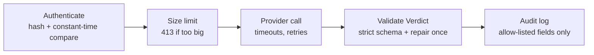

# Day 19: Recall + security lens: lock in Week 3 and harden the API (ADR-001)

| | |
|---|---|
| **Day** | 19 of 203 · Friday 6 Nov 2026 |
| **Week** | 3 of 29 · Testing an LLM service (M1) |
| **Phase** | Phase 1: LLM and application foundations |
| **Kind** | review |
| **Time** | 30 minutes |

## Today in 30 seconds

Friday is a short **recall day** for Week 3. Without notes, explain: testing non-deterministic systems, recorded HTTP fixtures, golden datasets, assertion-based evals, sync vs streaming API design, and logging tokens, latency and cost. Your gaps tell you what to revisit before the **M1 lab** on Saturday and Sunday.

Then the **security lens**: cap input size, authenticate with API keys that are **hashed at rest**, and write structured audit logs that **never contain secrets or raw transcripts**. Finish by drafting **ADR-001: provider abstraction and structured output strategy**.

### By the end of today you can

- Recall the six Week 3 concepts from memory and log your gaps
- Add input limits, hashed API-key auth and a clean audit log to Bastion's plan
- Draft ADR-001 (provider abstraction and structured output strategy)

## Concepts

### 1. How to do recall (10 minutes)

Same method as the last two Fridays. Close your notes. For each concept write two sentences: **what it is** and **where it shows up in Bastion**. Mark each green, amber or red, then check against the table below and the flip cards.

- Ambers and reds go in `notes/week-03.md` under *Gaps*.
- Re-read only the matching part of Days 15, 17 and 18.

> Anything still red from Week 2 goes on Saturday's TODO too.

> **Analogy:** Recall is a fire drill: find the blocked exit before the real fire, not during it.

### 2. Week 3 on one page

Use this as the answer key after you've written your own.

| Concept | One-line meaning | Where it shows up in Bastion |
| --- | --- | --- |
| Testing non-deterministic systems | Assert properties and invariants across samples, not one exact string | Verdict has a valid category, confidence in 0-1, and the quote really appears in the transcript |
| Recorded HTTP fixtures | Record one real provider response, replay it offline (vcrpy cassettes) | Unit tests run free and fast; secrets scrubbed from cassettes |
| Golden datasets | Labelled examples with expected outputs, run on every change | The 100-item set; accuracy and regressions tracked per commit |
| Assertion-based evals | Cheap always-true checks (schema, enums, contains, latency, cost) before any judge model | CI fails on a broken Verdict before LLM-as-judge is involved |
| Sync vs streaming API | One JSON body vs SSE; streaming improves time-to-first-token, not total time | `POST /v1/triage` and `POST /v1/triage/stream` with usage on the last event |
| Logging tokens, latency, cost | One structured line per request with metrics, no secrets | Audit/metrics log with tokens_in/out, latency_ms, cost_usd |

### 3. Security lens: three small controls

The API takes red-team transcripts, which are sensitive and sometimes hostile. Three cheap controls cover most of the early risk:

- **Input limits:** reject oversized bodies (HTTP 413) *before* any model call. This protects spend and latency, and maps to OWASP LLM10 Unbounded Consumption.
- **API-key auth, hashed at rest:** show a key once, store only its SHA-256 hash, compare in constant time. A leaked database then holds no usable keys. (High-entropy random keys are fine with a fast hash; passwords are different and need a slow one.)
- **Structured audit logs:** one JSON line per request, built from an **allow-list of fields**, so a careless extra argument can never leak a key or transcript.

### 4. What the request path looks like

Each gate runs before the next costs anything.



*Cheap checks first; log every outcome without secrets.*

### 5. ADR-001: provider abstraction and structured output strategy

Use the Day 16 shape: **Title, Status, Context, Decision, Consequences**. A reasonable first draft for Bastion:

- **Context:** two providers must be swappable; output must be a typed `Verdict`; tests must run offline.
- **Decision:** a small `LLMProvider` protocol (one method returning text plus usage); strict JSON schema from the Pydantic model where the provider supports it; validate in our code; one repair attempt, then `NeedsReview`.
- **Consequences:** easy to add a provider and to use FakeProvider in tests; we lose provider-specific features unless the protocol grows; schema features differ between providers, so the contract stays simple.

Mark it *Proposed* today and *Accepted* when M1 ships. Never edit it later: supersede it with a new ADR.

## api_guard.py: hashed key auth, size limit, safe audit log

Runs offline on Python 3.12 with only the standard library. The `__main__` block is the test: bad key gives 401, oversized input gives 413, and the success log line contains neither the key nor the transcript.

```python
# api_guard.py - Day 19: API-key auth (hashed at rest), input limit, safe audit log (offline)
import hashlib, hmac, json, secrets, time

MAX_CHARS = 20_000   # input limit: reject before spending tokens

def hash_key(key: str) -> str:
    return hashlib.sha256(key.encode()).hexdigest()

# Store ONLY hashes. A leaked database then holds no usable keys.
new_key = "bst_" + secrets.token_urlsafe(24)
KEY_HASHES = {hash_key(new_key): "analyst-1"}

def authenticate(presented: str) -> str | None:
    h = hash_key(presented)
    for stored, owner in KEY_HASHES.items():
        if hmac.compare_digest(stored, h):      # constant-time compare
            return owner
    return None

def audit(event: str, owner: str | None, **fields) -> str:
    """One JSON line per request. Allow-list the fields; never log keys or transcripts."""
    allowed = {"status", "tokens_in", "tokens_out", "latency_ms", "cost_usd", "transcript_chars"}
    safe = {k: v for k, v in fields.items() if k in allowed}
    return json.dumps({"ts": round(time.time()), "event": event, "owner": owner, **safe})

def handle(key: str, transcript: str) -> tuple[int, str]:
    owner = authenticate(key)
    if owner is None:
        return 401, audit("triage", None, status=401)
    if len(transcript) > MAX_CHARS:
        return 413, audit("triage", owner, status=413, transcript_chars=len(transcript))
    return 200, audit("triage", owner, status=200, tokens_in=812, tokens_out=64,
                      latency_ms=930, cost_usd=0.0021, transcript_chars=len(transcript),
                      api_key=key, transcript=transcript)   # extras are dropped by the allow-list

if __name__ == "__main__":
    assert handle("wrong", "x")[0] == 401
    assert handle(new_key, "a" * (MAX_CHARS + 1))[0] == 413
    code, line = handle(new_key, "secret transcript text")
    assert code == 200 and new_key not in line and "secret transcript" not in line
    print(line); print("ok: auth, size limit and clean audit log")
```

- Only `hash_key(key)` is stored, so a leaked table has no working keys.
- `hmac.compare_digest` avoids timing leaks.
- `audit()` keeps only allow-listed fields; `api_key` and `transcript` passed in by mistake are dropped.
- Turn the assertions into pytest tests so CI guards them.

## Hands-on task

30 minutes. Recall without notes (about 10 min). Check and log gaps (about 5 min). Security lens plus ADR-001 draft (about 15 min), or schedule them with a concrete step for the weekend.

- [ ] Write two-sentence answers for all six concepts without notes; mark green, amber or red
- [ ] Check against the table and flip cards; log gaps in `notes/week-03.md`
- [ ] Add a max-input-size check and a test that oversized input returns 413 before any provider call
- [ ] Store API keys as hashes only; add a test for the 401 path
- [ ] Make the audit log allow-list based; test that key and transcript never appear
- [ ] Draft `docs/adr/0001-provider-abstraction-and-structured-output.md` with status Proposed

## Security lens

**Logs are a leak path.** Red-team transcripts may contain real attack payloads or sensitive data. Log sizes and hashes, not content, and scrub secrets from recorded fixtures too.

## Architecture track

This week's architecture track (Tuesday 2026-11-03): **Documenting decisions: ADRs; first design kata**. Exercise: **Kata #1:** design a distributed rate limiter (requirements, API, data model, failure modes). Use the kata template in Section 8.

## Resources

- [OWASP LLM10:2025 Unbounded Consumption](https://genai.owasp.org/llmrisk/llm102025-unbounded-consumption/)
- [ADR examples and templates (adr.github.io)](https://adr.github.io/)

## Recall quiz

**Q1.** Why can't you test an LLM service with exact-match asserts?

<details>
<summary>Answer</summary>

Outputs vary between runs. Assert properties instead: valid schema, allowed enums, confidence range, quote present in the input.

</details>

**Q2.** What do recorded HTTP fixtures give you?

<details>
<summary>Answer</summary>

Offline, fast, free, repeatable tests using one real recorded provider response. Scrub secrets from cassettes.

</details>

**Q3.** What is a golden dataset for?

<details>
<summary>Answer</summary>

Labelled examples run on every change to detect accuracy regressions.

</details>

**Q4.** Why run assertion-based evals before an LLM judge?

<details>
<summary>Answer</summary>

They are cheap, deterministic and catch broken output immediately; judges are slower, costlier and noisier.

</details>

**Q5.** Does streaming make generation faster?

<details>
<summary>Answer</summary>

No. It lowers time-to-first-token, which is what users perceive; total time is about the same.

</details>

**Q6.** What belongs in a per-request log line?

<details>
<summary>Answer</summary>

Tokens in/out, latency, cost, status, owner and sizes. Never keys, secrets or raw transcripts.

</details>

**Q7.** How should API keys be stored?

<details>
<summary>Answer</summary>

Only as hashes; show the key once at creation; compare in constant time.

</details>

**Q8.** Why check input size before calling the model?

<details>
<summary>Answer</summary>

It protects spend and latency and is the cheapest defence against unbounded consumption.

</details>

**Q9.** What are the five ADR sections?

<details>
<summary>Answer</summary>

Title, Status, Context, Decision, Consequences.

</details>

**Q10.** An ADR decision changes. What do you do?

<details>
<summary>Answer</summary>

Write a new ADR that supersedes the old one; don't edit the old one.

</details>

## Tomorrow

Saturday: the M1 lab. Build the real providers behind `LLMProvider`, record fixtures with vcrpy, grow the golden set toward 100 items and finish both endpoints.
