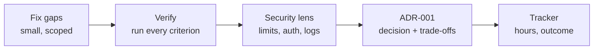

# Day 21: Finish, verify acceptance criteria and ship Milestone M1

| | |
|---|---|
| **Day** | 21 of 203 · Sunday 8 Nov 2026 |
| **Week** | 3 of 29 · Testing an LLM service (M1) |
| **Phase** | Phase 1: LLM and application foundations |
| **Kind** | ship |
| **Time** | 150 minutes |

## Today in 30 seconds

Today you **ship M1**. No new features: walk the acceptance criteria one by one, prove each with evidence, write **ADR-001** (provider abstraction and structured output strategy) and update your tracker.

A milestone is done when a reviewer can **verify** it, not when it feels done. Where a criterion fails, note a dated gap rather than hiding it. Plan about 2.5 hours.

### By the end of today you can

- Check every M1 acceptance criterion with evidence (or record a dated gap)
- Write ADR-001 and the security-lens note (input limits, hashed API keys, no secrets in logs)
- Commit the lab artefact and fill the tracker row in docs/PROGRESS.md

## Concepts

### 1. Ship checklist: criterion to evidence

For each criterion, decide in advance what a reviewer could run or read to confirm it.

| Criterion | Evidence |
| --- | --- |
| Schema validity on 100-item golden set, at most 1 repair retry | CI output: valid rate and repair count |
| Accuracy reported in CI | CI job summary line |
| Unit tests offline, nightly live promptfoo | `pytest` passes with network off; nightly job link |
| Per-request model, tokens, latency, cost logs | Sample log line |
| At least 10 prompt-injection cases pass | Test file and passing run |
| ADR-001 committed | File in docs/adr/ |

### 2. The ship flow

Verify first, document second, record last. Do not write the ADR from memory before the evidence is in.



*Finish then verify then document then track.*

### 3. What goes in ADR-001

An ADR records a decision, not a tutorial. Keep it to one page.

- **Context:** you need two providers and reliably structured verdicts.
- **Decision:** one `LLMProvider` interface; structured output via schema validation plus at most one repair retry.
- **Alternatives:** provider-native structured output only; free-text parsing; a heavy framework.
- **Consequences:** portability and testability gained; some provider-specific features unused; repair retries add latency and cost.
- **Status and date.**

### 4. Security lens for M1

- **Input limits:** cap transcript size and request rate.
- **API-key auth:** store only hashed keys; compare in constant time.
- **Audit logs:** structured, with model, tokens, latency and cost, and **never** secrets, keys or raw sensitive prompts.

## When to choose which

### G13. Evals

| Option | How it works | Pros | Cons | Choose when |
| --- | --- | --- | --- | --- |
| Code-based assertions | Deterministic checks: schema valid, contains/not contains, regex, tool called, test passes | Cheap, exact, fast | Only for checkable properties | Always first |
| Golden datasets (offline) | Curated inputs with expected outputs or labels, run in CI | Regression safety | Must be maintained; can go stale | Every LLM feature |
| LLM-as-judge: pointwise | Judge scores one output against criteria | Scales to open-ended outputs | Bias, drift, injection; must be calibrated | Fluency, faithfulness, policy compliance |
| LLM-as-judge: pairwise | Judge picks the better of two outputs | More reliable than absolute scores | Position bias (swap and average); needs a baseline | Comparing prompts/models |
| LLM-as-judge: rubric | Judge checks explicit, binary rubric items | Interpretable, more consistent | Rubric design effort | Complex outputs with clear criteria |
| Human evaluation | Experts label outputs | Ground truth; catches what metrics miss | Slow, expensive | Building gold sets; calibrating judges; high-stakes launches |
| Online evaluation | Score sampled production traces (judges, user feedback, implicit signals) | Real distribution; catches drift | Privacy; delayed signals | After launch, continuously |
| A/B testing | Split live traffic between variants, compare business metrics | Measures real impact | Needs traffic and time; guardrail metrics | Material prompt/model changes with enough users |
| Benchmarks | Public capability (MMLU-style), safety (HarmBench, JailbreakBench), agent (AgentDojo) suites | Comparable across models | Contaminated and not your product | Model selection shortlists only |

**Default:** code assertions + a golden set in CI; LLM-as-judge only after kappa with humans is acceptable; keep a private held-out adversarial set. Report confidence intervals (Miller, "Adding Error Bars to Evals").

Full guide: roadmap Section 9, [G13 Evals](../roadmap.md#g13-evals).

## check_m1.py: a tiny acceptance gate

Standard library only. Replace the sample numbers with your CI results. It fails loudly if a criterion is not met.

```python
# check_m1.py - run: python3 check_m1.py
results = {
    'golden_items': 100,
    'schema_valid': 100,
    'max_repairs_per_item': 1,
    'injection_cases_passed': 10,
    'adr_exists': True,
}
checks = [
    ('golden set size', results['golden_items'] >= 100),
    ('schema valid on all items', results['schema_valid'] == results['golden_items']),
    ('at most 1 repair retry', results['max_repairs_per_item'] <= 1),
    ('10+ injection cases pass', results['injection_cases_passed'] >= 10),
    ('ADR-001 committed', results['adr_exists']),
]
failed = [n for n, ok in checks if not ok]
for n, ok in checks:
    print(('PASS ' if ok else 'FAIL ') + n)
raise SystemExit(1 if failed else 0)
```

Wire the real numbers from your CI output into this and run it as the last CI step so M1 stays shipped.

## Hands-on task

Finish M1. Tick items as you confirm them.

- [ ] Every acceptance criterion checked off (or a dated gap noted)
- [ ] Week's lab artefact committed
- [ ] Security lens item written down
- [ ] ADR-001 written and committed
- [ ] Tracker row filled (hours, outcome, guides)

## Security lens

Input limits, API-key auth (hashed at rest) and structured audit logs that never log secrets. Grep your logs for keys before you call it shipped.

## Architecture track

This week's architecture track (Tuesday 2026-11-03): **Documenting decisions: ADRs; first design kata**. Exercise: **Kata #1:** design a distributed rate limiter (requirements, API, data model, failure modes). Use the kata template in Section 8.

## Recall quiz

**Q1.** What is the one-sentence outcome of this week?

<details>
<summary>Answer</summary>

A tested LLM-backed triage API with two providers, offline tests, a golden-set eval and injection tests, documented in ADR-001.

</details>

**Q2.** What would a reviewer challenge first?

<details>
<summary>Answer</summary>

Whether the golden set reflects real traffic and whether the injection cases are meaningful, so have evidence ready for both.

</details>

## Tomorrow

Phase 2 begins: model fundamentals, so you can explain why attacks work.
