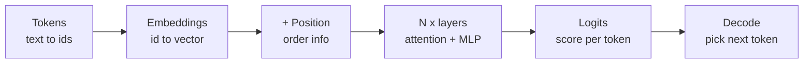
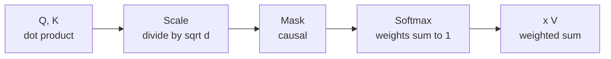

# Day 22: Transformer internals: concepts I

| | |
|---|---|
| **Day** | 22 of 203 · Monday 9 Nov 2026 |
| **Week** | 4 of 29 · Transformer internals |
| **Phase** | Phase 2: Model fundamentals and fine-tuning |
| **Kind** | concepts |
| **Time** | 45 minutes |

## Today in 30 seconds

A transformer turns text into **token embeddings**, mixes information between tokens with **self-attention**, and repeats this in layers on a shared **residual stream**. At the end it outputs **logits** for the next token; a **decoding strategy** picks one, and the **KV cache** avoids recomputing past work.

Today is concept reading: build one clear mental model, then tie each piece to Bastion. Plan about 45 minutes.

### By the end of today you can

- Explain the path from tokens to next-token logits in your own words
- Describe self-attention (Q, K, V), multi-head attention and why positional encoding is needed
- Explain the KV cache and name the main decoding strategies
- Skim G3 and note one choice relevant to Bastion

## Concepts

### 1. The big picture

Text is split into tokens, each token becomes a vector, a stack of layers refines the vectors, and the last position produces a score for every vocabulary token.



*Tokens to next-token choice.*

### 2. Embeddings and positional encoding

An **embedding** is a learned vector for each token id; similar usage tends to give nearby vectors. Attention itself has no sense of order, so **positional encoding** (sinusoidal in the original paper; learned or rotary in many newer models) injects position.

> Without position, 'dog bites man' and 'man bites dog' look the same to attention.

**Bastion example:** a triage transcript's wording and order both matter, and a long transcript uses up context window tokens, not characters.

### 3. Self-attention: Q, K, V

Each token makes a **query** (what I look for), a **key** (what I offer) and a **value** (what I pass on). Score = query dot key, scaled by sqrt(d), then **softmax** gives weights, and the output is the weighted sum of values.

- In decoder models a **causal mask** stops a token seeing later tokens.
- Cost grows with the square of sequence length, which is why long contexts are expensive.



*One attention head.*

### 4. Multi-head attention and the residual stream

**Multi-head attention** runs several smaller attention heads in parallel, so different heads can track different relations (for example syntax versus reference). Outputs are concatenated and projected.

The **residual stream** is the running vector per token: each attention or MLP block *adds* its output to it (`x = x + block(x)`). Think of it as a shared notebook that every layer reads from and writes to.

### 5. Logits, next-token prediction and decoding

The final vector is projected to **logits**, one score per vocabulary token. Softmax turns them into probabilities. The model only ever predicts the next token; text is produced by repeating.

| Strategy | How it picks | Use when |
| --- | --- | --- |
| Greedy | Highest probability | Deterministic, extraction, classification |
| Temperature | Rescales logits before softmax (low = sharper) | Tuning creativity versus consistency |
| Top-k | Sample from k most likely | Cut off the long tail |
| Top-p (nucleus) | Sample from smallest set with cumulative p | Adaptive tail cutoff |
| Beam search | Keep several best partial sequences | Translation-style tasks; less common for chat |

### 6. KV cache

When generating token n+1, the keys and values of tokens 1..n are unchanged. The **KV cache** stores them so each step only computes the new token's Q, K and V.

- Big speed-up for generation.
- Memory grows with sequence length, layers and batch size, so it often limits serving capacity (you will meet this again in model serving).

**Bastion example:** a long shared system prompt is a good candidate for prefix caching where your provider supports it.

### 7. Bastion connections

- **Structured verdicts:** use low temperature or greedy decoding for consistent JSON.
- **Prompt injection:** attention treats all context tokens alike, with no hard boundary between instructions and data. That is why input separation and validation matter.
- **Cost:** you pay for tokens in and out; context length drives latency and memory.

## When to choose which

### G3. Adapting models

Skim G3 and note which choice matters most for Bastion's cost and latency.

| Option | How it works | Pros | Cons | Choose when |
| --- | --- | --- | --- | --- |
| Prompting only | Instructions and examples in context | Zero training; instant iteration | Limited by context and base behaviour | Always try first |
| RAG | Retrieve relevant documents at query time and put them in context | Fresh, citable, permission-aware knowledge; no training | Retrieval quality is the bottleneck; injection surface | Knowledge that changes or must respect access control |
| Long context | Put whole documents in the window | Simple; no retrieval pipeline | Cost and latency per call; attention degrades mid-context | Few, bounded documents per request; analysis of one large artefact |
| Full fine-tuning | Update all weights on your data | Maximum adaptation | Expensive; needs lots of data; risk of forgetting and safety regression | Rarely; large orgs with big datasets and strong reasons |
| LoRA | Train small low-rank adapter matrices, freeze base weights | Cheap, small artefacts, swappable adapters | Slightly less capacity than full FT | Teaching format, style, task behaviour, classification |
| QLoRA | LoRA on a 4-bit quantised base model | Fine-tune 7-70B models on one GPU | Slower training; quantisation noise | Budget fine-tuning of mid-size models |
| Other adapters (prefix/prompt tuning, IA3) | Learn small extra vectors or scaling factors | Tiny parameter counts | Usually weaker than LoRA for LLMs | Very constrained memory or many tenants' adapters |
| RLHF (PPO with reward model) | Train a reward model on human preferences, optimise the policy against it | Strong alignment to preferences | Complex, unstable, costly | Frontier-lab-scale alignment work |
| DPO | Optimise directly on preference pairs (chosen vs rejected), no reward model | Simpler and stable; popular default for preference tuning | Needs good preference pairs | Steering tone, refusals, helpfulness with pairwise data |
| ORPO | Combines SFT and preference optimisation in one step without a reference model | One stage, cheaper | Newer, less battle-tested | Small teams doing SFT + preference in one pass |
| GRPO | RL using group-relative rewards from multiple sampled answers, no value model | Effective for verifiable tasks (maths, code) | Needs reward functions; RL complexity | Training reasoning on tasks with automatic checkers |
| Distillation | A strong teacher labels data; a smaller student learns from it | Big cost/latency reduction | Student inherits teacher errors; check provider terms on using outputs | High-volume narrow task once a big model performs it well |
| Continued pre-training | More next-token training on a large domain corpus | Deep domain fluency (language, jargon) | Expensive; needs lots of text; can erode instruction following | Very specialised domains with large unlabelled corpora |

**Default:** prompting, then RAG for knowledge, then LoRA/QLoRA for behaviour or cost, then distillation for scale. Fine-tuning rarely adds reliable new facts; RAG usually wins for knowledge.

Full guide: roadmap Section 9, [G3 Adapting models](../roadmap.md#g3-adapting-models).

## attention.py: toy attention and temperature

Standard library only; output verified. Tiny numbers, but the same maths as a real head: scaled dot product, causal mask, softmax, then temperature on logits.

```python
# attention.py - run: python3 attention.py  (standard library only)
import math

def softmax(xs):
    m = max(xs)
    es = [math.exp(x - m) for x in xs]
    s = sum(es)
    return [e / s for e in es]

def dot(a, b):
    return sum(x * y for x, y in zip(a, b))

# 3 tokens, 2-dim toy vectors (query, key, value per token)
Q = [[1.0, 0.0], [0.0, 1.0], [1.0, 1.0]]
K = [[1.0, 0.0], [0.0, 1.0], [1.0, 1.0]]
V = [[1.0, 2.0], [3.0, 4.0], [5.0, 6.0]]
d = 2

for i, q in enumerate(Q):
    scores = [dot(q, k) / math.sqrt(d) for k in K]
    # causal mask: token i may only look at tokens 0..i
    scores = [s if j <= i else float('-inf') for j, s in enumerate(scores)]
    w = softmax(scores)
    out = [sum(w[j] * V[j][c] for j in range(3)) for c in range(2)]
    print(f"token {i}: weights={[round(x, 3) for x in w]} output={[round(x, 3) for x in out]}")

# next-token logits -> probabilities, with temperature
logits = {'cat': 2.0, 'dog': 1.0, 'car': 0.1}
for T in (0.5, 1.0, 2.0):
    p = softmax([v / T for v in logits.values()])
    print('T=%.1f' % T, {k: round(x, 3) for k, x in zip(logits, p)})
```

Token 0 can only see itself (weight 1.0); later tokens spread weight over earlier ones. Lower temperature sharpens the distribution (cat 0.864 at T=0.5 versus 0.502 at T=2.0).

## Hands-on task

Read the two resources, then write your note.

- [ ] Read The Illustrated Transformer
- [ ] Skim Attention Is All You Need (section 3 is enough)
- [ ] Write bastion/notes/week-04.md with a section per concept and one Bastion example each
- [ ] Answer the recall prompts from memory, then check
- [ ] Commit the note

## Security lens

The model sees one flat token stream — no hardware boundary between instructions and data. Read Greshake et al., indirect prompt injection: <https://arxiv.org/abs/2302.12173>.

## Architecture track

This week's architecture track (Tuesday 2026-11-10): **Data-intensive systems: reliability, scalability, maintainability**. Exercise: Rewrite Bastion's non-functional requirements using DDIA's reliability/scalability/maintainability vocabulary.

## Resources

- Jay Alammar, The Illustrated Transformer: <https://jalammar.github.io/illustrated-transformer/>
- Vaswani et al., Attention Is All You Need: <https://arxiv.org/abs/1706.03762>

## Recall quiz

**Q1.** Why do transformers need positional encoding?

<details>
<summary>Answer</summary>

Self-attention is order-agnostic; position information must be added to the embeddings so word order is represented.

</details>

**Q2.** What does the KV cache store and why?

<details>
<summary>Answer</summary>

The keys and values of past tokens, so each new token only computes its own Q, K, V instead of reprocessing the whole sequence.

</details>

**Q3.** What does lowering temperature do?

<details>
<summary>Answer</summary>

Divides logits by a smaller T before softmax, making the distribution sharper so likely tokens dominate.

</details>

**Q4.** What is the residual stream?

<details>
<summary>Answer</summary>

The per-token vector that each block adds its output to (x = x + block(x)), read and written by every layer.

</details>

## Tomorrow

Transformer internals: concepts II.
