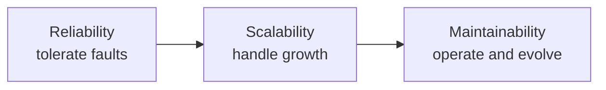

# Day 23: Architecture track: Data-intensive systems: reliability, scalability, maintainability

| | |
|---|---|
| **Day** | 23 of 203 · Tuesday 10 Nov 2026 |
| **Week** | 4 of 29 · Transformer internals |
| **Phase** | Phase 2: Model fundamentals and fine-tuning |
| **Kind** | arch |
| **Time** | 120 minutes |

## Today in 30 seconds

Kleppmann's *Designing Data-Intensive Applications* gives three words for judging any data system: **reliability** (keeps working when things go wrong), **scalability** (copes as load grows) and **maintainability** (people can operate and change it). Today you restate Bastion's non-functional requirements in this vocabulary and name one tradeoff. Plan about 2 hours.

### By the end of today you can

- Define reliability, scalability and maintainability with precise sub-terms (faults vs failures, load parameters, percentiles, operability/simplicity/evolvability)
- Rewrite Bastion's non-functional requirements using this vocabulary and commit under bastion/docs/architecture/

## Concepts

### 1. The three concerns

- **Reliability:** continues to work correctly even when faults occur (hardware, software, human).
- **Scalability:** a reasonable way to deal with growth in load, data volume or complexity.
- **Maintainability:** many different people can work on it productively over time.

They often pull against each other, so naming which one wins in a decision is the architect's job.

*Three lenses for one system.*

### 2. Reliability: faults vs failures

A **fault** is one component deviating from spec; a **failure** is the whole system stopping service. Goal: fault-tolerance so faults do not become failures.

| Fault | Example | Mitigation |
| --- | --- | --- |
| Hardware | Host dies | Replicas, health checks |
| Software | Bad release, provider outage | Canary, retries, fallback |
| Human | Wrong config | Review, rollback |

### 3. Scalability: describe load, then performance

Pick **load parameters** (requests/sec, tokens per request, concurrent sessions, documents indexed). Then measure performance with **percentiles**, not averages: p50 is typical, p95/p99 are tail latency. Tail latency matters because slow calls compound when a request fans out to many backends.

Scaling up (bigger machine) is simple; scaling out (more machines) adds distribution complexity. Elastic systems suit unpredictable load; manual scaling is simpler to reason about.

| Item | Value (ms) |
| --- | --- |
| p50 | 800 |
| p95 | 2400 |
| p99 | 6000 |

*Bar chart — p50: 800ms, p95: 2400ms, p99: 6000ms.*

*Illustrative latency percentiles (example numbers, ms).*

### 4. Maintainability: three sub-goals

- **Operability:** make routine operations easy (observability, runbooks, sane defaults).
- **Simplicity:** remove accidental complexity through good abstractions.
- **Evolvability:** make change easy (modular design, tests, swappable model/provider).

### 5. Turning vague requirements into measurable ones

Replace 'fast and reliable' with: *'99% of triage verdicts return within 5 s; 99.5% monthly availability; a provider outage degrades to a queued response rather than an error.'* Each requirement gets a metric, a target and a measurement window (an SLI, SLO pairing).

## Hands-on task

Read Part I (chapter 1) of DDIA, then do the exercise.

- [ ] Read DDIA Part I / chapter 1 (reliability, scalability, maintainability)
- [ ] List Bastion's current non-functional requirements
- [ ] Rewrite each under reliability, scalability or maintainability with a metric and target
- [ ] State one explicit tradeoff (e.g. latency vs cost, or availability vs consistency)
- [ ] Keep it to one page and commit under bastion/docs/architecture/

## Security lens

The model sees one flat token stream — no hardware boundary between instructions and data. Read Greshake et al., indirect prompt injection: <https://arxiv.org/abs/2302.12173>.

## Architecture track

Exercise: rewrite Bastion's non-functional requirements using DDIA's vocabulary. Done when it is at most 1 page, committed, and one tradeoff is stated.

## Resources

- [DDIA book site](https://dataintensive.net/) — Part I foundations; 2nd ed. also on O'Reilly

## Recall quiz

**Q1.** Difference between a fault and a failure?

Answer

A fault is one component deviating from spec; a failure is the system as a whole no longer providing service.

**Q2.** Why use percentiles rather than average latency?

Answer

Averages hide the slow tail; p95/p99 show what unlucky users experience.

**Q3.** Name the three sub-goals of maintainability.

Answer

Operability, simplicity, evolvability.

**Q4.** Name one tradeoff in Bastion between these concerns.

Answer

Example: adding fallback models improves reliability but raises cost and operational complexity.

## Tomorrow

Next plan day.
