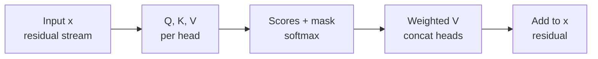

# Day 24: Transformer internals: concepts II + decision guides

| | |
|---|---|
| **Day** | 24 of 203 · Wednesday 11 Nov 2026 |
| **Week** | 4 of 29 · Transformer internals |
| **Phase** | Phase 2: Model fundamentals and fine-tuning |
| **Kind** | concepts |
| **Time** | 90 minutes |

## Today in 30 seconds

Day 22 built the mental model; today you go one level deeper on the parts that decide **cost, latency and behaviour**: how position is encoded, why attention uses several **heads**, how **decoding strategies** (greedy, temperature, top-k, top-p) reshape the logits, and how the **KV cache** trades memory for speed. Then you skim decision guide **G3** and note one choice that matters for Bastion. Plan about 90 minutes: ~50 watching/reading, ~25 running the code, ~15 on the note.

### By the end of today you can

- Explain embeddings, self-attention, multi-head attention, positional encoding, the residual stream, logits and the KV cache, and choose a decoding strategy for a task
- Skim G3 and note one choice relevant to Bastion; write the week-04 note with one Bastion example per concept

## Concepts

### 1. Embeddings and positional encoding, deeper

An **embedding** is a row in a learned table: token id → vector (typically thousands of numbers). Similar usage gives nearby vectors. Attention alone is **order-blind** (it sees a set of vectors), so position must be injected:
- **Sinusoidal / learned absolute:** add a position vector to the embedding (original paper; the code below prints it).
- **Rotary (RoPE):** rotate query/key vectors by an angle that depends on position, so attention scores depend on *relative* distance. Common in current open models.
- **ALiBi:** subtract a distance-proportional penalty from attention scores.

Why it matters: position scheme limits **context length** and how well a model extends beyond what it was trained on.

| Scheme | How position enters | Notes |
| --- | --- | --- |
| Sinusoidal | Added to input embedding | Fixed, no parameters |
| Learned absolute | Added; table is trained | Hard cap at trained length |
| RoPE | Rotates Q and K | Relative; widely used; extendable with scaling tricks |
| ALiBi | Bias on attention scores | Extrapolates to longer inputs reasonably |

### 2. Self-attention and multi-head attention

Each token makes a **query** (what am I looking for), **key** (what do I offer) and **value** (what I pass on). Scores = Q·K / √d, a **causal mask** hides future tokens, softmax makes weights, output = weighted sum of values.

**Multi-head:** run several smaller attention computations in parallel, each with its own Q/K/V projections, then concatenate and project. Different heads can specialise (e.g. nearby words, matching brackets, copying earlier names). Variants cut memory: **MQA** shares one K/V set across all heads; **GQA** shares K/V within groups (a middle ground). These matter in section 5.



*One attention block, simplified.*

### 3. The residual stream and the rest of a layer

Think of the **residual stream** as a shared whiteboard of one vector per token. Every attention block and every **MLP (feed-forward) block** reads it, computes something, and **adds** its result back (`x = x + f(norm(x))`). Because layers only add, early information survives to the end, and gradients flow through deep stacks. Roughly: attention moves information *between* tokens; the MLP transforms information *within* a token and stores much of the model's learned facts. Repeat for N layers, then project the final vector to the vocabulary.

### 4. Logits and decoding strategies

The last vector becomes **logits**: one raw score per vocabulary token. Softmax turns them into probabilities; a **decoding strategy** chooses the token. Generation is repeated one token at a time.
- **Greedy:** always take the top token. Deterministic, can loop or be bland.
- **Temperature:** divide logits by T before softmax. T<1 sharper, T>1 flatter. T→0 approaches greedy.
- **Top-k:** keep only the k most likely tokens, renormalise, sample.
- **Top-p (nucleus):** keep the smallest set whose cumulative probability ≥ p, sample.
- **Beam search:** track several candidate sequences; useful in translation, rare for chat.

Note: even temperature 0 is not guaranteed bit-identical across hardware/batching, so do not assume perfect determinism.

| Item | Value (%) |
| --- | --- |
| T=0.5 | 66.2 |
| T=1.0 | 48.2 |
| T=2.0 | 35.6 |

*Bar chart — T=0.5: 66.2%, T=1.0: 48.2%, T=2.0: 35.6%.*

*Probabilities after softmax at temperature 0.5 vs 1.0 for token 'the' (from the code below).*

### 5. KV cache: memory for speed

When generating token n+1, the keys and values of tokens 1..n do not change, so they are **cached** and only the new token's Q/K/V are computed. Without it, each step recomputes the whole prefix. The cost is memory, which grows linearly with **context length x concurrent requests**:

`bytes = 2 x layers x kv_heads x head_dim x bytes_per_value x tokens x batch`

This is why **GQA/MQA**, quantised KV caches, paged allocation (as in vLLM) and **prefix/prompt caching** matter: they cut the dominant serving cost. The code below shows a 4x saving from GQA on an illustrative 8B-class shape.

| Item | Value (GiB) |
| --- | --- |
| 32 KV heads (MHA) | 64 |
| 8 KV heads (GQA) | 16 |

*Bar chart — 32 KV heads (MHA): 64GiB, 8 KV heads (GQA): 16GiB.*

*KV cache for 16 concurrent 8k-token sequences (GiB, illustrative 8B-class shape, fp16).*

### 6. Prefill vs decode

Serving has two phases. **Prefill** processes the whole prompt in parallel (compute-bound; sets **time-to-first-token**). **Decode** produces one token per step reading the KV cache (memory-bandwidth-bound; sets **tokens per second**). Long prompts hurt TTFT; long outputs and many users hurt decode throughput and cache memory.

### 7. Bastion connections

- **Embeddings:** retrieval of past incidents/runbooks uses embeddings; model choice affects recall.
- **Attention/context:** long logs crowd the context; truncate or summarise before sending.
- **Decoding:** triage verdicts use low temperature for stable output; creative test-case generation can use higher.
- **KV cache / prompt caching:** keep the long static system prompt first so the prefix is cacheable.
- **Logits:** structured-output and classification can read token probabilities as a confidence signal.

## When to choose which

### G3. Adapting models

Skim G3 and note one choice that matters most for Bastion: for example, which model size/serving option fits the latency and cost target, given what the KV cache and decoding cost imply.

| Option | How it works | Pros | Cons | Choose when |
| --- | --- | --- | --- | --- |
| Prompting only | Instructions and examples in context | Zero training; instant iteration | Limited by context and base behaviour | Always try first |
| RAG | Retrieve relevant documents at query time and put them in context | Fresh, citable, permission-aware knowledge; no training | Retrieval quality is the bottleneck; injection surface | Knowledge that changes or must respect access control |
| Long context | Put whole documents in the window | Simple; no retrieval pipeline | Cost and latency per call; attention degrades mid-context | Few, bounded documents per request; analysis of one large artefact |
| Full fine-tuning | Update all weights on your data | Maximum adaptation | Expensive; needs lots of data; risk of forgetting and safety regression | Rarely; large orgs with big datasets and strong reasons |
| LoRA | Train small low-rank adapter matrices, freeze base weights | Cheap, small artefacts, swappable adapters | Slightly less capacity than full FT | Teaching format, style, task behaviour, classification |
| QLoRA | LoRA on a 4-bit quantised base model | Fine-tune 7-70B models on one GPU | Slower training; quantisation noise | Budget fine-tuning of mid-size models |
| Other adapters (prefix/prompt tuning, IA3) | Learn small extra vectors or scaling factors | Tiny parameter counts | Usually weaker than LoRA for LLMs | Very constrained memory or many tenants' adapters |
| RLHF (PPO with reward model) | Train a reward model on human preferences, optimise the policy against it | Strong alignment to preferences | Complex, unstable, costly | Frontier-lab-scale alignment work |
| DPO | Optimise directly on preference pairs (chosen vs rejected), no reward model | Simpler and stable; popular default for preference tuning | Needs good preference pairs | Steering tone, refusals, helpfulness with pairwise data |
| ORPO | Combines SFT and preference optimisation in one step without a reference model | One stage, cheaper | Newer, less battle-tested | Small teams doing SFT + preference in one pass |
| GRPO | RL using group-relative rewards from multiple sampled answers, no value model | Effective for verifiable tasks (maths, code) | Needs reward functions; RL complexity | Training reasoning on tasks with automatic checkers |
| Distillation | A strong teacher labels data; a smaller student learns from it | Big cost/latency reduction | Student inherits teacher errors; check provider terms on using outputs | High-volume narrow task once a big model performs it well |
| Continued pre-training | More next-token training on a large domain corpus | Deep domain fluency (language, jargon) | Expensive; needs lots of text; can erode instruction following | Very specialised domains with large unlabelled corpora |

**Default:** prompting, then RAG for knowledge, then LoRA/QLoRA for behaviour or cost, then distillation for scale. Fine-tuning rarely adds reliable new facts; RAG usually wins for knowledge.

Full guide: roadmap Section 9, [G3 Adapting models](../roadmap.md#g3-adapting-models).

## deep_dive.py: position encoding, decoding strategies, KV cache size

Standard library only; run it and compare with the output shown. Numbers are toy/illustrative, the formulas are the real ones.

```python
# deep_dive.py - run: python3 deep_dive.py  (standard library only)
import math, random

def softmax(xs, T=1.0):
    xs = [x / T for x in xs]
    m = max(xs); es = [math.exp(x - m) for x in xs]; s = sum(es)
    return [e / s for e in es]

# 1) sinusoidal positional encoding (position 0..2, 4 dims)
def pos_enc(pos, dim=4):
    out = []
    for i in range(0, dim, 2):
        f = pos / (10000 ** (i / dim))
        out += [math.sin(f), math.cos(f)]
    return out
for p in range(3):
    print("pos", p, [round(x, 3) for x in pos_enc(p)])

# 2) decoding strategies on one logit vector
vocab  = ["the", "a", "cat", "dog", "zebra"]
logits = [3.0, 2.5, 2.0, 0.5, -1.0]
probs  = softmax(logits)
print("probs      ", {w: round(p, 3) for w, p in zip(vocab, probs)})
print("greedy     ", vocab[probs.index(max(probs))])

def top_k(ps, k):
    keep = sorted(range(len(ps)), key=lambda i: -ps[i])[:k]
    z = sum(ps[i] for i in keep)
    return {vocab[i]: round(ps[i] / z, 3) for i in keep}
def top_p(ps, p):
    order = sorted(range(len(ps)), key=lambda i: -ps[i]); keep, c = [], 0
    for i in order:
        keep.append(i); c += ps[i]
        if c >= p: break
    z = sum(ps[i] for i in keep)
    return {vocab[i]: round(ps[i] / z, 3) for i in keep}
print("top-k=2    ", top_k(probs, 2))
print("top-p=0.9  ", top_p(probs, 0.9))
for T in (0.5, 1.0, 2.0):
    print(f"T={T}       ", [round(x, 3) for x in softmax(logits, T)])
random.seed(0)
print("sampled x5 ", random.choices(vocab, probs, k=5))

# 3) KV cache memory: 2 (K and V) * layers * kv_heads * head_dim * bytes * tokens
def kv_bytes(layers, kv_heads, head_dim, tokens, dtype_bytes=2, batch=1):
    return 2 * layers * kv_heads * head_dim * dtype_bytes * tokens * batch
# Llama-style 8B shape (public architecture numbers): 32 layers, 8 KV heads (GQA), dim 128
for name, kvh in (("MHA 32 kv heads", 32), ("GQA  8 kv heads", 8)):
    g = kv_bytes(32, kvh, 128, 8192) / 2**30
    print(f"{name}: 8k ctx, 1 seq = {g:.2f} GiB; 16 seqs = {16*g:.1f} GiB")
```

Expected output (excerpt):
pos 0 [0.0, 1.0, 0.0, 1.0]
pos 1 [0.841, 0.54, 0.01, 1.0]
pos 2 [0.909, -0.416, 0.02, 1.0]
probs       {'the': 0.482, 'a': 0.292, 'cat': 0.177, 'dog': 0.04, 'zebra': 0.009}
greedy      the
top-k=2     {'the': 0.622, 'a': 0.378}
top-p=0.9   {'the': 0.506, 'a': 0.307, 'cat': 0.186}
T=0.5        [0.662, 0.244, 0.09, 0.004, 0.0]
MHA 32 kv heads: 8k ctx, 1 seq = 4.00 GiB; 16 seqs = 64.0 GiB
GQA  8 kv heads: 8k ctx, 1 seq = 1.00 GiB; 16 seqs = 16.0 GiB

Notice: top-p keeps 3 tokens here but would keep more on a flatter distribution (adaptive), while top-k always keeps exactly k. GQA with 8 KV heads cuts the cache 4x versus 32.

## Hands-on task

Watch Karpathy's *Let's build GPT* (the attention section is the key part; it is long, so take notes and pause) and skim the 3Blue1Brown neural-network and transformer chapters, then write the note.

- [ ] Watch/skim the listed resources (Karpathy: focus on self-attention and the transformer block)
- [ ] Run deep_dive.py and change the temperature or top-p to see the effect
- [ ] Write bastion/notes/week-04.md with a section per concept (embeddings, self-attention, multi-head, positional encoding, residual stream, logits, KV cache, decoding) and one Bastion example each
- [ ] Skim G3 and add one line: the choice most relevant to Bastion
- [ ] Answer the recall prompts from memory, then check
- [ ] Commit the note

## Security lens

The model sees one flat token stream — no hardware boundary between instructions and data. Read Greshake et al., indirect prompt injection: <https://arxiv.org/abs/2302.12173>.

## Architecture track

This week's architecture track (Tuesday 2026-11-10): **Data-intensive systems: reliability, scalability, maintainability**. Exercise: Rewrite Bastion's non-functional requirements using DDIA's reliability/scalability/maintainability vocabulary.

## Resources

- [Karpathy, Let's build GPT](https://www.youtube.com/watch?v=kCc8FmEb1nY) — Focus on the self-attention and transformer-block sections
- [3Blue1Brown neural networks series](https://www.3blue1brown.com/topics/neural-networks) — Includes the transformer and attention chapters

## Recall quiz

**Q1.** Why does a transformer need positional information?

<details>
<summary>Answer</summary>

Attention treats its inputs as an unordered set; without position signals the model could not tell 'dog bites man' from 'man bites dog'.

</details>

**Q2.** What does multi-head attention add over a single head?

<details>
<summary>Answer</summary>

Several parallel attention computations with separate projections, letting different heads capture different relationships; outputs are concatenated and projected.

</details>

**Q3.** What is the residual stream?

<details>
<summary>Answer</summary>

The per-token vector that each attention/MLP block reads and adds its output to, carrying information through all layers.

</details>

**Q4.** Temperature 0.5 vs 2.0: which is more deterministic and why?

<details>
<summary>Answer</summary>

0.5: dividing logits by a small T sharpens the distribution toward the top token; 2.0 flattens it.

</details>

**Q5.** Top-k vs top-p?

<details>
<summary>Answer</summary>

Top-k keeps a fixed number of tokens; top-p keeps the smallest set whose cumulative probability reaches p, so the set size adapts.

</details>

**Q6.** What does the KV cache save and what does it cost?

<details>
<summary>Answer</summary>

It saves recomputing keys/values of earlier tokens at each step; it costs memory that grows with context length and concurrent requests.

</details>

**Q7.** Name two ways to shrink KV cache cost.

<details>
<summary>Answer</summary>

GQA/MQA, quantised KV cache, paged allocation, prefix caching, shorter contexts.

</details>

**Q8.** Explain prefill vs decode.

<details>
<summary>Answer</summary>

Prefill processes the prompt in parallel (sets time to first token); decode generates token by token using the cache (sets tokens per second).

</details>

## Tomorrow

Day 25: lab prep for Transformer internals (about 60 minutes): set up the environment and write the lab's done criteria before coding.
