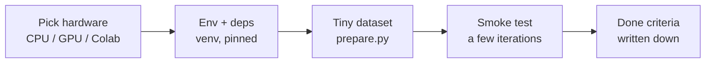

# Day 25: Lab prep: Transformer internals

| | |
|---|---|
| **Day** | 25 of 203 · Thursday 12 Nov 2026 |
| **Week** | 4 of 29 · Transformer internals |
| **Phase** | Phase 2: Model fundamentals and fine-tuning |
| **Kind** | lab-prep |
| **Time** | 60 minutes |

## Today in 30 seconds

Tomorrow-ish you will train a **tiny character-level GPT** with nanoGPT. Today is not about the model; it is about making the lab **cheap to start and easy to finish**: a clean environment, a tiny dataset, a smoke test that proves the training loop runs, and written **done criteria** so you know when to stop. Plan about 60 minutes: ~15 reading, ~30 setup, ~15 writing the plan.

### By the end of today you can

- Prepare the environment and scaffolding for the nanoGPT lab (deps, data, a smoke test)
- Write the lab's done criteria and risk list before coding

## Concepts

### 1. Why a lab-prep day exists

Most lab time is lost to **setup surprises**: wrong Python version, missing GPU, a dataset that is too large, no idea when to stop. A prep day removes them in advance.
- **Pin the environment** so the lab is reproducible.
- **Shrink the problem** so one run takes minutes, not hours.
- **Define done first** so you do not tinker forever.

The lab itself: train a small GPT on a text file (e.g. Shakespeare) at character level, then sample text from it. You will see loss fall and gibberish turn into word-like text.



*Lab-prep sequence.*

### 2. Choose where the lab will run

Character-level models with a small config are trainable even on a laptop CPU, just slowly. Pick one and note it.

| Option | Good for | Watch out for |
| --- | --- | --- |
| Laptop CPU | Zero cost, tiny config (few layers, small context) | Slow; use few iterations; fine for the learning goal |
| Free notebook GPU (e.g. Colab) | Faster full-size run | Session limits; save checkpoints; do not paste secrets |
| Rented cloud GPU | Larger experiments | Cost: set a budget cap and shut it down after |
| Apple silicon (MPS) | Decent speed locally | Some ops differ; follow the repo's notes |

### 3. The shape of a nanoGPT run

nanoGPT is a small, readable GPT implementation. The usual flow:
- `prepare.py` downloads a text file and writes **train/val** token files (for characters, vocab is ~65 symbols).
- `train.py` reads a config (layers, heads, embedding size, context length, batch size, learning rate, max iterations) and logs **train and validation loss**.
- `sample.py` loads the checkpoint and generates text, using the decoding settings you learned (temperature, top-k).

Read the config for the small character-level example and write down each hyperparameter in your own words. Treat exact file names and flags as things to confirm in the repo README, since it may change.

> **Analogy:** Like packing for a trip: the trip is short, but forgetting the charger costs you the whole day.

### 4. Smoke test, then real run

A **smoke test** is a tiny run (a handful of iterations, tiny model) whose only job is to prove the pipeline works end to end: data loads, loss prints, a checkpoint is written, sampling works. Only then launch the longer run.

Useful signals: loss starts near ln(vocab) (~4.2 for 65 chars) and decreases; validation loss tracks train loss until overfitting begins.

| Item | Value (loss) |
| --- | --- |
| start (random) | 4.2 |
| after smoke test | 3.2 |
| short run | 2 |
| longer run | 1.5 |

*Bar chart — start (random): 4.2loss, after smoke test: 3.2loss, short run: 2loss, longer run: 1.5loss.*

*Illustrative expected loss pattern (not measured).*

### 5. Write done criteria before coding

A lab is done when **observable** things are true, not when you feel finished. Examples: loss curve printed and decreasing; a sample of 300+ characters saved; one experiment changed (e.g. fewer heads or lower temperature) with a one-paragraph comparison; notes committed. Also list the **top risk** (cost, security, time) and its mitigation: time-box the run, cap cloud spend, never commit API keys or large checkpoints.

## When to choose which

### G3. Adapting models

Re-skim G3 and note which option your lab hardware choice maps to.

| Option | How it works | Pros | Cons | Choose when |
| --- | --- | --- | --- | --- |
| Prompting only | Instructions and examples in context | Zero training; instant iteration | Limited by context and base behaviour | Always try first |
| RAG | Retrieve relevant documents at query time and put them in context | Fresh, citable, permission-aware knowledge; no training | Retrieval quality is the bottleneck; injection surface | Knowledge that changes or must respect access control |
| Long context | Put whole documents in the window | Simple; no retrieval pipeline | Cost and latency per call; attention degrades mid-context | Few, bounded documents per request; analysis of one large artefact |
| Full fine-tuning | Update all weights on your data | Maximum adaptation | Expensive; needs lots of data; risk of forgetting and safety regression | Rarely; large orgs with big datasets and strong reasons |
| LoRA | Train small low-rank adapter matrices, freeze base weights | Cheap, small artefacts, swappable adapters | Slightly less capacity than full FT | Teaching format, style, task behaviour, classification |
| QLoRA | LoRA on a 4-bit quantised base model | Fine-tune 7-70B models on one GPU | Slower training; quantisation noise | Budget fine-tuning of mid-size models |
| Other adapters (prefix/prompt tuning, IA3) | Learn small extra vectors or scaling factors | Tiny parameter counts | Usually weaker than LoRA for LLMs | Very constrained memory or many tenants' adapters |
| RLHF (PPO with reward model) | Train a reward model on human preferences, optimise the policy against it | Strong alignment to preferences | Complex, unstable, costly | Frontier-lab-scale alignment work |
| DPO | Optimise directly on preference pairs (chosen vs rejected), no reward model | Simpler and stable; popular default for preference tuning | Needs good preference pairs | Steering tone, refusals, helpfulness with pairwise data |
| ORPO | Combines SFT and preference optimisation in one step without a reference model | One stage, cheaper | Newer, less battle-tested | Small teams doing SFT + preference in one pass |
| GRPO | RL using group-relative rewards from multiple sampled answers, no value model | Effective for verifiable tasks (maths, code) | Needs reward functions; RL complexity | Training reasoning on tasks with automatic checkers |
| Distillation | A strong teacher labels data; a smaller student learns from it | Big cost/latency reduction | Student inherits teacher errors; check provider terms on using outputs | High-volume narrow task once a big model performs it well |
| Continued pre-training | More next-token training on a large domain corpus | Deep domain fluency (language, jargon) | Expensive; needs lots of text; can erode instruction following | Very specialised domains with large unlabelled corpora |

**Default:** prompting, then RAG for knowledge, then LoRA/QLoRA for behaviour or cost, then distillation for scale. Fine-tuning rarely adds reliable new facts; RAG usually wins for knowledge.

Full guide: roadmap Section 9, [G3 Adapting models](../roadmap.md#g3-adapting-models).

## check_env.py: confirm the machine is ready

Standard library only; it reports what the lab can use. Run it before installing anything heavy.

```python
# check_env.py - run: python3 check_env.py
import sys, shutil, importlib.util
print('python', sys.version.split()[0])
for m in ['torch','numpy','tiktoken','requests']:
    print(m, 'installed' if importlib.util.find_spec(m) else 'MISSING')
print('git', 'ok' if shutil.which('git') else 'MISSING')
print('nvidia-smi', 'found' if shutil.which('nvidia-smi') else 'no NVIDIA GPU detected (CPU/MPS/Colab is fine)')
free = shutil.disk_usage('.').free / 1e9
print(f'free disk: {free:.1f} GB')
```

Missing packages go into a fresh virtual environment (`python3 -m venv .venv`), installed with pinned versions recorded in requirements.txt.

## Hands-on task

Set up the environment and scaffolding so Saturday's lab starts instantly. Do not train the full model today.

- [ ] Skim Jay Alammar's The Illustrated Transformer once more as a refresher
- [ ] Clone nanoGPT into your project folder and create a virtual environment
- [ ] Run check_env.py, install deps, record versions in requirements.txt
- [ ] Run the character-level data prepare step and confirm train/val files exist
- [ ] Run a smoke test (a few iterations) and note the starting loss
- [ ] Write lab-done.md with done criteria, top risk and a time-box; commit a skeleton with a TODO list for Saturday

## Security lens

The model sees one flat token stream — no hardware boundary between instructions and data. Read Greshake et al., indirect prompt injection: <https://arxiv.org/abs/2302.12173>.

## Architecture track

This week's architecture track (Tuesday 2026-11-10): **Data-intensive systems: reliability, scalability, maintainability**. Exercise: Rewrite Bastion's non-functional requirements using DDIA's reliability/scalability/maintainability vocabulary.

## Resources

- [Jay Alammar, The Illustrated Transformer](https://jalammar.github.io/illustrated-transformer/) — Refresher on the architecture
- [nanoGPT repository](https://github.com/karpathy/nanoGPT) — Read the README for current commands

## Recall quiz

**Q1.** What will 'done' look like for this week's lab?

<details>
<summary>Answer</summary>

Observable criteria: loss decreasing and logged, a saved generated sample, one experiment compared in notes, everything committed.

</details>

**Q2.** Which risk (cost, security, time) is most likely to derail it?

<details>
<summary>Answer</summary>

Usually time (setup surprises, long CPU runs) or cloud cost; mitigate with a smoke test, a time-box and a spend cap.

</details>

**Q3.** What is a smoke test for?

<details>
<summary>Answer</summary>

Proving the whole pipeline works end to end with a tiny run before spending time or money on the real one.

</details>

**Q4.** Roughly what loss should a random character model start at with 65 characters?

<details>
<summary>Answer</summary>

About ln(65) ≈ 4.2.

</details>

## Tomorrow

Day 26: recall plus a security lens on Transformer internals.
