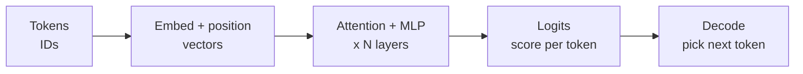

# Day 26: Recall + security lens: Transformer internals

| | |
|---|---|
| **Day** | 26 of 203 · Friday 13 Nov 2026 |
| **Week** | 4 of 29 · Transformer internals |
| **Phase** | Phase 2: Model fundamentals and fine-tuning |
| **Kind** | review |
| **Time** | 30 minutes |

## Today in 30 seconds

A 30-minute review day. First **recall without notes** the week's pieces: embeddings, self-attention, multi-head attention, positional encoding, the residual stream, logits, KV cache and decoding. Then apply the **security lens**: a transformer reads one flat token stream, so instructions and data are not separated by any hardware boundary. That is the root of **indirect prompt injection**.

### By the end of today you can

- Active recall of the week's concepts
- Read and act on the week's security lens

## Concepts

### 1. The week in one pipeline

Walk this chain from memory, then check yourself:
- **Tokens → embeddings:** each token ID becomes a vector.
- **Positional encoding:** adds order information, since attention alone is order-blind.
- **Self-attention / multi-head:** each token mixes in information from other tokens; heads look for different relationships in parallel.
- **Residual stream:** every layer *adds* to a running vector instead of replacing it.
- **Logits → softmax:** final vector becomes a score per vocabulary token.
- **Decoding:** temperature, top-k, top-p or greedy picks the next token.
- **KV cache:** stores past keys/values so each new token costs one step, not a full recompute.

*Forward pass for one generated token.*

### 2. Recall prompts (answer without notes)

Write 1-2 sentences each:
- Why does attention need positional information?
- What does multi-head attention give you over one head?
- Why is the residual stream a useful mental model?
- What does temperature do to the logits distribution?
- Why does the KV cache speed up generation, and what does it cost (memory)?
- When would you choose greedy vs top-p sampling?

Mark each answer **solid / shaky / blank**. Shaky and blank items are tomorrow's re-reading list.

### 3. Security lens: one flat token stream

A CPU separates code from data with memory protections. A transformer has **no such boundary**: system prompt, user message, retrieved documents and tool output all become tokens in the same sequence, and attention can let any token influence any later one.
- **Direct injection:** the user types hostile instructions.
- **Indirect injection:** hostile instructions hide in content the model reads (web page, email, document, tool result). This is the Greshake et al. paper's central point.
- **Consequence:** treat all retrieved or tool content as *untrusted input*, and limit what the model can do with tools regardless of what it is told.

| Mitigation | Helps with | Limit |
| --- | --- | --- |
| Clear delimiters and role labelling | Reduces accidental confusion | Not a hard boundary; models can still follow injected text |
| Least-privilege tools and scoped credentials | Limits blast radius | Needs design up front |
| Human approval for risky actions | Stops irreversible harm | Adds friction |
| Output filtering and monitoring | Catches exfiltration patterns | Incomplete; attackers adapt |

## Hands-on task

Answer the recall prompts without notes, then do the security lens item (or plan it for the weekend).

- [ ] Answer all six recall prompts from memory and mark each solid/shaky/blank
- [ ] Note the gaps as a re-reading list
- [ ] Read the Greshake et al. paper abstract and introduction (or schedule the full read with a concrete time)
- [ ] Write down one tool in a system you know that should have narrower permissions

## Security lens

Treat every token that did not come from you as untrusted: retrieved text, web pages and tool output can all carry instructions.

## Architecture track

This week's architecture track (Tuesday 2026-11-10): **Data-intensive systems: reliability, scalability, maintainability**. Exercise: Rewrite Bastion's non-functional requirements using DDIA's reliability/scalability/maintainability vocabulary.

## Resources

- [Greshake et al., Not what you've signed up for (indirect prompt injection)](https://arxiv.org/abs/2302.12173) — The security lens reading for this week

## Recall quiz

**Q1.** Why can't a model enforce a boundary between instructions and data?

Answer

Everything is tokens in one sequence, and attention lets any token influence the output. Separation is only learned behaviour, not an enforced mechanism.

**Q2.** What is indirect prompt injection?

Answer

Hostile instructions embedded in content the model ingests (pages, documents, tool output) rather than typed by the user.

**Q3.** What does the KV cache store, and what is the trade-off?

Answer

Past keys and values per layer, so each new token needs only one step; the cost is memory that grows with context length.

**Q4.** What does raising temperature do?

Answer

Flattens the next-token distribution, making output more varied and less predictable.

**Q5.** Name two mitigations that limit damage even if an injection succeeds.

Answer

Least-privilege tool access and human approval for risky actions.

## Tomorrow

Next up is the following day on the roadmap.
