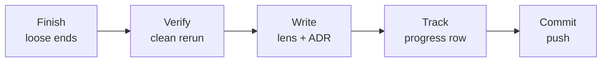

# Day 28: Ship week 4: finish lab, security lens, tracker

| | |
|---|---|
| **Day** | 28 of 203 · Sunday 15 Nov 2026 |
| **Week** | 4 of 29 · Transformer internals |
| **Phase** | Phase 2: Model fundamentals and fine-tuning |
| **Kind** | ship |
| **Time** | 150 minutes |

## Today in 30 seconds

Today is a **ship day**. You close out week 4 (Transformer internals): finish the lab from Day 27, check it against acceptance criteria, write down the security lens item, and fill in your progress tracker. The aim is a *committed, reproducible artefact* plus a one-sentence outcome for the week, not new material.

### By the end of today you can

- Finish and verify the week 4 lab artefact
- Write down the security lens: one flat token stream
- Update docs/PROGRESS.md and your brag doc

## Concepts

### 1. Ship checklist (about 150 minutes)

- **0:00-0:45** Finish loose ends from the lab: rerun the nanoGPT sample and the top-10 probe from a clean shell.
- **0:45-1:15** Check acceptance criteria: code runs, `RESULTS.md` has your measurements (loss, entropy, top-token probability).
- **1:15-1:45** Write the security lens note and one short ADR (for example: why you picked that small model and decoding settings).
- **1:45-2:30** Update `docs/PROGRESS.md`, brag doc, commit and push.



*Ship flow.*

### 2. Security lens: one flat token stream

A transformer receives **one sequence of tokens**. The system prompt, the user message, a retrieved web page and a tool result are all concatenated. There is no hardware boundary like user mode versus kernel mode; the 'boundary' is only chat-template markers the model *learned* to respect.
- Attention lets any token influence any later token, so injected text can compete with developer instructions.
- Your Day 27 probe showed this: conflicting instructions **split** probability mass rather than one cleanly winning.
- Consequence: treat model output influenced by untrusted text as untrusted, and enforce permissions **outside** the model.
- Read Greshake et al., indirect prompt injection (link in resources).

| Layer | Boundary type | Reliable? |
| --- | --- | --- |
| OS process / user mode | Hardware-enforced | Yes |
| Chat template roles | Learned convention | No, probabilistic |
| Output filter / tool allow-list | Code outside the model | Yes, if correctly written |

### 3. Writing a good one-sentence outcome and ADR

- **Outcome sentence:** 'I trained a tiny GPT and measured next-token distributions, showing that conflicting instructions split probability instead of flipping cleanly.'
- **ADR shape:** Context, Decision, Alternatives, Consequences. Keep it to half a page.
- **Reviewer's first challenge** is usually: 'how do you know this generalises beyond one model and one prompt?' Note your limits honestly (small model, few prompts).
- Decision guide **G3** (model/decoding choice) from the roadmap applies: record which option you picked and why.

### 4. Tracker and brag doc

Fill one row per week: hours spent, outcome, guides touched. In the brag doc add a line with a *measurable* result, for example 'entropy rose from X to Y with conflicting instructions'. Do not include confidential or employer-specific details.

## When to choose which

### G3. Adapting models

| Option | How it works | Pros | Cons | Choose when |
| --- | --- | --- | --- | --- |
| Prompting only | Instructions and examples in context | Zero training; instant iteration | Limited by context and base behaviour | Always try first |
| RAG | Retrieve relevant documents at query time and put them in context | Fresh, citable, permission-aware knowledge; no training | Retrieval quality is the bottleneck; injection surface | Knowledge that changes or must respect access control |
| Long context | Put whole documents in the window | Simple; no retrieval pipeline | Cost and latency per call; attention degrades mid-context | Few, bounded documents per request; analysis of one large artefact |
| Full fine-tuning | Update all weights on your data | Maximum adaptation | Expensive; needs lots of data; risk of forgetting and safety regression | Rarely; large orgs with big datasets and strong reasons |
| LoRA | Train small low-rank adapter matrices, freeze base weights | Cheap, small artefacts, swappable adapters | Slightly less capacity than full FT | Teaching format, style, task behaviour, classification |
| QLoRA | LoRA on a 4-bit quantised base model | Fine-tune 7-70B models on one GPU | Slower training; quantisation noise | Budget fine-tuning of mid-size models |
| Other adapters (prefix/prompt tuning, IA3) | Learn small extra vectors or scaling factors | Tiny parameter counts | Usually weaker than LoRA for LLMs | Very constrained memory or many tenants' adapters |
| RLHF (PPO with reward model) | Train a reward model on human preferences, optimise the policy against it | Strong alignment to preferences | Complex, unstable, costly | Frontier-lab-scale alignment work |
| DPO | Optimise directly on preference pairs (chosen vs rejected), no reward model | Simpler and stable; popular default for preference tuning | Needs good preference pairs | Steering tone, refusals, helpfulness with pairwise data |
| ORPO | Combines SFT and preference optimisation in one step without a reference model | One stage, cheaper | Newer, less battle-tested | Small teams doing SFT + preference in one pass |
| GRPO | RL using group-relative rewards from multiple sampled answers, no value model | Effective for verifiable tasks (maths, code) | Needs reward functions; RL complexity | Training reasoning on tasks with automatic checkers |
| Distillation | A strong teacher labels data; a smaller student learns from it | Big cost/latency reduction | Student inherits teacher errors; check provider terms on using outputs | High-volume narrow task once a big model performs it well |
| Continued pre-training | More next-token training on a large domain corpus | Deep domain fluency (language, jargon) | Expensive; needs lots of text; can erode instruction following | Very specialised domains with large unlabelled corpora |

**Default:** prompting, then RAG for knowledge, then LoRA/QLoRA for behaviour or cost, then distillation for scale. Fine-tuning rarely adds reliable new facts; RAG usually wins for knowledge.

Full guide: roadmap Section 9, [G3 Adapting models](../roadmap.md#g3-adapting-models).

## Quick clean-run check

Run from the lab repo to confirm everything reproduces and is committed.

```python
git status --short          # should be empty after commit
python -c "import numpy; print('numpy ok')"
grep -n 'entropy' RESULTS.md || echo 'add entropy numbers to RESULTS.md'
git log --oneline | head -3
```

A clean status, working imports and recorded numbers are the minimum bar for 'shipped'.

## Hands-on task

Finish the lab, check acceptance criteria, write the ADR and update the tracker.

- [ ] Week's lab artefact committed
- [ ] Security lens item written down
- [ ] Tracker row filled (hours, outcome, guides)

## Security lens

Instructions and data share one token stream; enforce permissions in code outside the model.

## Architecture track

This week's architecture track (Tuesday 2026-11-10): **Data-intensive systems: reliability, scalability, maintainability**. Exercise: Rewrite Bastion's non-functional requirements using DDIA's reliability/scalability/maintainability vocabulary.

## Resources

- [Greshake et al., indirect prompt injection](https://arxiv.org/abs/2302.12173) — The security lens reading

## Recall quiz

**Q1.** What is the one-sentence outcome of this week?

<details>
<summary>Answer</summary>

Example: I can explain how a transformer turns tokens into next-token probabilities and measured that conflicting instructions split probability mass.

</details>

**Q2.** Why is there no instruction/data boundary inside the model?

<details>
<summary>Answer</summary>

Everything is one flat token stream; role markers are learned conventions, not enforced boundaries.

</details>

**Q3.** What would a reviewer challenge first?

<details>
<summary>Answer</summary>

Whether results generalise beyond one small model and a few prompts.

</details>

## Tomorrow

Week 5 begins: the next phase of model fundamentals.
