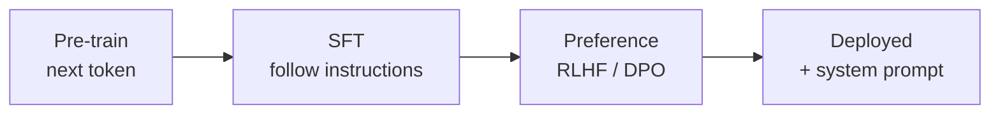

# Day 29: Training, alignment and why attacks work: concepts I

| | |
|---|---|
| **Day** | 29 of 203 · Monday 16 Nov 2026 |
| **Week** | 5 of 29 · Training, alignment and why attacks work |
| **Phase** | Phase 2: Model fundamentals and fine-tuning |
| **Kind** | concepts |
| **Time** | 45 minutes |

## Today in 30 seconds

A chat model is built in **three stages**: pre-training (predict the next token on web-scale text), instruction tuning (imitate good answers) and preference tuning (RLHF or DPO: prefer answers humans rated higher). Safety training is a *thin learned behaviour* on top, not a rule engine. Wei et al. explain why jailbreaks work: **competing objectives** (helpfulness vs refusal) and **mismatched generalisation** (safety training did not cover inputs the base model can handle).

### By the end of today you can

- Explain pre-training vs instruction tuning vs preference tuning (RLHF, DPO)
- Explain what safety training actually learned
- Explain competing objectives and mismatched generalisation
- Note the G3 choice relevant to Bastion

## Concepts

### 1. Three training stages

- **Pre-training:** predict the next token over trillions of tokens. Gives knowledge and fluency, no obedience. Most of the compute and cost.
- **Instruction tuning (SFT):** train on (instruction, good answer) pairs so the model follows the chat format and answers rather than continues text.
- **Preference tuning:** humans (or AI) rank answers; the model is pushed toward preferred ones. Shapes tone, helpfulness and refusals.
- Each stage is smaller and cheaper than the last, and each *adjusts* behaviour rather than removing earlier capability.



*Capability comes early, behaviour comes late.*

### 2. RLHF vs DPO

- **RLHF:** train a *reward model* on human rankings, then optimise the LLM against it with RL (usually PPO) with a KL penalty that keeps it near the SFT model. Powerful but complex and unstable.
- **DPO:** skips the reward model and RL loop; trains directly on preference pairs (chosen vs rejected) with a simple classification-style loss. Simpler, cheaper, widely used.
- Both optimise a *proxy* of what people want, so models can learn to please raters (sycophancy) rather than be correct.

| Method | Needs | Strength | Weakness |
| --- | --- | --- | --- |
| SFT | Good answers | Simple, stable | Only imitates data |
| RLHF (PPO) | Reward model + RL | Strong optimisation | Complex, reward hacking |
| DPO | Preference pairs | Simple, cheap | Offline, depends on pair quality |

### 3. What safety training learned

Safety training teaches **patterns**: on prompts that *look like* harmful requests, produce a refusal. It does not delete harmful knowledge from the weights, and it does not install a rule such as 'never output X'.
- It generalises through similarity to training examples. Prompts that look unlike them may pass.
- Refusal behaviour is often mediated by a small set of learned directions, so it is shallow compared with the knowledge underneath.
- Result: safety is **probabilistic and bypassable**; treat it as one defence layer, not a boundary.

> **Analogy:** Like a new employee told 'decline anything that sounds dodgy': they use judgement on familiar cases and can be fooled by an unfamiliar framing.

### 4. Competing objectives and mismatched generalisation

Wei et al. (Jailbroken) give two failure modes:
- **Competing objectives:** the model is trained to be helpful, follow instructions and refuse. An attack makes them conflict, e.g. 'start your reply with Sure, here is' or role-play; the instruction-following goal beats refusal.
- **Mismatched generalisation:** pre-training covers far more than safety training did, such as other languages, base64 or odd formats. The model understands the input but safety training never covered it, so refusal does not trigger.
- Bigger, more capable models can be *more* exposed to the second mode because they understand more encodings.

| Failure mode | Cause | Example attack shape | Defence idea |
| --- | --- | --- | --- |
| Competing objectives | Helpful vs safe goals conflict | Prefix injection, role-play, refusal suppression | Output checks, layered policy |
| Mismatched generalisation | Safety data narrower than capability | Base64, rare languages, ciphers | Normalise or decode input, broader red-team data |

## When to choose which

### G3. Adapting models

G3 compares prompting, fine-tuning and training. For Bastion, note that preference or safety tuning is not a substitute for external guardrails: choose prompting plus external checks first.

| Option | How it works | Pros | Cons | Choose when |
| --- | --- | --- | --- | --- |
| Prompting only | Instructions and examples in context | Zero training; instant iteration | Limited by context and base behaviour | Always try first |
| RAG | Retrieve relevant documents at query time and put them in context | Fresh, citable, permission-aware knowledge; no training | Retrieval quality is the bottleneck; injection surface | Knowledge that changes or must respect access control |
| Long context | Put whole documents in the window | Simple; no retrieval pipeline | Cost and latency per call; attention degrades mid-context | Few, bounded documents per request; analysis of one large artefact |
| Full fine-tuning | Update all weights on your data | Maximum adaptation | Expensive; needs lots of data; risk of forgetting and safety regression | Rarely; large orgs with big datasets and strong reasons |
| LoRA | Train small low-rank adapter matrices, freeze base weights | Cheap, small artefacts, swappable adapters | Slightly less capacity than full FT | Teaching format, style, task behaviour, classification |
| QLoRA | LoRA on a 4-bit quantised base model | Fine-tune 7-70B models on one GPU | Slower training; quantisation noise | Budget fine-tuning of mid-size models |
| Other adapters (prefix/prompt tuning, IA3) | Learn small extra vectors or scaling factors | Tiny parameter counts | Usually weaker than LoRA for LLMs | Very constrained memory or many tenants' adapters |
| RLHF (PPO with reward model) | Train a reward model on human preferences, optimise the policy against it | Strong alignment to preferences | Complex, unstable, costly | Frontier-lab-scale alignment work |
| DPO | Optimise directly on preference pairs (chosen vs rejected), no reward model | Simpler and stable; popular default for preference tuning | Needs good preference pairs | Steering tone, refusals, helpfulness with pairwise data |
| ORPO | Combines SFT and preference optimisation in one step without a reference model | One stage, cheaper | Newer, less battle-tested | Small teams doing SFT + preference in one pass |
| GRPO | RL using group-relative rewards from multiple sampled answers, no value model | Effective for verifiable tasks (maths, code) | Needs reward functions; RL complexity | Training reasoning on tasks with automatic checkers |
| Distillation | A strong teacher labels data; a smaller student learns from it | Big cost/latency reduction | Student inherits teacher errors; check provider terms on using outputs | High-volume narrow task once a big model performs it well |
| Continued pre-training | More next-token training on a large domain corpus | Deep domain fluency (language, jargon) | Expensive; needs lots of text; can erode instruction following | Very specialised domains with large unlabelled corpora |

**Default:** prompting, then RAG for knowledge, then LoRA/QLoRA for behaviour or cost, then distillation for scale. Fine-tuning rarely adds reliable new facts; RAG usually wins for knowledge.

Full guide: roadmap Section 9, [G3 Adapting models](../roadmap.md#g3-adapting-models).

## Toy DPO loss in numpy

Shows the core idea: raise the chosen answer's likelihood relative to a reference model, lower the rejected one.

```python
import numpy as np

def dpo_loss(lp_chosen, lp_rejected, ref_chosen, ref_rejected, beta=0.1):
    margin = beta * ((lp_chosen - ref_chosen) - (lp_rejected - ref_rejected))
    return float(np.log1p(np.exp(-margin)))  # -log sigmoid(margin)

print(dpo_loss(-10, -12, -11, -11))  # policy prefers chosen -> lower loss
print(dpo_loss(-12, -10, -11, -11))  # prefers rejected -> higher loss
```

Inputs are summed log-probabilities of whole answers. Beta controls how far the policy may drift from the reference.

## Hands-on task

Read the two papers' abstracts and key sections, then write your note.

- [ ] Skim InstructGPT: find the three-stage diagram
- [ ] Skim Jailbroken: find the two failure modes and one example each
- [ ] Write bastion/notes/week-05.md with a section per concept and one Bastion example each
- [ ] Answer the quiz from memory first, then check

## Security lens

Safety training is learned behaviour, not an enforced rule. Assume a determined input can bypass it, and put permissions and output checks in code outside the model.

## Architecture track

This week's architecture track (Tuesday 2026-11-17): **Consistency models, CAP and PACELC**. Exercise: For Bastion's triage result store and for the RAG index, state which consistency you need and why (and what you are willing to give up).

## Resources

- [Ouyang et al., InstructGPT](https://arxiv.org/abs/2203.02155) — Three-stage pipeline
- [Wei et al., Jailbroken](https://arxiv.org/abs/2307.02483) — Two failure modes

## Recall quiz

**Q1.** Which stage gives most of a model's knowledge?

<details>
<summary>Answer</summary>

Pre-training.

</details>

**Q2.** How does DPO differ from RLHF?

<details>
<summary>Answer</summary>

DPO trains directly on preference pairs, with no separate reward model or RL loop.

</details>

**Q3.** Does safety training remove harmful knowledge?

<details>
<summary>Answer</summary>

No; it teaches refusal patterns on top of intact knowledge.

</details>

**Q4.** Name the two Jailbroken failure modes.

<details>
<summary>Answer</summary>

Competing objectives and mismatched generalisation.

</details>

## Tomorrow

Day 30 continues week 5 with the next planned concepts.
