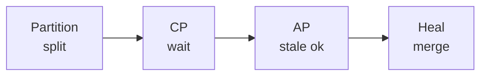

# Day 30: Architecture track: Consistency models, CAP and PACELC

| | |
|---|---|
| **Day** | 30 of 203 · Tuesday 17 Nov 2026 |
| **Week** | 5 of 29 · Training, alignment and why attacks work |
| **Phase** | Phase 2: Model fundamentals and fine-tuning |
| **Kind** | arch |
| **Time** | 120 minutes |

## Today in 30 seconds

**CAP** says that during a network **partition** a distributed store must choose between **consistency** (every read sees the latest write) and **availability** (every request gets an answer). **PACELC** adds the everyday case: *Else* (no partition) you still trade **Latency** against **Consistency**. Consistency is a spectrum (linearizable → sequential → causal → eventual), and you pick the weakest model that keeps your invariants safe.

### By the end of today you can

- Explain CAP precisely and why 'pick two of three' is misleading
- Use PACELC to reason about normal-operation latency tradeoffs
- Rank consistency models from strongest to weakest
- State the consistency needed for Bastion's triage result store and RAG index

## Concepts

### 1. What CAP really says

- **Consistency (C)** in CAP means *linearizability*: all clients see one up-to-date copy.
- **Availability (A):** every non-failing node answers every request.
- **Partition tolerance (P):** the system keeps working when messages between nodes are lost. Real networks partition, so P is not optional.
- So the real choice is only **during a partition**: refuse some requests (CP) or answer possibly stale data (AP).
- CAP says nothing about latency or normal operation.



*Partition happens → choose.*

> **Analogy:** Two bank branches lose their phone line: either stop withdrawals (CP) or allow them and sort out overdrafts later (AP).

### 2. PACELC: the everyday tradeoff

**If Partition then A or C, Else Latency or Consistency.**
- Replication across nodes or regions costs round trips. Waiting for replicas to agree = higher latency but fresher reads.
- Answering from the nearest replica = low latency but possibly stale.
- Systems are labelled by both halves, e.g. PA/EL (Dynamo-style, Cassandra defaults) or PC/EC (strongly consistent stores such as Spanner-style systems).

| Label | During partition | Normal operation | Typical shape |
| --- | --- | --- | --- |
| PA/EL | Available | Low latency | Eventually consistent KV, caches |
| PC/EC | Consistent | Pay latency for consistency | Consensus-backed SQL / coordination stores |
| PC/EL | Consistent | Low latency | Primary with async replicas (reads may lag) |
| PA/EC | Available | Consistent | Rare, awkward combination |

### 3. The consistency spectrum

- **Linearizable:** behaves like one copy; real-time order respected. Costliest.
- **Sequential:** one global order all agree on, not tied to real time.
- **Causal:** cause-before-effect order preserved; unrelated writes may differ.
- **Read-your-writes / monotonic reads:** session guarantees; you never see your own update vanish or time go backwards.
- **Eventual:** replicas converge if writes stop; no promise when.
- Stronger models make code simpler but cost latency and availability. Jepsen's hierarchy maps these precisely.

| Model | Guarantee | Cost | Good for |
| --- | --- | --- | --- |
| Linearizable | Single up-to-date copy | High latency, lower availability | Locks, leader election, unique IDs |
| Causal | Causes seen before effects | Medium | Comments, chat, collaborative state |
| Session (RYW) | See your own writes | Low | User-facing profile or settings |
| Eventual | Converges later | Lowest | Caches, search indexes, analytics |

### 4. Applying it to Bastion

- **Triage result store:** a verdict (allow / block / escalate) must not silently flip or be lost. Need *read-your-writes* at least and a single writer per item; linearizable for the 'already actioned' flag to avoid double-action. Accept higher write latency; triage is not millisecond-critical.
- **RAG index:** documents are added or removed in batches. *Eventual* consistency is fine for relevance, but **deletions and access changes** are a security issue: a revoked document must stop being retrievable quickly. Give up freshness for new content, not for permission changes (filter by ACL at query time against the authoritative store).
- Always state what you give up.

## When to choose which

### G20. Distributed data and integration patterns

G20 helps choose data stores. Match each store to the weakest consistency model that keeps its invariants safe.

| Pattern | How it works | Choose when |
| --- | --- | --- |
| Synchronous request/response | Caller waits for callee | Need immediate answer; callee is reliable and fast |
| Asynchronous messaging | Fire and forget or request/reply over a queue | Decoupling, buffering, retries |
| Transactional outbox | Write business row and outbox event in one DB transaction; publisher drains the outbox | Reliably emit events after a DB write without dual-write bugs |
| Saga (orchestration or choreography) | Sequence of local transactions with compensations | Multi-service workflows that cannot share one ACID transaction |
| CDC (change data capture) | Stream DB changes (Debezium) into Kafka/search/analytics | Keep projections and search indexes in sync |
| Idempotent consumers | Deduplicate by idempotency key | All consumers that can see retries |
| Inbox / dedup store | Persist processed message IDs | Exactly-once *effect* despite at-least-once delivery |

Full guide: roadmap Section 9, [G20 Distributed data and integration patterns](../roadmap.md#g20-distributed-data-and-integration-patterns).

## Stale reads from a lagging replica

A tiny simulation: writes go to the primary; the replica applies them after a delay.

```python
import collections
primary={}
replica={}
log=collections.deque()

def write(k,v):
    primary[k]=v
    log.append((k,v))

def replicate_one():
    if log:
        k,v=log.popleft(); replica[k]=v

write('verdict:42','escalate')
print('replica read:',replica.get('verdict:42'))
replicate_one()
print('replica read:',replica.get('verdict:42'))
```

The first read is stale (an AP/EL choice). Reading from the primary, or waiting for replication, buys consistency with latency.

## Hands-on task

Skim the three resources, then write a one-page note and commit it under `bastion/docs/architecture/`.

- [ ] Skim Abadi's PACELC paper (intro and examples)
- [ ] Read the Jepsen consistency hierarchy page
- [ ] Read DDIA's consistency chapters (replication and consistency/consensus)
- [ ] Write the triage store and RAG index consistency decisions (<=1 page)
- [ ] State one tradeoff explicitly and commit

## Security lens

Write a one-page note, 'Why safety training is shallow', linking jailbreak families to mechanisms. Reusable for onboarding red-teamers.

## Architecture track

Ask of every store: what is the worst thing a stale read can do here? If the answer is 'security or money', pay for stronger consistency.

## Resources

- DDIA consistency chapters — Replication and consistency/consensus chapters
- [Abadi, PACELC](https://www.cs.umd.edu/~abadi/papers/abadi-pacelc.pdf) — Original paper
- [Jepsen consistency hierarchy](https://jepsen.io/consistency) — Interactive map

## Recall quiz

**Q1.** Why is 'pick 2 of 3' misleading for CAP?

<details>
<summary>Answer</summary>

Partitions will happen, so P is not optional. The choice is C vs A only while partitioned.

</details>

**Q2.** What does PACELC add?

<details>
<summary>Answer</summary>

Even without a partition you trade latency against consistency.

</details>

**Q3.** Which model suits a revoked-document check in RAG?

<details>
<summary>Answer</summary>

A strong read of the authoritative permission store; the index itself may stay eventual.

</details>

**Q4.** Name two session guarantees weaker than linearizability.

<details>
<summary>Answer</summary>

Read-your-writes and monotonic reads.

</details>

## Tomorrow

Day 31: next item in the Phase 2 plan.
