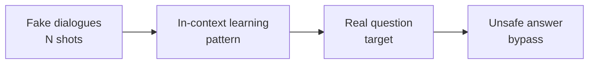
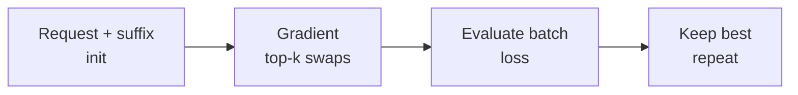

# Day 31: Many-shot, multi-turn jailbreaks and gradient-based adversarial suffixes

| | |
|---|---|
| **Day** | 31 of 203 · Wednesday 18 Nov 2026 |
| **Week** | 5 of 29 · Training, alignment and why attacks work |
| **Phase** | Phase 2: Model fundamentals and fine-tuning |
| **Kind** | concepts |
| **Time** | 90 minutes |

## Today in 30 seconds

Alignment is a *learned tendency*, not a hard rule, so attackers can push the model back toward unsafe behaviour. **Many-shot** jailbreaks fill a long context with faux dialogues showing the 'bad' behaviour until in-context learning overrides safety training. **Multi-turn** jailbreaks escalate gradually across turns. **Gradient-based suffixes (GCG)** use white-box gradients to optimise a gibberish string that makes refusal unlikely, and often transfer to other models.

### By the end of today you can

- Explain many-shot and multi-turn jailbreaks and why long context helps them
- Explain how GCG optimises an adversarial suffix and why it transfers
- Pick sensible defences for each attack family
- Skim G3 and G16 and note one choice relevant to Bastion

## Concepts

### 1. Many-shot jailbreaking

- Long context windows (100k+ tokens) let an attacker paste **hundreds of fake user/assistant turns** where the assistant happily complies with harmful requests.
- The final real question then follows the pattern. **In-context learning** beats safety fine-tuning as the shot count grows.
- Reported effectiveness follows a **power law** in the number of shots, and grows with model size.
- Defences: classify/limit prompts, fine-tune against the pattern, input sanitising of embedded dialogue markers. Caps on context length reduce risk but cost capability.



*More shots, more compliance.*

> **Analogy:** Like peer pressure: if a hundred 'people' in the room all answered, the 101st answer feels normal.

### 2. Multi-turn jailbreaks

- The attacker never asks the harmful thing directly. They **escalate step by step** (role-play, hypotheticals, 'continue the story', then 'make it more detailed').
- Per-message filters pass each turn; the **conversation as a whole** crosses the line. Examples in the literature: Crescendo-style escalation, automated attacker-LLM loops.
- Defences: evaluate the **whole conversation state**, not just the last message; track topic drift; reset or summarise-and-recheck periodically; red-team with automated multi-turn attackers.

| Attack | Needs | Strength | Best defence |
| --- | --- | --- | --- |
| Many-shot | Long context | Scales with shots | Context-level classifiers, training on the pattern |
| Multi-turn | Chat history | Evades per-message filters | Conversation-level moderation |
| GCG suffix | White-box gradients | Transfers, but looks like gibberish | Perplexity filter, adversarial training |

### 3. Gradient-based adversarial suffixes (GCG)

- **Greedy Coordinate Gradient** (Zou et al., 2023) appends a suffix of ~20 tokens to a harmful request.
- Goal: maximise the probability that the model starts its answer with an affirmative target such as *'Sure, here is...'*.
- Loop: compute the gradient of the loss w.r.t. one-hot token choices, take top-k candidate swaps per position, evaluate a batch, **keep the best swap**, repeat.
- Needs **white-box** access (open-weights model), but suffixes optimised on open models **transferred** to closed models in the paper.
- Suffixes look like gibberish, so a **perplexity filter** catches many; later attacks produce more readable suffixes.



*GCG loop.*

### 4. Why these attacks work at all

- Safety training teaches a **behavioural prior** (refuse), layered over a base model that can imitate anything.
- Context can shift the prior (many-shot), dialogue can walk it across the boundary (multi-turn), and optimisation can find inputs far from training data where refusal never generalised (GCG).
- Takeaway: treat model alignment as **one layer**. Add input/output classifiers, least-privilege tools and monitoring.

## When to choose which

### G3. Adapting models

G3 is the choose-your-adaptation guide. Note which option keeps safety behaviour intact: fine-tuning can erode alignment, so re-run your red-team suite after any tuning.

| Option | How it works | Pros | Cons | Choose when |
| --- | --- | --- | --- | --- |
| Prompting only | Instructions and examples in context | Zero training; instant iteration | Limited by context and base behaviour | Always try first |
| RAG | Retrieve relevant documents at query time and put them in context | Fresh, citable, permission-aware knowledge; no training | Retrieval quality is the bottleneck; injection surface | Knowledge that changes or must respect access control |
| Long context | Put whole documents in the window | Simple; no retrieval pipeline | Cost and latency per call; attention degrades mid-context | Few, bounded documents per request; analysis of one large artefact |
| Full fine-tuning | Update all weights on your data | Maximum adaptation | Expensive; needs lots of data; risk of forgetting and safety regression | Rarely; large orgs with big datasets and strong reasons |
| LoRA | Train small low-rank adapter matrices, freeze base weights | Cheap, small artefacts, swappable adapters | Slightly less capacity than full FT | Teaching format, style, task behaviour, classification |
| QLoRA | LoRA on a 4-bit quantised base model | Fine-tune 7-70B models on one GPU | Slower training; quantisation noise | Budget fine-tuning of mid-size models |
| Other adapters (prefix/prompt tuning, IA3) | Learn small extra vectors or scaling factors | Tiny parameter counts | Usually weaker than LoRA for LLMs | Very constrained memory or many tenants' adapters |
| RLHF (PPO with reward model) | Train a reward model on human preferences, optimise the policy against it | Strong alignment to preferences | Complex, unstable, costly | Frontier-lab-scale alignment work |
| DPO | Optimise directly on preference pairs (chosen vs rejected), no reward model | Simpler and stable; popular default for preference tuning | Needs good preference pairs | Steering tone, refusals, helpfulness with pairwise data |
| ORPO | Combines SFT and preference optimisation in one step without a reference model | One stage, cheaper | Newer, less battle-tested | Small teams doing SFT + preference in one pass |
| GRPO | RL using group-relative rewards from multiple sampled answers, no value model | Effective for verifiable tasks (maths, code) | Needs reward functions; RL complexity | Training reasoning on tasks with automatic checkers |
| Distillation | A strong teacher labels data; a smaller student learns from it | Big cost/latency reduction | Student inherits teacher errors; check provider terms on using outputs | High-volume narrow task once a big model performs it well |
| Continued pre-training | More next-token training on a large domain corpus | Deep domain fluency (language, jargon) | Expensive; needs lots of text; can erode instruction following | Very specialised domains with large unlabelled corpora |

**Default:** prompting, then RAG for knowledge, then LoRA/QLoRA for behaviour or cost, then distillation for scale. Fine-tuning rarely adds reliable new facts; RAG usually wins for knowledge.

Full guide: roadmap Section 9, [G3 Adapting models](../roadmap.md#g3-adapting-models).

### G16. Security controls and red-team methods

G16 covers guardrail and defence choices. For Bastion, pick the layer that catches multi-turn drift (conversation-level checks).

| Risk family | Primary controls | Notes |
| --- | --- | --- |
| Prompt injection / goal hijack (LLM01, ASI01) | Separate trusted instructions from untrusted data; plan-then-execute; dual LLM; capability tokens (CaMeL-style); never let the model be the authorisation layer | Softeners (spotlighting, datamarking) help but are bypassable |
| Insecure output handling (LLM05) | Treat model output as untrusted; schema validation; no eval/shell interpolation | Classic XSS/SQLi via LLM |
| Excessive agency / tool misuse (LLM06, ASI02, ASI05) | Least-privilege tools, sandboxes (G10), HITL for writes, step/token budgets | Prefer deny-by-default tools |
| Sensitive disclosure / system prompt leak (LLM02, LLM07) | Minimise secrets in prompts; output filters; never put keys in context | Assume prompts can leak |
| Data / model / memory poisoning (LLM04, ASI06) | Provenance, signed models (`safetensors`), curated corpora, memory write policies (G8) | Includes indirect injection via RAG |
| Vector / embedding weaknesses (LLM08) | Access-controlled retrieval, tenant filters, embedding inversion awareness | See G4, G6 |
| Misinformation (LLM09) | Grounding, citations, refusal when retrieval is weak (CRAG/Self-RAG) | Eval faithfulness |
| Unbounded consumption (LLM10) | Max tokens, timeouts, rate limits, spend caps, queue depth limits | DoS and denial-of-wallet |
| Supply chain (LLM03, ASI04) | Pin model revisions, scan models (ModelScan), pin MCP tool definition hashes, SBOMs/AIBOMs | MCP tool poisoning |
| Identity / privilege abuse (ASI03) | Per-tool credentials, no token passthrough, short-lived tokens | MCP auth best practices |
| Insecure agent communication (ASI07) | Authenticated agent-to-agent channels; treat A2A like any RPC |  |
| Human-agent trust exploitation (ASI09) | Show full tool args before approval; bind approvals to exact actions | Non-bypassable HITL |
| Cascading failures / rogue agents (ASI08, ASI10) | Circuit breakers, blast-radius limits (cells), kill switches, monitoring |  |

**Default:** threat-model first, automate regression, keep a private held-out set, and pair every finding with a control and a CI test.

Full guide: roadmap Section 9, [G16 Security controls and red-team methods](../roadmap.md#g16-security-controls-and-red-team-methods).

## Conversation-level check vs per-message check

A toy scorer showing why multi-turn escalation slips past per-message filters.

```python
turns=[0.2,0.35,0.5,0.62,0.75]  # per-turn risk scores
THRESH=0.8
print('per-message flagged:',any(t>THRESH for t in turns))
print('cumulative flagged:',sum(turns)/len(turns)*1.5>0.7 or sum(turns[-3:])>1.8)
```

No single turn exceeds the threshold, but the trajectory does. Real systems score the whole conversation with a classifier.

## Hands-on task

Read both resources and write a one-page note with each concept and one Bastion example.

- [ ] Read Zou et al., GCG (abstract, method, transfer results)
- [ ] Read Anthropic's many-shot jailbreaking post
- [ ] Write bastion/notes/week-05.md with a section per concept and a Bastion example
- [ ] Skim G3 and G16 and note one Bastion choice
- [ ] Answer the recall questions from memory, then check

## Security lens

Attack families here are for defensive testing on systems you are authorised to test. Build detection (conversation-level, perplexity) before building attacks.

## Architecture track

This week's architecture track (Tuesday 2026-11-17): **Consistency models, CAP and PACELC**. Exercise: For Bastion's triage result store and for the RAG index, state which consistency you need and why (and what you are willing to give up).

## Resources

- Zou et al., GCG: <https://arxiv.org/abs/2307.15043>
- Anthropic, Many-shot jailbreaking: <https://www.anthropic.com/research/many-shot-jailbreaking>

## Recall quiz

**Q1.** Why do many-shot jailbreaks get stronger with longer context?

<details>
<summary>Answer</summary>

More in-context examples strengthen in-context learning of the faux pattern, overriding safety training; effectiveness follows a power law in shot count.

</details>

**Q2.** Why do per-message filters miss multi-turn attacks?

<details>
<summary>Answer</summary>

Each turn looks benign; harm emerges only from the escalating trajectory, so check conversation state.

</details>

**Q3.** What does GCG optimise and what does it need?

<details>
<summary>Answer</summary>

A suffix that maximises probability of an affirmative start; needs white-box gradients, yet transfers to other models.

</details>

**Q4.** One cheap defence against GCG suffixes?

<details>
<summary>Answer</summary>

A perplexity filter, since the suffixes are gibberish.

</details>

## Tomorrow

Day 32: next item in the Phase 2 plan.
