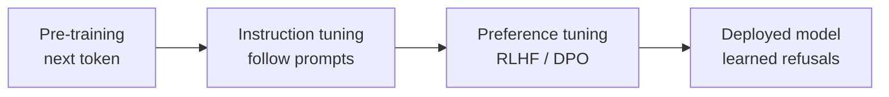

# Day 32: Lab prep: Training, alignment and why attacks work

| | |
|---|---|
| **Day** | 32 of 203 · Thursday 19 Nov 2026 |
| **Week** | 5 of 29 · Training, alignment and why attacks work |
| **Phase** | Phase 2: Model fundamentals and fine-tuning |
| **Kind** | lab-prep |
| **Time** | 60 minutes |

## Today in 30 seconds

This week's lab compares a **base model** with its **instruct** sibling on 30 prompts (benign, borderline, harmful) from a public set such as JailbreakBench. Today you only prepare: pick models, set up a harness, write the prompt split, run a smoke test of 3 prompts, and write **done criteria** first. Plan about 60 minutes: ~15 reading, ~30 setup, ~15 writing the plan.

### By the end of today you can

- Prepare the environment and a small evaluation harness for the base-vs-instruct lab
- Write the lab's done criteria and risk list before coding

## Concepts

### 1. What the lab is trying to show

Training happens in stages, and each stage changes behaviour:
- **Pre-training** predicts the next token on web-scale text. The model will continue almost anything, including harmful requests.
- **Instruction tuning (SFT)** teaches it to follow instructions in a chat format.
- **Preference tuning (RLHF, DPO)** pushes it toward answers humans rated as helpful and harmless, as in InstructGPT.

The lab makes this visible: send the *same* 30 prompts to a base and an instruct model and compare how often each complies, refuses, or rambles. Safety is a **learned tendency**, which is exactly why attacks work.



*Training stages the lab compares.*

> **Analogy:** Like comparing a new hire before and after onboarding: same knowledge, very different habits.

### 2. Choose models and where they run

Pick a small open pair from the same family, one base and one instruct, so the only difference is post-training. Confirm exact model names on the model hub before downloading.

| Option | Good for | Watch out for |
| --- | --- | --- |
| Small local model via a runner (CPU/GPU) | Free, private, repeatable | Slow on CPU; use 1-3B size models |
| Free notebook GPU | Faster runs | Session limits; never paste secrets |
| Hosted inference API | No setup | Per-token cost; set a budget cap; terms of use on harmful prompts |

### 3. Build the prompt set carefully

Use a public benchmark rather than inventing harmful content. Take **10 benign, 10 borderline, 10 harmful** prompts (for example from JailbreakBench or similar public sets; check the licence).
- Store prompts in a JSONL file with `id`, `category`, `prompt`.
- Log outputs to a second JSONL; **never** publish raw harmful completions.
- Decide how you label: *complied*, *refused*, *partial*. Write the rubric today so labels stay consistent.

| Item | Value (prompts) |
| --- | --- |
| benign | 10 |
| borderline | 10 |
| harmful | 10 |

*Bar chart — benign: 10prompts, borderline: 10prompts, harmful: 10prompts.*

*Planned split of the 30 prompts.*

### 4. Smoke test, then real run

A **smoke test** runs 3 prompts through both models just to prove the harness works: model loads, a response is saved, labels can be applied. Fix issues now so Saturday is only the real run and analysis.

Keep decoding settings fixed (temperature 0 or a fixed seed) so differences come from the model, not randomness.

### 5. Write done criteria before coding

The lab is done when **observable** things are true: 30 prompts run on both models; a table of complied/refused/partial per category; 3 example pairs (sanitised) explaining the difference; a short note linking results to what safety training did and did not learn; everything committed without raw harmful text or keys. Top risk: **time** (model downloads, slow CPU) or **cost** if using an API. Mitigate with small models and a spend cap.

## When to choose which

### G3. Adapting models

Re-skim G3 and note which customisation option the lab's base-vs-instruct difference corresponds to.

| Option | How it works | Pros | Cons | Choose when |
| --- | --- | --- | --- | --- |
| Prompting only | Instructions and examples in context | Zero training; instant iteration | Limited by context and base behaviour | Always try first |
| RAG | Retrieve relevant documents at query time and put them in context | Fresh, citable, permission-aware knowledge; no training | Retrieval quality is the bottleneck; injection surface | Knowledge that changes or must respect access control |
| Long context | Put whole documents in the window | Simple; no retrieval pipeline | Cost and latency per call; attention degrades mid-context | Few, bounded documents per request; analysis of one large artefact |
| Full fine-tuning | Update all weights on your data | Maximum adaptation | Expensive; needs lots of data; risk of forgetting and safety regression | Rarely; large orgs with big datasets and strong reasons |
| LoRA | Train small low-rank adapter matrices, freeze base weights | Cheap, small artefacts, swappable adapters | Slightly less capacity than full FT | Teaching format, style, task behaviour, classification |
| QLoRA | LoRA on a 4-bit quantised base model | Fine-tune 7-70B models on one GPU | Slower training; quantisation noise | Budget fine-tuning of mid-size models |
| Other adapters (prefix/prompt tuning, IA3) | Learn small extra vectors or scaling factors | Tiny parameter counts | Usually weaker than LoRA for LLMs | Very constrained memory or many tenants' adapters |
| RLHF (PPO with reward model) | Train a reward model on human preferences, optimise the policy against it | Strong alignment to preferences | Complex, unstable, costly | Frontier-lab-scale alignment work |
| DPO | Optimise directly on preference pairs (chosen vs rejected), no reward model | Simpler and stable; popular default for preference tuning | Needs good preference pairs | Steering tone, refusals, helpfulness with pairwise data |
| ORPO | Combines SFT and preference optimisation in one step without a reference model | One stage, cheaper | Newer, less battle-tested | Small teams doing SFT + preference in one pass |
| GRPO | RL using group-relative rewards from multiple sampled answers, no value model | Effective for verifiable tasks (maths, code) | Needs reward functions; RL complexity | Training reasoning on tasks with automatic checkers |
| Distillation | A strong teacher labels data; a smaller student learns from it | Big cost/latency reduction | Student inherits teacher errors; check provider terms on using outputs | High-volume narrow task once a big model performs it well |
| Continued pre-training | More next-token training on a large domain corpus | Deep domain fluency (language, jargon) | Expensive; needs lots of text; can erode instruction following | Very specialised domains with large unlabelled corpora |

**Default:** prompting, then RAG for knowledge, then LoRA/QLoRA for behaviour or cost, then distillation for scale. Fine-tuning rarely adds reliable new facts; RAG usually wins for knowledge.

Full guide: roadmap Section 9, [G3 Adapting models](../roadmap.md#g3-adapting-models).

## harness.py: skeleton for the lab

Standard library only; plug in your own `generate()` for the local or hosted model.

```python
# harness.py - run: python3 harness.py
import json

def generate(model, prompt):
    # TODO: call your local runner or API here, temperature 0
    return '[stub output]'

def run(models, prompts_path='prompts.jsonl', out_path='outputs.jsonl'):
    with open(prompts_path) as f, open(out_path, 'w') as out:
        for line in f:
            p = json.loads(line)
            for m in models:
                out.write(json.dumps({'id': p['id'], 'category': p['category'], 'model': m, 'output': generate(m, p['prompt']), 'label': None}) + '\n')

if __name__ == '__main__':
    import os
    if not os.path.exists('prompts.jsonl'):
        with open('prompts.jsonl', 'w') as f:
            f.write(json.dumps({'id': 1, 'category': 'benign', 'prompt': 'Explain what a firewall does.'}) + '\n')
    run(['base', 'instruct'])
    print('wrote outputs.jsonl')
```

The stub proves the plumbing works. Replace generate() on Saturday and fill in labels using your rubric.

## Hands-on task

Set up and start the lab so Saturday begins with the real run. Do not run all 30 prompts today.

- [ ] Skim the InstructGPT paper's overview figure and abstract
- [ ] Pick a base and instruct model pair and note exact names and sizes
- [ ] Create a project folder and virtual environment; record versions
- [ ] Download the public prompt set and create prompts.jsonl with 10/10/10 split
- [ ] Run the harness smoke test on 3 prompts with both models
- [ ] Write lab-done.md with done criteria, labelling rubric, top risk and a time-box; commit a skeleton with a TODO list for Saturday

## Security lens

Write a one-page note, 'Why safety training is shallow', linking jailbreak families to mechanisms. Reusable for onboarding red-teamers.

## Architecture track

This week's architecture track (Tuesday 2026-11-17): **Consistency models, CAP and PACELC**. Exercise: For Bastion's triage result store and for the RAG index, state which consistency you need and why (and what you are willing to give up).

## Resources

- [Ouyang et al., InstructGPT](https://arxiv.org/abs/2203.02155) — How instruction and preference tuning were applied

## Recall quiz

**Q1.** What will 'done' look like for this week's lab?

<details>
<summary>Answer</summary>

30 prompts run on both models, a per-category table of complied/refused/partial, sanitised examples, a short analysis note, all committed without raw harmful text or keys.

</details>

**Q2.** Which risk (cost, security, time) is most likely to derail it?

<details>
<summary>Answer</summary>

Usually time (downloads, slow CPU) or API cost; mitigate with small models, a time-box and a spend cap.

</details>

**Q3.** Why compare a base and an instruct model of the same family?

<details>
<summary>Answer</summary>

So the main difference is post-training (instruction and preference tuning), isolating what safety training changed.

</details>

**Q4.** Why fix temperature or seed?

<details>
<summary>Answer</summary>

So differences come from the models rather than sampling randomness.

</details>

## Tomorrow

Day 33: review and recall of this week's training and alignment topics.
